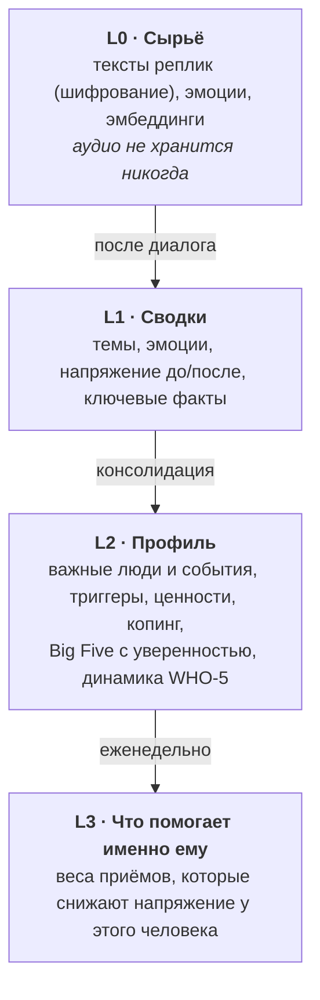
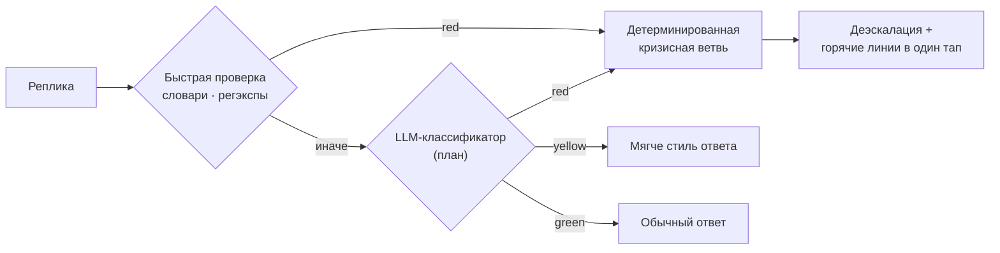
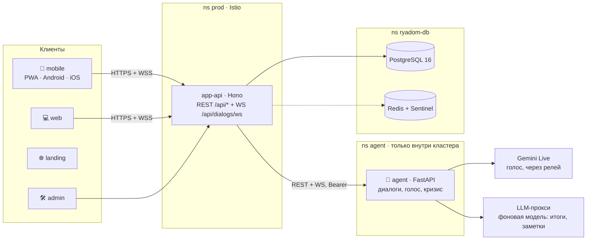
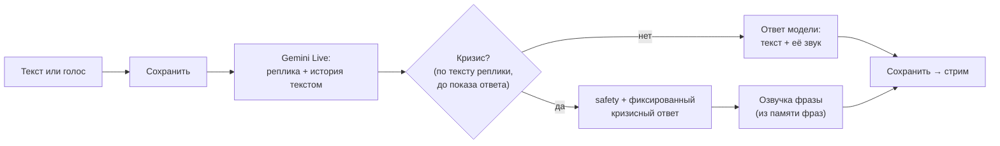

<div align="center">

# 🌙 Слышу Рядом

### Голосовой ИИ-компаньон для эмоциональной разгрузки

**«Когда нужно, чтобы кто-то был рядом»**

[](https://xn----htbtgjker8b3a2c.xn--p1ai/pwa/)
[](https://xn----htbtgjker8b3a2c.xn--p1ai/)


</div>

---

## 💬 Что это

**«Слышу Рядом»** — голосовой собеседник, которому можно выговориться в любой момент. Он слушает без осуждения, помогает назвать и прожить эмоции, помнит человека между разговорами — и бережно возвращает его к живым людям: друзьям, группам поддержки, специалистам.

> [!IMPORTANT]
> Это **не психотерапия и не медицинская услуга**, а сервис самоподдержки. Агент не ставит диагнозы и не назначает лекарства.
> Он мост: разгрузка здесь и сейчас и путь к живому контакту.

<table>
<tr>
<td width="50%">

**🎙️ Голос — основной интерфейс**
Нажми «Поговорить» и просто говори. Агент отвечает голосом (мужским или женским), его можно перебить на полуслове, как в живом разговоре. Режим hands-free сам понимает, когда ты закончил.

</td>
<td width="50%">

**🆘 Кризис важнее продукта**
Каждая реплика проверяется на признаки кризиса *до* генерации ответа. При риске агент останавливается, отвечает детерминированным текстом и показывает горячие линии. Кнопка SOS доступна с любого экрана, даже без сети.

</td>
</tr>
<tr>
<td>

**🔒 Приватность по умолчанию**
Вход без регистрации, данные только в РФ, голос человека не сохраняется нигде, тексты не попадают в логи. «Стереть всё» — одна кнопка.

</td>
<td>

**🤝 Успех — когда легче и ближе к людям**
Мы не оптимизируем время в приложении. Метрика продукта — снижение напряжения после разговора и живые контакты.

</td>
</tr>
</table>

### 🚀 Попробовать

| Где | Ссылка |
|---|---|
| 📱 **Приложение (PWA)** — работает в браузере, ставится на главный экран | **[слышу-рядом.рф/pwa](https://xn----htbtgjker8b3a2c.xn--p1ai/pwa/)** |
| 🌐 Сайт проекта | [слышу-рядом.рф](https://xn----htbtgjker8b3a2c.xn--p1ai/) |
| 💻 Веб-приложение | [слышу-рядом.рф/app](https://xn----htbtgjker8b3a2c.xn--p1ai/app/) |
| ⬇️ Скачать (Android, iOS) | [слышу-рядом.рф/download](https://xn----htbtgjker8b3a2c.xn--p1ai/download) |

---

## 📑 Содержание

- [Принципы](#-принципы)
- [Как это выглядит для человека](#-как-это-выглядит-для-человека)
- [Режимы](#-режимы)
- [Память](#-память)
- [Кризисный протокол](#-кризисный-протокол)
- [Архитектура](#%EF%B8%8F-архитектура)
- [Стек](#-стек)
- [Структура репозитория](#-структура-репозитория)
- [Быстрый старт](#-быстрый-старт)
- [Статус и дорожная карта](#%EF%B8%8F-статус-и-дорожная-карта)
- [Метрики](#-метрики)
- [Документация](#-документация)
- [Как вносить изменения](#-как-вносить-изменения)

---

## 🧭 Принципы

Манифест продукта обязателен для любой бизнес-логики, промпта и метрики:

| | Принцип | Что это значит |
|---|---|---|
| 👂 | **Слушаем, не судим** | Никаких оценок, поучений и «а вот надо было» |
| 🤲 | **Советы — только по запросу** | По умолчанию — слушание, отражение, помощь назвать эмоцию |
| 🫥 | **Профиль под капотом** | Психологический профиль адаптирует стиль общения, но никогда не показывается как ярлык или диагноз |
| 🌱 | **Успех — когда легче и ближе к людям** | Не оптимизируем минуты в приложении |
| ⏳ | **Время — часть заботы** | Агент знает, что прошло три часа или три недели, и ведёт себя соответственно |
| 🆘 | **Кризис важнее продукта** | Кризисный протокол перекрывает любой режим, лимит и метрику |
| 🔐 | **Приватность по умолчанию** | Без рекламы, без продажи данных, без обучения общих моделей на личных диалогах |

**Тон** — «спокойный взрослый рядом»: тепло без сюсюканья, внимание без допроса, честность без оценок.

---

## 🌌 Как это выглядит для человека

<details open>
<summary><b>А. «23:40, тяжело после ссоры»</b></summary>

Открыл приложение → одна кнопка **«Поговорить»** → выговорился голосом 10 минут → агент отразил и помог назвать эмоции: *«Звучит как обида и усталость одновременно — так?»* → короткое завершение «что забираешь с собой» → утром бережный пуш: *«Как ты после вчерашнего?»*

</details>

<details>
<summary><b>Б. «Между группами» — режим «Выздоровление»</b></summary>

Вечерний чекин HALT (голоден / зол / одинок / устал) → напряжение 7/10 → агент предлагает протокол деэскалации → напоминает про наставника и показывает кнопку звонка → чекин попадает в счётчик чистого времени.

</details>

<details>
<summary><b>В. «Три недели тишины» — темпоральная память</b></summary>

Человек вернулся после паузы → агент: *«Тебя не было три недели. В прошлый раз тяжёлой была тема работы — что изменилось за это время?»* — вместо «продолжаем, как будто вчера».

</details>

<details>
<summary><b>Г. «Красная зона» — кризисный протокол</b></summary>

Классификатор видит риск → агент мягко останавливает сценарий → короткая деэскалация → на экране горячие линии в один тап → предложение набрать прямо сейчас. **Никакого удержания в диалоге.**

</details>

---

## 🎭 Режимы

Все режимы работают поверх общего ядра: память, чувство времени, кризисный протокол и «мост к людям» у них общие.

| Режим | Суть | Статус |
|---|---|---|
| 🗣️ **Выговориться** `vent` | Свободная разгрузка: активное эмпатическое слушание, отражение, называние эмоций | ✅ работает (по умолчанию) |
| ☕ **Поболтать** `chat` | Лёгкий разговор без терапевтической нагрузки, когда одиноко | 🗓️ план |
| 📓 **Гештальт-дневник** `gestalt_diary` | Письма без адресата, работа с незавершёнными ситуациями; упражнения адаптированы с практикующими гештальт-терапевтами | 🗓️ план |
| 🌿 **Выздоровление** `recovery` | Инвентаризация, чекины HALT, счётчик чистого времени, кнопка «хочу сорваться» → деэскалация и звонок наставнику. Без имён и атрибутики 12-шаговых сообществ | 🗓️ план |
| 🌅 **Ритуалы** `rituals` | Утренний настрой и вечерняя рефлексия по 2–4 минуты. Серия не «сгорает», а «отдыхает» | 🗓️ план |
| 🫶 **Тепло** `warmth` | Забота и ощущение «тебя ждали». Жёсткие потолки: никакой романтической эксклюзивности и сексуализации | 🔒 зарезервирован до ревью консультантами |

---

## 🧠 Память

Целевая архитектура памяти — четыре слоя. Сейчас диалоги живут в памяти процесса агента; собственная БД — первый крупный шаг дорожной карты.



- **Темпоральность.** У каждого элемента есть время; агент получает явный контекст: «с прошлого разговора прошло N дней», «обычно приходит по вечерам», «в прошлый раз тяжёлой была тема X».
- **Только научно обоснованные модели** — Big Five и WHO-5. Никакой соционики и «16 типов».
- **Прозрачность без ярлыков.** Человек может посмотреть и поправить факты о себе.
- **Инкогнито.** Разговор, который не читает и не пишет долговременную память.

---

## 🆘 Кризисный протокол



- Классификация **каждой** реплики — текстовой и голосовой — **до** генерации ответа.
- Кризисная ветвь не зависит от генеративной модели: в худший момент поведение предсказуемо.
- Порог настроен на высокую полноту (recall-first): лучше лишний бережный вопрос, чем пропуск.
- Список горячих линий ведёт приложение и дублирует его в клиенте — лист SOS открывается даже офлайн.
- Кризисные скрипты и линии проходят ревью практикующих психологов до релиза.

---

## 🏗️ Архитектура



**Как проходит разговор:** клиент → шлюз `app-api` (аккаунты, согласия, лимиты, горячие линии) → агент (голос ведёт Gemini Live: расшифровка реплики → кризисная проверка → ответ модели её собственным звуком). Шлюз не хранит и не логирует содержимое сообщений; агент получает только `userId`, без почты и имени.

<details>
<summary><b>Конвейер одной реплики — как есть</b></summary>



</details>

<details>
<summary><b>Голос: ключевые гарантии</b></summary>

| Гарантия | Значение |
|---|---|
| Первый звук после текста ответа | ≤ 0,9 с (иначе клиент читает сам) |
| Замолчать, когда человек перебивает | ≤ 300 мс |
| Вход / выход | PCM16 моно 16 кГц / 24 кГц |
| Голосовая реплика | до 300 с |
| Отказ озвучки фиксированной фразы | текст всё равно доходит, человек видит, что голос недоступен |
| Gemini недоступен (релей, ключ) | `VOICE_UNAVAILABLE`: запасного голосового пути нет |
| Отказ фоновой модели | разговор идёт как обычно; итоги и заметки откладываются |

</details>

---

## 🧰 Стек

| Слой | Технологии |
|---|---|
| **Клиенты** | TypeScript · Next.js 16 + React 19 + Tailwind 4 + shadcn/ui (веб, лендинг, админка) · Framework7 + Capacitor 8 + Vite (PWA, Android, iOS) |
| **Шлюз** | Node.js ≥ 24 · Hono · Drizzle ORM · PostgreSQL · Redis |
| **Агент** | Python 3.12 · FastAPI · httpx · pydantic-settings · prometheus-client · uv |
| **Модели** | Gemini Live `gemini-3.8-live` (голос, речь в речь; через релей) · фоновая модель `gigachat3.5-432b-a28b` через OpenAI-совместимый прокси (итоги разговоров и недели, заметки памяти) · Cognee (память) |
| **Голос на клиенте** | Собственный детектор реплики (VAD) и плеер в `client-core` |
| **Монорепо** | pnpm workspaces · Turborepo · Playwright (e2e) |
| **Инфраструктура** | Timeweb Cloud Kubernetes (Москва) · Istio Gateway API · cert-manager · CloudNativePG · Yandex Cloud (S3, DNS, Container Registry) |
| **Наблюдаемость** | Prometheus · Loki · Grafana · Langfuse |

---

## 📂 Структура репозитория

```
ryadom/
├── agent/                  🤖 ИИ-агент (Python, FastAPI): диалоги, голос, кризис
├── app/                    📦 Монорепо приложения (pnpm + Turborepo)
│   ├── apps/
│   │   ├── mobile/         📱 PWA + Android + iOS (Framework7 + Capacitor)
│   │   ├── web/            💻 Веб-клиент (Next.js)
│   │   ├── landing/        🌐 Лендинг, политика, оферта, загрузка
│   │   └── admin/          🛠️ Админка: пользователи, блокировка, журнал
│   ├── services/api/       🔌 Шлюз: аккаунты, согласия, лимиты, WS к агенту
│   ├── packages/
│   │   ├── contracts/      📜 Публичный API клиент ↔ шлюз
│   │   ├── core/           ⚙️ Бизнес-операции аккаунтов
│   │   ├── client-core/    🎧 Сокет диалога, захват и воспроизведение голоса
│   │   ├── db/             🗄️ Схема и миграции (Drizzle)
│   │   ├── design/  ui/    🎨 Дизайн-токены и компоненты
│   ├── dev/agent-mock/     🧪 Заглушка агента для разработки и e2e
│   └── e2e/                🎭 Сквозные тесты (Playwright)
├── k8s/                    ☸️ Манифесты кластера, Istio, БД, мониторинг
├── openspec/               📐 OpenSpec changes: детальные требования по capability
└── docs/                   📚 Спецификации, кастдев
```

---

## ⚡ Быстрый старт

### Требования

- **Node.js ≥ 24** и **pnpm** (версия закреплена в `packageManager`)
- **Python 3.12** и **[uv](https://docs.astral.sh/uv/)** — для агента
- **Docker** — для локальных PostgreSQL и Redis

### Приложение

```bash
cd app
pnpm install
pnpm infra:up          # PostgreSQL + Redis в Docker
pnpm db:migrate        # миграции
pnpm dev:agent-mock    # заглушка агента (в отдельном терминале) — или настоящий агент, см. ниже
pnpm dev               # api + landing + web + admin + mobile
```

Отдельные части: `pnpm dev:api`, `pnpm dev:web`, `pnpm dev:app` (PWA), `pnpm dev:landing`, `pnpm dev:admin`.
Переменные окружения — в `.env.example` каждого приложения.

Так запускает стенд человек: порты фиксированные (3000–3003, 5174, 55433, …), второй такой стенд рядом не встанет.
Агенты и параллельные задачи работают в своих git worktree, и у каждого worktree **свой стенд**: слот, а с ним свои
порты (`20000 + 100·слот + k`), compose-проекты и база для юнит-тестов.

```bash
cd app
pnpm stand:up [--only api,web] [--infra-only]   # контейнеры + миграции + dev-серверы на портах слота
pnpm stand:env                                  # адреса и переменные стенда
pnpm stand:down                                 # снять всё своё (--release — вернуть и слот)
pnpm stand:ls                                   # стенды всей машины;  pnpm stand:gc — убрать брошенные
```

Карта портов и подробности — в скилле [`local-dev`](.agents/skills/local-dev/SKILL.md).

### Агент

Для разработки приложения настоящий агент не нужен: `pnpm dev:agent-mock` (см. выше) повторяет его контракт без моделей.

Настоящему агенту нужен ключ Gemini: без `GEMINI_API_KEY` сервис не стартует. Из России Google напрямую недоступен, поэтому
задают адрес релея (`GEMINI_BASE_URL`) и его токен (`GEMINI_RELAY_TOKEN`, см. [agent/relay/README.md](agent/relay/README.md)).
Итоги разговоров, итоги недели и заметки памяти делает фоновая модель прокси (`LLM_BASE_URL`, `AGENT_API_TOKEN`); без неё агент
разговаривает, а итоги и заметки не появляются.

```bash
cd agent
uv sync
cp .env.example .env     # заполнить AGENT_INTERNAL_TOKEN и GEMINI_API_KEY (и релей, если нужен)
uv run uvicorn app.main:app --port 8001
```

Все настройки — в [agent/.env.example](agent/.env.example) и [agent/README.md](agent/README.md).

### Проверки

```bash
# приложение
cd app
pnpm typecheck && pnpm lint
pnpm test                      # юнит-тесты: каждый прогон в своей базе PostgreSQL, одновременные прогоны не мешают друг другу
pnpm e2e                       # сквозные тесты (Playwright) на стенде worktree; в pnpm test не входят
pnpm evidence <TASK> [спеки]   # то же + по скриншоту на каждый шаг сценария (e2e/evidence/<TASK>/)

# агент
cd agent
uv run pytest
uv run python scripts/smoke.py --url http://127.0.0.1:8001 --token <токен> --wav reply.wav
```

---

## 🗺️ Статус и дорожная карта

<table>
<tr><th>✅ Уже работает</th><th>🚧 Частично</th></tr>
<tr valign="top">
<td>

- Вход без регистрации и по почте, согласия 18+
- Голосовой и текстовый разговор, режим hands-free, перебивание голосом
- Ответы модели голосом (речь в речь, Gemini Live) и текстом
- Мужской и женский голос агента
- Кризисная ветвь и лист горячих линий (в т.ч. офлайн)
- Журнал разговоров
- Удаление аккаунта со стиранием данных у агента
- Автоудаление неактивных анонимных аккаунтов (90 дней)
- Админка, лендинг, PWA, Android, iOS

</td>
<td>

- Кризисный детектор — пока список фраз, без LLM-ступени
- Сводка разговора — упрощённая
- `sinceLastDialogHours` считается, но ещё не влияет на ответ
- Экран «Люди рядом» — только горячие линии
- Укладывание в 0,9 с до первого звука — за счёт кэша и прогрева

</td>
</tr>
</table>

**Дальше по порядку:**

1. 🛡️ Расширенный словарь кризиса + эталонные фразы в тестах
2. 📋 Структурные логи и сквозная трассировка
3. ⏱️ Таймаут реплики целиком
4. 🗄️ Собственная БД агента — диалоги переживают перезапуск
5. ↔️ Несколько реплик агента и мягкая остановка
6. 📝 Сводка разговора моделью + напряжение «до»
7. ⏳ Темпоральный контекст и приветствие с учётом паузы
8. 🧯 LLM-ступень кризисного классификатора и уровень `yellow`
9. 🕶️ PII-маскирование перед внешними моделями
10. 💭 Классификация эмоций
11. 🧠 Память L1–L2 и retrieval
12. 🌱 Антизависимый контур и проактивный «мост к людям»
13. 🎭 Режимы «Поболтать», «Ритуалы», «Дневник», «Выздоровление»
14. 🔭 Langfuse и метрики конвейера
15. 📈 L3 и глобальный A/B

Полный план с критериями приёмки — [docs/spec.md §12](docs/spec.md#12-дорожная-карта-бизнес-логики).

---

## 📊 Метрики

**North star:** доля разговоров, после которых напряжение снизилось на 2+ пункта по шкале 1–10, — **≥ 70 %**.

| Конкурс Sber500xDisrupt | Порог | Цель |
|---|---|---|
| DAU (устойчиво, 23 из 28 дней) | ≥ 1 000 | 1 500–2 500 |
| Обращений к решению на DAU | ≥ 25 (номинация «Высокочастотная поверхность») | 30+ |

Одна честная сессия из 8–12 реплик даёт 30–50 обращений к компонентам (распознавание → кризис → эмоции → память → генерация → озвучка) — метрика набирается глубиной сценария, без накруток.

| Продукт и безопасность | Цель |
|---|---|
| Удержание D1 / D7 / D30 | 45 % / 25 % / 15 % |
| Первая голосовая сессия в день установки | ≥ 60 % |
| Recall кризисного классификатора | ≥ 0,9, помощь на экране < 1 с |
| Открыли «Люди рядом» | ≥ 10 % MAU |
| Мягкая рекомендация живого контакта при переиспользовании | 100 % |

---

## 📚 Документация

| Документ | О чём |
|---|---|
| [docs/spec.md](docs/spec.md) | **Актуальная спецификация v2.0 (SDD)** — требования `REQ-…` со статусами, ограничения, архитектура, расхождения с кодом, дорожная карта |
| [openspec/changes/](openspec/changes/) | Детальные проверяемые требования по capability (`agent-api` и др.) |
| [agent/README.md](agent/README.md) | Агент: модели, метрики, запуск, проверка |
| [k8s/README.md](k8s/README.md) | Кластер, доступы, порядок развёртывания |
| [docs/analytics.md](docs/analytics.md) | Продуктовая аналитика (PostHog): каталог событий, приватность, что собирают клиенты, проверка после выката |
| [loadtest/out/20261013-084304-public.docx](loadtest/out/20261013-084304-public.docx) | Отчёт нагрузочного тестирования агента (Locust, публичный прогон 13.10, до ~10 RPS): RPS, задержки, отказы; рядом `.html` и CSV |

---

## 🤝 Как вносить изменения

Проект развивается по **spec-driven development**: сначала спецификация, затем код.

1. Найди требование в [docs/spec.md](docs/spec.md) (`REQ-…`) и в соответствующей capability `openspec/`.
2. Новое или меняющееся поведение — сначала правка спецификации или новый OpenSpec change.
3. Код пишется под требование; в тестах и PR указывается `REQ-…`.
4. Только через pull request в `main`; мёрж и деплой выполняет человек.
5. Секреты — никогда в git: только плейсхолдеры `<CHANGE_ME_*>`.

Расхождение кода и спецификации — это находка: её фиксируют в [§11 спецификации](docs/spec.md#11-расхождения-спецификации-и-кода), а не исправляют молча.

---

<div align="center">

### Если тебе сейчас тяжело

Ты не один. Экстренные службы — **112** · Психологическая помощь МЧС России — **8 (495) 989-50-50** ·
Московская служба психологической помощи — **8 (495) 575-03-16**. Расскажи близкому человеку, как ты.

<br/>

<sub>Сделано с заботой для конкурса Sber500xDisrupt · Лицензия [GPL-3.0](LICENSE)</sub>

</div>
