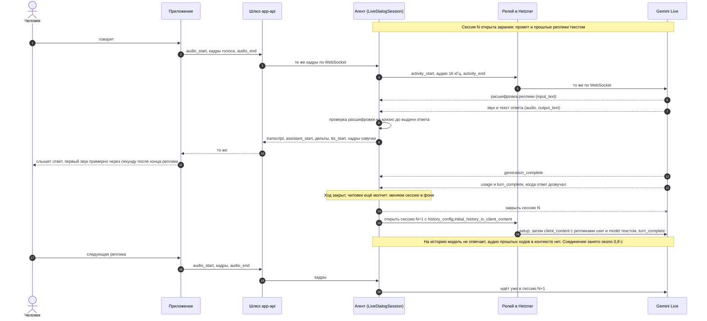
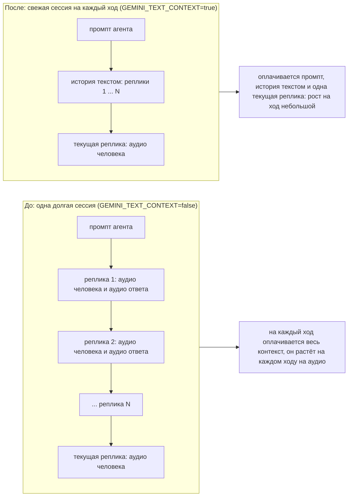
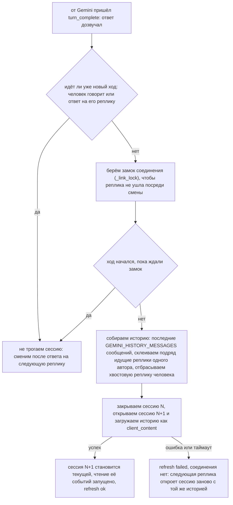

# agent: упрощённая версия

Агент «Слышу Рядом» в самом простом виде. Он нужен, чтобы проверить три вещи до появления настоящей логики:
**API работает, голос работает, приложение с ним интегрируется.**

Что в нём есть:

- весь контракт `agent-api` ([openspec/changes/add-agent-service/specs/agent-api](../openspec/changes/add-agent-service/specs/agent-api/spec.md)): REST диалогов и один WebSocket на диалог, текст и голос, внутренний токен, единый формат ошибок;
- ответы пишет настоящая чат-модель по последним сообщениям диалога (режим `LLM_MODE=proxy`, см. «Модели»); если модель не ответила, агент отвечает шаблоном по кругу;
- кризис определяется по списку слов и отвечает фиксированным текстом, модель в этот путь не входит;
- голос человека распознаёт whisper: реплика превращается в текст, и дальше всё как у набранной;
- настоящая озвучка ответов и приветствия, мужским или женским голосом: Qwen TTS или SaluteSpeech (режим `TTS_MODE`);
- по выбору голосовой диалог идёт речью в речь через Gemini Live (`VOICE_PIPELINE=gemini_live`, см. «Режим gemini_live»);
  по умолчанию работает каскад «распознавание, чат-модель, озвучка», описанный ниже;
- диалоги в памяти процесса с копией на диске (SQLite, `DIALOG_DB_PATH`): переживают перезапуск и выкат пода, реплика одна;
  без диска пропадают при перезапуске.

Чего нет специально: LangGraph, БД и память между диалогами, классификаторы эмоций, PII-фильтр, несколько реплик.
Всё это остаётся в плане [add-agent-service](../openspec/changes/add-agent-service/tasks.md) и подключается на место
`services/dialog_store.py` и `services/replies.py`.

## Трейсинг (Langfuse)

Ходы диалогов трассируются в self-hosted Langfuse (ns `infra`, тот же кластер): одна трасса на ход
(расшифровка реплики → ответ, расход токенов Gemini, задержки этапов), трассы одного разговора собраны
в сессию по id диалога, человек — по id аккаунта. В каскаде дополнительно span'ы распознавания, чата и озвучки.
Реализация — `app/core/tracing.py`, настройки — `LangfuseSettings` (`LANGFUSE_*`, см. `.env.example`): по умолчанию
выключено, при `LANGFUSE_ENABLED=true` ключи обязательны (fail-fast), `LANGFUSE_TRACE_TEXT=false` прячет тексты реплик
(остаются длины, токены и задержки). Сбой записи трассы не влияет на диалог. Ключи проекта (pk-lf…/sk-lf…) создаются
в UI Langfuse и лежат в Secret `agent-secrets`; UI доступен через
`kubectl port-forward -n infra svc/langfuse-web 3000:3000` → http://localhost:3000.

## Модели

Этот раздел про каскад (`VOICE_PIPELINE=cascade`, по умолчанию). В режиме `gemini_live` чат и распознавание не
используются, см. «Режим gemini_live».

Чат и распознавание ходят через тот же OpenAI-совместимый прокси программы (LiteLLM) и с тем же ключом `AGENT_API_TOKEN`,
что и озвучка Qwen. Режим задаёт `LLM_MODE`: `proxy` (по умолчанию, нужны `AGENT_API_TOKEN` и `LLM_BASE_URL`, иначе сервис не стартует)
или `template` (без моделей: шаблонные ответы и заглушка `[голосовая реплика, N с]` вместо распознавания; для разработки и тестов).

**Язык.** Агент всегда говорит только по-русски: правило лежит в `SYSTEM_PROMPT` и общее для каскада и `gemini_live`. Если с ним
говорят на другом языке или просят переключиться (перевести, сказать что-то на другом языке), он отвечает по-русски, что пока
поддерживает только русский, и предлагает продолжить разговор по-русски. Проверено на живом Gemini: 7 из 7 ответов на английскую,
немецкую и испанскую речь и текст были по-русски (до правила 0 из 7), обычные русские разговоры фразу об языке не получают.

| Что | Модель | Где настраивается |
|---|---|---|
| Ответы | `gigachat3.5-432b-a28b` | `LLM_CHAT_MODEL` |
| Распознавание речи | `whisper-large-v3` (язык `ru`) | `STT_MODEL` |
| Озвучка | `qwen/qwen-audio-3.0-tts-flash` | `QWEN_TTS_MODEL` |

Почему именно эта чат-модель. Для проверки взяли одну реплику («Мне сегодня очень тревожно, на работе всё валится…») и один
системный промпт и сравнили модели прокси по скорости и тону ответа (2026-10-09, стрим, до 200 токенов):

| Модель | Первый токен | Всего | Итог |
|---|---|---|---|
| `gigachat3.5-432b-a28b` | 0,59 с | 1,1 с | выбрана: быстро, тёплый живой русский, признаёт чувство и задаёт один вопрос |
| `gigachat-2-max` | 0,58 с | 0,8 с | быстро, но ответ короче и суше |
| `gigachat3-10b-a1.8b` | 0,68 с | 0,8 с | быстро, ответ нормальный, но проще |
| `gpt-oss-120b` | 1,14 с | 1,3 с | нормально, но медленнее и холоднее |
| `claude-haiku-4.5`, `gpt-4.1-mini`, `gemini-3.1-flash-lite` | 1,0-1,3 с | 1,3-1,7 с | хорошо, но вдвое медленнее; зарубежные поставщики |
| `deepseek-v4-flash`, `qwen3-235b-a22b` | 2,8 и 5,3 с | 3,4 и 5,6 с | слишком медленно для голосового диалога |
| `qwen3.6-35b-a3b`, `glm-4.7` | — | — | пустой ответ и таймаут |

Ответ короткий (до 200 токенов, одно-три предложения) и без стрима от модели: он нужен целиком, и дальше идёт по прежнему пути
стрима слов и озвучки по предложениям. Первый звук зависит от Qwen TTS: по логам боевого пода (2026-10-10, 19 ответов) от
готового ответа модели до первого синтезированного предложения проходит 1,2-4,3 с, медиана 1,5 с. Это дольше 0,9 с из контракта,
поэтому клиент не читает ответ своим голосом (раньше читал и получался двойной голос): ответ ждёт голос агента.

Тексты и голос человека уходят во внешний прокси, куда он их дальше направляет, агент не знает: для персональных данных это нужно
подтвердить (в плане add-agent-service чат стоит на Cloud.ru, данные в РФ). В журнал пишутся только модель, время и размеры, сами реплики не пишутся.
Распознавание не получает тишину: запись тише примерно -50 дБ считается пустой, чтобы whisper не выдумывал слова.

Голосовая реплика — до `VOICE_TURN_MAX_SECONDS` (по умолчанию 300 с, как и предел на клиенте): звук сверх этого
отбрасывается. Распознавание ждёт `STT_TIMEOUT_SECONDS` (по умолчанию 120 с), отдельно от `LLM_TIMEOUT_SECONDS` чата:
пять минут речи whisper распознаёт заметно дольше 15 с.

### Ответ потоком

Ответ модели идёт от прокси потоком (SSE `stream: true`: так прокси отдаёт чат по протоколу OpenAI; клиент с агентом, как
и раньше, говорит по WebSocket). Агент режет поток на предложения и работает ими, не дожидаясь конца ответа: первое
предложение сразу уходит клиенту (`assistant_start`, дельты) и в озвучку, остальные догоняют. Сумма дельт по-прежнему
равна `assistant_end.text` (предложения через пробел). Ответ ложится в историю с первого предложения и дописывается,
так что после обрыва клиент найдёт там всё, что успел услышать и увидеть. Оборванный по лимиту токенов хвост без
конца предложения отбрасывается; отказ модели после первого предложения не заменяется шаблоном, договаривается
сказанным.

Озвучка берёт предложения по мере появления и синтезирует с опережением (`SPEECH_PREFETCH` в `app/api/dialog_ws.py`,
2): пока звучит одно, следующее уже готовится.

Пробовали (2026-10-10) озвучивать первое предложение отдельно, а остальные одним запросом, ради связной интонации между
предложениями. На слух с Qwen разницы не нашли, скорости это не добавляет (первое предложение озвучивается так же), так что
идею убрали. Если вернётся мысль улучшать «естественность» голоса, дело, скорее, в самом голосе и в стиле текста ответов.

Звук Qwen тоже читается потоком (`QWEN_TTS_STREAM`, по умолчанию `true`): прокси отдаёт его кусками (замер
`scripts/latency_probe.py`: 14-76 кусков на фразу), и кадр по 200 мс уходит клиенту, как только набрался, не дожидаясь
конца фразы. `tts_start` уходит с первым кадром. До первого байта Qwen нужно 0,8-1,8 с, и от длины текста это зависит
слабо и непоследовательно (замеры 2026-10-10, оба голоса, 13-95 знаков), поэтому первое предложение ради скорости не режем
по запятой: выигрыш меньше разброса, а интонация сбрасывалась бы. `false` возвращает прежнее поведение (фраза целиком).
Остальные провайдеры (SaluteSpeech, espeak) отдают звук целиком, а кэш озвученных фраз проигрывает запомненное сразу.

Что ещё влияет на задержку:
- Соединения с прокси живут 60 с простоя (`KEEPALIVE_LIMITS` в `app/clients/speech.py`), а не 5 с, как по умолчанию в
  `httpx`: прокси держит простаивающее соединение минимум минуту, а между репликами человека обычно 5-30 с, и каждый ход
  начинался бы с нового TCP+TLS на каждый из трёх запросов (распознавание, чат, озвучка). Живой замер с паузами в 7 с между
  ходами: первый звук 2,2 с -> 1,95 с.
- Новая реплика человека (набранное сообщение или распознанная голосовая) сразу обрывает озвучку прошлого ответа, которая
  ещё идёт или ждёт провайдера (`DialogSession._supersede_speech`). Раньше озвучка следующего ответа стояла в очереди за
  прошлой: в живой сессии первый звук пришёл через 12 с вместо 2.

### Реплика, оборванная на полуслове

Если распознанная реплика кончается запятой, многоточием, союзом или предлогом («я думаю, что…»), ответ ждёт
`INCOMPLETE_HOLD_MS` (1500 мс, 0 выключает). Заговорил снова: ответ будет один на обе части (в историю для модели они
идут подряд как одна реплика человека). Нет: ответ уходит по таймеру. Если «заговорил» оказалось кашлем (реплика без
речи), ответ на оборванную фразу уходит сразу. Кризисные фразы не задерживаются никогда.

### Эхо

Реплика, начатая поверх озвучки (после `tts_cancel`), текст которой на 80% и больше совпадает подряд со словами самого
агента (последний ответ или приветствие), считается эхом динамика: ответа не будет, клиент получает пустой
`transcript`. Обычная реплика, даже слово в слово повторяющая агента, эхом не считается.

## Режим gemini_live (речь в речь)

`VOICE_PIPELINE` задаёт, каким путём идёт голосовой диалог: `cascade` (по умолчанию: распознавание, чат-модель, озвучка, см.
«Модели») или `gemini_live`: Gemini Live слушает, отвечает и говорит одна модель, по WebSocket через SDK `google-genai`.
Протокол с клиентом тот же, что у каскада (`transcript`, `assistant_*`, `tts_*`, `safety`), приложение менять не нужно.

Как включить: `VOICE_PIPELINE=gemini_live` и `GEMINI_API_KEY`; из России ещё `GEMINI_BASE_URL` и `GEMINI_RELAY_TOKEN`
(см. «Ограничения»). Без `GEMINI_API_KEY` сервис в этом режиме не стартует. Включённый режим виден в `GET /health/ready`:
`"pipeline": "gemini-live:<модель>"`, `"llm": "none"`, `"stt": "none"`.

| Переменная | По умолчанию | Что |
|---|---|---|
| `VOICE_PIPELINE` | `cascade` | `cascade` или `gemini_live` |
| `GEMINI_API_KEY` | нет (в этом режиме обязателен) | ключ Gemini API |
| `GEMINI_BASE_URL` | пусто (напрямую в Google) | адрес Gemini API (`https://…`, без слэша на конце), обычно адрес релея; SDK сам берёт `wss://…` для Live |
| `GEMINI_RELAY_TOKEN` | пусто | токен релея, уходит заголовком `X-Relay-Token` на `GEMINI_BASE_URL`; без него релей отвечает 403 |
| `GEMINI_LIVE_MODEL` | `gemini-3.8-live` | модель Live |
| `GEMINI_LIVE_VOICE_MALE` | `Charon` | голос для рода `male` (встроенные голоса Gemini) |
| `GEMINI_LIVE_VOICE_FEMALE` | `Kore` | голос для рода `female` |
| `GEMINI_CONNECT_TIMEOUT_SECONDS` | `15` | сколько ждать открытия соединения с Gemini Live (от 1) |
| `GEMINI_TRANSCRIPT_WAIT_MS` | `1000` | сколько ждать расшифровку реплики, прежде чем отдать ответ (0-5000); не пришла за это время: реплика считается пустой, ответ отбрасывается |
| `GEMINI_IDLE_TIMEOUT_SECONDS` | `15` | ответ, от которого нет событий дольше этого, считается оборванным (от 1) |
| `GEMINI_TEXT_CONTEXT` | `true` | после каждого ответа менять сессию на свежую, куда прошлые реплики загружены текстом, а не накопленным аудио: контекст хода не растёт, оплата токенов почти плоская (см. «Контекст сессии и стоимость») |
| `GEMINI_HISTORY_MESSAGES` | `40` | сколько последних сообщений диалога модель получает текстом при новой сессии (при `GEMINI_TEXT_CONTEXT` это её единственная память о разговоре); 0 — весь диалог |
| `GEMINI_THINKING_BUDGET` | `-1` | «размышление» модели перед ответом, токены: `-1` (по умолчанию) параметр не отправляется, решает Google; `0` выключено (замер: первый звук 0,79 с вместо 0,96 с, ответы короткие и тёплые; рекомендуется включить после проверки на слух); `>0` предел |
| `GEMINI_COMPRESSION` | `true` | сжатие контекста скользящим окном, чтобы длинный разговор не обрывался (при `GEMINI_TEXT_CONTEXT` контекст и так маленький, это страховка) |
| `GEMINI_COMPRESSION_TRIGGER_TOKENS` | `0` | при каком размере контекста (токены) сжимать; 0 — решает Google (около 80% окна модели) |
| `GEMINI_COMPRESSION_TARGET_TOKENS` | `0` | до какого размера сжимать (токены); 0 — решает Google |
| `GEMINI_SESSION_RESUMPTION` | `true` | возобновление сессии по handle после переподключения; работает только при `GEMINI_TEXT_CONTEXT=false` (иначе контекст приходит текстом, а handle вернул бы накопленное аудио) |

Как это работает:

- **Границы реплики задаёт клиент.** `audio_start` и `audio_end` агент передаёт модели как начало и конец активности (ручной
  режим, серверный VAD Google выключен). Тишина до начала речи модели не уходит, кроме запаса около 0,5 с, чтобы не обрезать
  первое слово.
- **Кризис проверяется до того, как человек услышит ответ.** Пока нет расшифровки реплики (`GEMINI_TRANSCRIPT_WAIT_MS`), ответ
  модели придерживается; расшифровка проверяется на кризис тем же списком слов, что и в каскаде. Кризис: ответ модели
  выбрасывается, человеку приходит `safety` и фиксированный кризисный ответ. Набранное сообщение с кризисными словами работает так же.
- **Фиксированные фразы** (приветствие, кризисный ответ) озвучивает тот же голос Gemini: модель просят произнести фразу
  дословно в отдельной короткой сессии. Озвученное кэшируется (`TTS_CACHE_ITEMS`), и при старте агент заранее прогревает кэш:
  оба приветствия и кризисный ответ обоими голосами (12 коротких сессий, в журнале «прогрев озвучки закончен: озвучено N,
  не удалось M»). Шаблонные ответы (если модель промолчала) озвучиваются при первом обращении.
- **Контекст между ходами** (`GEMINI_TEXT_CONTEXT`, по умолчанию включено): после каждого ответа агент меняет сессию на свежую,
  а прошлые реплики кладёт в неё текстом. Подробно, со схемой и замерами: «Контекст сессии и стоимость».
- **Длинный разговор** (при `GEMINI_TEXT_CONTEXT=false`). Скользящее окно (`GEMINI_COMPRESSION*`): когда контекст сессии подходит
  к пределу, Google сам выбрасывает самое старое, а промпт и начало разговора остаются. Без сжатия голосовая сессия живёт около 15 минут.
- **Возобновление сессии** (при `GEMINI_TEXT_CONTEXT=false`, `GEMINI_SESSION_RESUMPTION`). Соединение с Google живёт ограниченно, перед
  закрытием Google присылает предупреждение (GoAway). Агент хранит handle сессии и между репликами переоткрывает соединение по нему:
  контекст разговора переживает переподключение. Handle не принят (устарел, сессия закрыта) или возобновление выключено: сессия
  начинается заново, а контекст возвращается последними `GEMINI_HISTORY_MESSAGES` сообщений текстом. При `GEMINI_TEXT_CONTEXT`
  (по умолчанию) так и происходит всегда, поэтому GoAway и обрыв между репликами ничего не теряют.
- **Голос выбирается по роду**, как у остальных провайдеров: `male` берёт `GEMINI_LIVE_VOICE_MALE`, `female` берёт
  `GEMINI_LIVE_VOICE_FEMALE`; выбор в API агента и `set_voice` те же, что в «Озвучка и выбор голоса». Голос у сессии один на всё
  соединение, поэтому смена голоса открывает новую сессию (с историей текстом).
- **Набранные сообщения** (`text`) тоже идут через Gemini: модель отвечает на них как на сказанные, текстом и голосом.
- Перебивание (`tts_cancel`), защита от эха, сохранение диалога и метрики общие с каскадом; метрика `stt` не ведётся,
  распознавания у агента нет. Если Gemini не ответил или соединение оборвалось, клиент получает `error` с кодом
  `VOICE_UNAVAILABLE` (один раз за соединение), а на уже распознанную реплику, ответ на которую не начался, агент отвечает
  шаблоном, как в каскаде.

Ограничения:

- **Из России нужен релей.** Google отвечает «User location is not supported», поэтому `GEMINI_BASE_URL` указывает на прослойку в
  поддерживаемой стране. Как её создать, проверить и свернуть: [relay/README.md](relay/README.md). Голос и тексты людей идут
  через релей и Google, за пределы РФ: для персональных данных это нужно подтвердить.
- **Чат и распознавание из `LLM_MODE` не используются**, звук даёт Gemini, а не `TTS_MODE`. Ключ прокси (`AGENT_API_TOKEN`) и
  `LLM_BASE_URL` в этом режиме не нужны, но `LLM_MODE` и `TTS_MODE` проверяются на допустимые значения, как раньше: опечатка
  в `LLM_MODE` или `TTS_MODE` по-прежнему не даёт сервису стартовать.
- **Прогрев.** Первые секунды после старта, пока кэш приветствий прогревается, приложение может прочитать приветствие
  своим голосом, как и в каскаде. Задержка до первого звука видна в `agent_voice_latency_seconds{stage="first_sound"}`.
- Диалоги в памяти процесса с копией на диске (см. «Диалоги и хранилище»), реплика одна. Автоматического перехода на каскад при недоступности Gemini нет:
  переключает `VOICE_PIPELINE`.

### Контекст сессии и стоимость (GEMINI_TEXT_CONTEXT)

Gemini Live оплачивает **весь контекст сессии на каждый ход**, а голос человека и голос ответов копятся в нём аудио-токенами
(на стенде около 300 токенов за реплику человека и столько же за ответ). Цена хода поэтому растёт с каждой репликой, а цена диалога
растёт быстрее, чем линейно. У OpenAI Realtime эту проблему решают удалением аудио-реплик (`conversation.item.delete`) и подстановкой
текста; у Gemini Live реплик-объектов с id нет, поэтому сделано эквивалентное: **после каждого ответа агент меняет сессию на свежую,
в которую прошлые реплики загружены текстом**. Аудио остаётся в контексте только у текущей реплики, а память о разговоре сохраняется
(проверено: свежая сессия с одной лишь текстовой историей правильно пересказывает начало разговора).

#### Весь путь одного хода и смена сессии



#### Что лежит в контексте хода



#### Когда и как меняется сессия



Если соединение закрыл Google (GoAway) или оно оборвалось между репликами, происходит то же самое, только в начале следующего хода: история всегда лежит в приложении, а не в сессии Gemini, поэтому ничего не теряется.

Что важно знать:

- **Историю держит агент, а не Google.** Источник правды — сообщения диалога в памяти агента. Поэтому обрыв, GoAway, смена голоса и
  смена сессии после ответа устроены одинаково: новая сессия получает последние `GEMINI_HISTORY_MESSAGES` сообщений текстом.
  Возобновление сессии по handle при включённой опции не используется (handle вернул бы накопленное аудио), сжатие контекста
  остаётся страховкой. После кризиса сессия тоже открывается заново к следующему ходу: в её истории то, что человек услышал на самом
  деле (кризисный ответ агента), а не выброшенный ответ модели.
- **Смена идёт в фоне**, пока человек думает (около 0,8 с по замерам: соединение с релеем и загрузка истории, метрики
  `agent_gemini_context_refresh_*`). Если человек заговорил раньше, сессия посреди его реплики не меняется: смена откладывается до
  следующего ответа. Сначала закрывается старая сессия, потом открывается новая, двух живых сессий одного диалога не бывает. Пока
  идёт смена, соединение занято: если человек заговорил в эти доли секунды, первые кадры его реплики ждут конца смены (худший
  случай: ответ на такую реплику позже на остаток этих ~0,8 с). Сессию, на которой не было ни одного хода, не меняют (защита от
  цепочки смен). Неудавшуюся смену повторять не нужно: следующая реплика сама откроет сессию и загрузит историю.
- **Учёт токенов.** Gemini присылает `usage_metadata` вместе с `turn_complete`, то есть через несколько секунд после
  `generation_complete` (когда ответ дозвучал). Агент считает их в `agent_gemini_tokens_total` и пишет строку журнала
  `live usage … prompt=… (text=… audio=…) response=…`; сессию меняет только после этого события.
- **Скорость: зависит от паузы перед следующей репликой.** Если человек заговорил почти сразу после смены сессии (через
  доли секунды), Gemini позже присылает расшифровку и первый звук приходит на 0,1-0,2 с позже (медиана 1,35-1,52 с против
  1,22-1,34 с в замерах с паузой 3 с, когда следующая реплика начиналась через 0,04-1,2 с после конца смены). С паузой 8 с, ближе к живому
  разговору, разницы нет: 1,27 с с оптимизацией против 1,36 с без неё (выборки по 12 ходов, разброс отдельных ходов около
  ±0,2 с). В любом случае это почти вдвое быстрее каскада (2,6 с в проде). Способ передачи истории (`client_content` или
  текст в системной инструкции) на скорость не влияет; если нужна гарантия скорости, `GEMINI_TEXT_CONTEXT=false` возвращает
  одну долгую сессию.
- **Что осталось в цене хода.** После оптимизации около половины входных токенов хода занимает промпт агента (~960 токенов
  текста), и он оплачивается каждый ход. Дальше экономить можно им (короче промпт, кэш контекста), но это отдельная работа.

Замеры (`scripts/live_context_bench.py`: один диалог из 12 голосовых реплик на живом `gemini-3.8-live` через релей, пять фраз
по кругу, пауза «человек думает» 3 с; токены из `usage_metadata` приращением за ход). Прогоны шли парами в разном порядке:

| | без оптимизации (`false`) | с оптимизацией (`true`) |
|---|---|---|
| входные токены за 12 ходов | 38 846 - 43 020 | 19 145 - 19 165 (около -53%) |
| из них аудио | 22 487 - 25 925 | 3 279 (около -86%) |
| входных токенов на последнем ходу | 5 196 - 5 868 | 1 935 |
| рост контекста за ход | около +380 | около +50 |
| первый звук, медиана ходов 2-12, пауза 3 с между репликами | 1,22 - 1,34 с | 1,35 - 1,52 с |
| то же, пауза 8 с | 1,36 с | 1,27 с |
| смена сессии | никогда | после каждого ответа, 0,76-0,86 с в фоне |

Как повторить: запустить агент в режиме `gemini_live` с нужным значением `GEMINI_TEXT_CONTEXT` и
`uv run python scripts/live_context_bench.py --url http://127.0.0.1:8001 --token <токен> --pcm-dir <каталог с in_0_16k.pcm … in_4_16k.pcm> --turns 12`.

## Метрики

`GET /metrics` (без токена, как `/health`, и без access-лога) отдаёт счётчики Prometheus голосового режима «без рук».
Звук и тексты в метрики и журнал не попадают.

| Метрика | Что |
|---|---|
| `agent_voice_interruptions_total` | перебивания озвучки (`tts_cancel`), голосом или нажатием |
| `agent_voice_false_interruptions_total` | перебивания, после которых реплика оказалась пустой: детектор принял эхо или шум за речь |
| `agent_voice_turn_end_delay_seconds` | гистограмма: тишина от последнего кадра с речью до `audio_end`, то есть сколько ждал детектор конца реплики |
| `agent_voice_turns_truncated_total` | реплики длиннее `VOICE_TURN_MAX_SECONDS` |
| `agent_voice_latency_seconds{stage}` | гистограмма задержек: `stt` (конец реплики → текст), `first_sentence` (начало ответа → первое предложение), `tts_first` (синтез первого куска у провайдера), `first_sound` (конец реплики человека → `tts_start`: пауза, которую он ощущает) |
| `agent_voice_echo_total` | реплики-эхо: агент услышал сам себя при перебивании |
| `agent_voice_held_turns_total` | реплики, оборванные на полуслове, ответ на которые задержан |
| `agent_dialog_db_errors_total{op}` | сбои базы диалогов на диске (`open`, `load`, `write`, `erase`): запись повторяется, диалоги остаются в памяти |
| `agent_dialog_db_write_seconds` | гистограмма: сколько занимает запись пачки изменённых диалогов на диск (в фоновом потоке) |
| `agent_gemini_tokens_total{direction,modality}` | токены Gemini Live по `usage_metadata` каждого хода: `prompt` (весь контекст хода, оплачивается заново на каждый ход) и `response`; modality: `all`, `text`, `audio` |
| `agent_gemini_context_refresh_total{result}` | смены сессии после ответа (`GEMINI_TEXT_CONTEXT`): `ok` или `failed` |
| `agent_gemini_context_refresh_seconds` | гистограмма: сколько занимает смена сессии (соединение и загрузка истории), идёт в фоне между репликами |

В журнал на каждый ответ с голосом пишется строка `first sound dialog=… ms=…` и (для потока) `chat stream … first_ms=…`.

`scripts/latency_probe.py` замеряет прокси напрямую (чат со стримом и без, озвучка целиком и потоком) и показывает, где
уходит время и собирает ли прокси звук целиком: `AGENT_API_TOKEN=… uv run python scripts/latency_probe.py --base-url …`.

## Запуск

```bash
cd agent
uv sync
AGENT_INTERNAL_TOKEN=<токен> TTS_MODE=espeak LLM_MODE=template uv run uvicorn app.main:app --port 8001
```

Без `AGENT_INTERNAL_TOKEN` сервис не стартует. По умолчанию `VOICE_PIPELINE=cascade`, `TTS_MODE=qwen` и `LLM_MODE=proxy`, и нужны
ключ прокси и адрес (см. ниже), поэтому для локального запуска без ключей выбраны `TTS_MODE=espeak` (или `none`) и
`LLM_MODE=template`.

Речь в речь через Gemini Live (ключ прокси и `TTS_MODE`/`LLM_MODE` не нужны; из России ещё релей, см. «Режим gemini_live»):

```bash
AGENT_INTERNAL_TOKEN=<токен> VOICE_PIPELINE=gemini_live GEMINI_API_KEY=<ключ Gemini> \
  [GEMINI_BASE_URL=https://<хост релея> GEMINI_RELAY_TOKEN=<токен релея>] uv run uvicorn app.main:app --port 8001
```

Остальные настройки — в [.env.example](.env.example).

В контейнере (ставит espeak-ng): `docker build -t ryadom-agent .`

## Проверка

```bash
uv run pytest                                   # 205 тестов: REST, WebSocket, голос, озвучка, провайдеры речи, чат и распознавание, Gemini Live
uv run python scripts/prompt_check.py           # ручная проверка промпта на живой модели (LLM_MODE=proxy): набор диалогов и ответы
uv run python scripts/smoke.py --url http://127.0.0.1:8001 --token <токен> --wav reply.wav [--voice female]
```

`smoke.py` ходит по живому серверу так же, как шлюз приложения, проверяет всё по порядку и сохраняет голос ответа
в `reply.wav`, чтобы его можно было послушать. Послушать произвольный текст: `GET /dev/tts?text=Привет&voice=female`
с заголовком `Authorization: Bearer <токен>` (возвращает WAV; не входит в контракт).
`POST /dev/tts {"mode": "none"}` выключает озвучку на лету (агент ведёт себя как при отказавшем синтезе: ответы идут текстом, клиент читает их сам), `{"mode": "auto"}` включает обратно, `GET /dev/tts` без текста показывает режим. Тот же переключатель есть у `dev/agent-mock`, на него опираются e2e-тесты приложения.

## Озвучка и выбор голоса

Чем озвучивать, задаёт `TTS_MODE` (в режиме `gemini_live` звук даёт Gemini, а `TTS_MODE` не используется). Это не секрет, он лежит
в конфиге; недостающий ключ или бинарник — сервис не стартует:

| `TTS_MODE` | Что | Что нужно |
|---|---|---|
| `qwen` (по умолчанию) | Qwen TTS (`qwen/qwen-audio-3.0-tts-flash`) через прокси программы | `AGENT_API_TOKEN` (ключ прокси) и `QWEN_TTS_BASE_URL` |
| `salutespeech` | SaluteSpeech | `SALUTE_SPEECH_AUTH_KEY` (ключ авторизации Сбера) |
| `espeak` | локальный espeak-ng, для разработки | espeak-ng в PATH |
| `none` | без озвучки: ответы остаются текстом (приложение читает вслух только приветствие), для разработки и тестов | ничего |

Режим не выбирается по наличию ключа: когда появится ключ Сбера, достаточно сменить `TTS_MODE` на `salutespeech`.
`POST /dev/tts {"mode": ...}` (см. выше) выключает озвучку на лету поверх выбранного режима.

Ключ прокси хранится в `AGENT_API_TOKEN` и принадлежит только агенту. Не путать с `AGENT_INTERNAL_TOKEN`: это общий
токен между сервисами, им приложение представляется агенту.

Выход всегда PCM16, 24 кГц, кадры по 200 мс, как в контракте. `GET /health/ready` показывает режим голоса и выбранных
провайдеров: `{"status":"ok","pipeline":"cascade","tts":"qwen","llm":"proxy:<модель>","stt":"proxy:<модель>"}`, где `pipeline` это
`cascade` или `gemini-live:<модель>`, а `tts`, `llm` и `stt` это имена провайдеров или `none` (в `gemini_live` `llm` и `stt`
всегда `none`, а `tts` равен `gemini-live:<модель>`).

Голос выбирается **по роду**: `male` или `female`, по умолчанию `male` (`TTS_DEFAULT_VOICE`). Каждый провайдер
отображает род на свои голоса:

| Род | SaluteSpeech | Qwen TTS | espeak-ng |
|---|---|---|---|
| `male` | `Bys_24000` (Борис) | `loongjohn` | `ru` |
| `female` | `Nec_24000` (Наталья) | `longanhuan_v3.6` | `ru+f2` |

Озвученные фразы агент помнит (`TTS_CACHE_ITEMS`, по умолчанию 64): ответы шаблонные, и повтор не ждёт провайдера.
Это нужно приветствию: клиент ждёт его `tts_start` не дольше 0,9 с и читает текст сам, если звук опаздывает, а Qwen через
прокси отдаёт первый звук за 1-2 с. Поэтому при старте агент заранее озвучивает все фиксированные фразы (приветствия,
шаблонные ответы, кризисный ответ) обоими голосами, это около минуты в фоне (в `gemini_live` прогреваются приветствия и
кризисный ответ). Пока прогрев не закончился, приложение может прочитать приветствие само своим голосом. Ответы модели
клиент сам не читает никогда, ждёт голос агента.

Предложения ответа синтезируются с опережением (`SPEECH_PREFETCH` в `app/api/dialog_ws.py`, сейчас 2): пока отдаётся и
звучит одно, следующее уже готовится, и между предложениями нет паузы на запрос к Qwen. Кадры идут по порядку.

У Qwen TTS свои значения: другие голоса (`alloy`, `Cherry` и т. п.) и формат `wav` апстрим отвергает с 400, а прокси
превращает это в невнятный 500.

Как выбрать голос в API агента:

- `POST /v1/users/{userId}/dialogs` с телом `{"voice": "male" | "female"}` (тело необязательно). Выбор запоминается за
  человеком; без `voice` берётся прошлый выбор, а если его нет, голос по умолчанию. Ответ содержит `voice`.
  У возобновлённого диалога голос меняется, если `voice` передан.
- Кадр сокета `{"type": "set_voice", "voice": "male" | "female"}` меняет голос идущего диалога со следующей озвучки.
  Приветствие озвучивается голосом, выбранным при старте.

## Диалоги и хранилище

Рабочий набор диалогов живёт в памяти процесса, как и раньше. Если задан `DIALOG_DB_PATH`, он дублируется в файл SQLite (стандартная
библиотека Python, без новых зависимостей, `app/services/dialog_db.py`), и после перезапуска или выката пода диалоги возвращаются:

- **Запись в фоне** раз в `DIALOG_DB_FLUSH_MS` (500 мс): пишется только разница с уже записанным, одной транзакцией. Ответ, который
  дописывается по словам, сохраняется целиком: диалоги с живым сокетом сверяются с диском на каждой записи. При остановке пода
  (SIGTERM) агент дописывает всё несохранённое. При сбое записи она повторяется с растущей паузой, диалоги остаются в памяти.
- **Один «битый» символ не ломает запись.** Непарный суррогат (оборванная половина эмодзи в JSON клиента) на границе записи заменяется на «?»,
  а если пачка всё же не записалась, повтор идёт по одному диалогу: остальные люди пишутся, сбойный диалог ждёт следующей попытки.
- **Загрузка по человеку** при первом обращении к нему после старта (любой REST-маршрут и сокет): журнал, история, открытый диалог,
  выбранный голос, идентификаторы реплик клиента (повтор реплики после перезапуска по-прежнему не плодит сообщений). Сбой чтения
  даёт ошибку запроса, а не пустую историю.
- **Стирание** (`DELETE /v1/users/{userId}`) удаляет диалоги, сообщения и выбор голоса и из памяти, и с диска (`secure_delete`, после
  чего журнал WAL усекается, иначе в нём остались бы прежние страницы с текстом), и только потом отвечает `204`; идущий сокет стёртого
  человека обратно на диск не пишет. Если диск задан, но не подключён, или стереть не удалось, ответ `503 AGENT_INTERNAL`: приложение не
  должно считать данные стёртыми и повторит позже. Блоки сетевого диска, освобождённые файловой системой, и снимки провайдера агент не контролирует.
- **Диск недоступен** (путь не открылся, файл повреждён или новее агента): агент не падает. Он работает в памяти, пишет в журнал ошибку
  `dialog db is NOT available`, считает `agent_dialog_db_errors_total{op="open"}`, а `/health/ready` показывает `"dialogs": "memory"`
  (при диске `"sqlite"`). Если после этого диск починили, диалоги вернутся только после перезапуска.
- **Не записывается** то, что временно: живой сокет, неозвученное приветствие. Звук и расшифровки реплик на диск не пишутся, только
  тексты сообщений, как и в памяти.
- В k8s файл лежит на PVC `agent-data` (`k8s/agent/03-pvc.yaml`, 5 ГБ, сетевой диск Timeweb). **Бэкапов у диска нет**, а удаление PVC
  удаляет диск вместе с диалогами: см. `k8s/agent/README.md`. Настоящая БД агента (design D6, PostgreSQL) подставляется на место
  `DialogDatabase`.
- Память пода растёт с числом людей, обращавшихся после старта (их диалоги держатся в памяти до перезапуска); для бета-нагрузки это
  мегабайты, при росте нужна выгрузка давно неактивных людей.

Начало нового разговора. `POST /v1/users/{userId}/dialogs` без тела-флага ничего не меняет и возвращает открытый диалог с `resumed: true`.
Ответ содержит `messageCount` (сколько сообщений в диалоге) и `lastActivityAt`, чтобы клиент мог спросить человека: продолжить или
завершить и начать новый. С `{"new": true}` открытый диалог с сообщениями завершается (название по первой реплике, в журнале он остаётся
завершённым), его живой сокет получает `ended` и закрывается кодом 1000 (а сокет, открытый к такому диалогу позже, например после
обрыва связи на другом экране, получает `ready`, `ended` и тоже закрывается, реплик не принимая), и создаётся новый (`resumed: false`). Открытый диалог без сообщений
не завершается, а переиспользуется. `sinceLastDialogHours` считается от последней активности человека (завершение или последнее сообщение),
в том числе в только что закрытом диалоге.

## Подключение приложения

В env приложения (`services/api` и `apps/admin`):

```
AGENT_API_URL=http://<адрес агента>:8001
AGENT_API_TOKEN=<тот же токен, что AGENT_INTERNAL_TOKEN у агента>
```

Здесь `AGENT_API_TOKEN` — имя переменной внутри приложения для общего токена между сервисами. На стороне агента то же
имя занимает ключ прокси Qwen, это другой секрет. Поэтому в Secret'ах кластера общий токен лежит под именем
`AGENT_INTERNAL_TOKEN` и в Deployment приложения подставляется в переменную `AGENT_API_TOKEN`.

Локальную заглушку `dev/agent-mock` это не заменяет и не ломает: она остаётся для разработки без агента.
