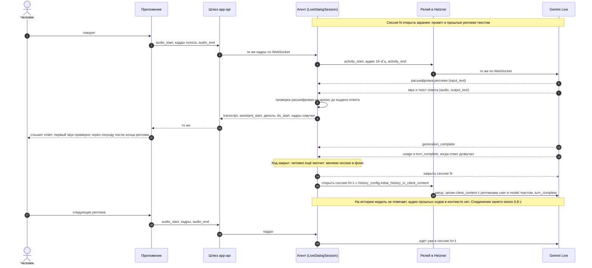
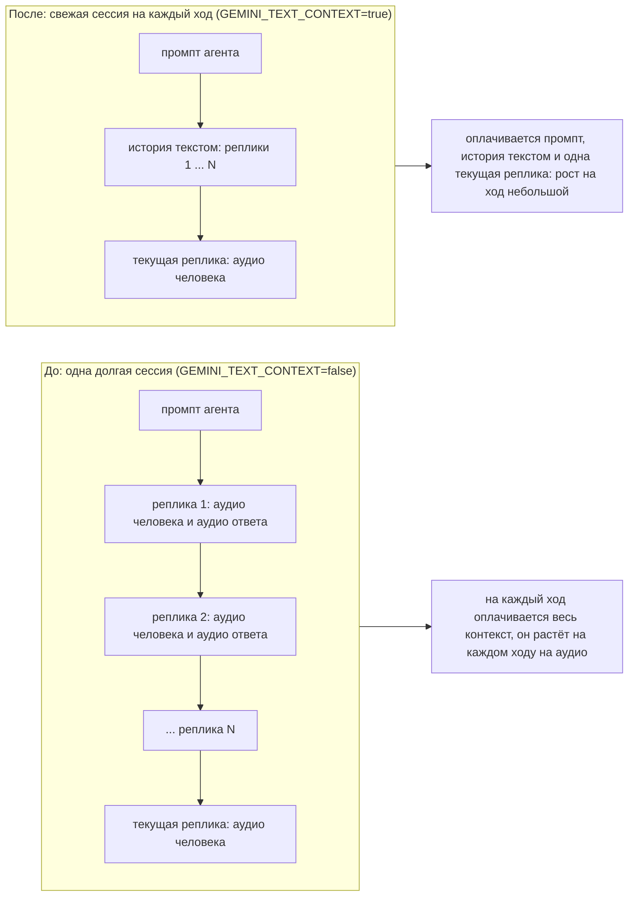
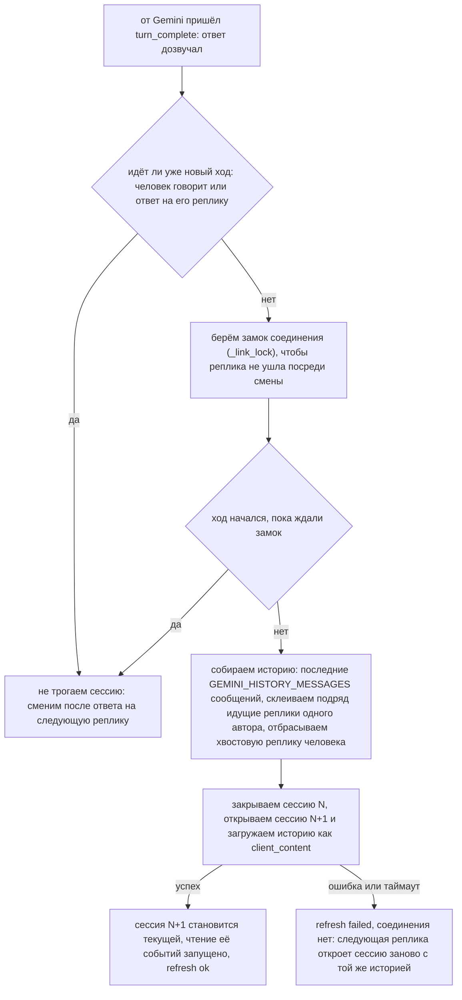

# agent: упрощённая версия

Агент «Слышу Рядом» в самом простом виде. Он нужен, чтобы проверить три вещи до появления настоящей логики:
**API работает, голос работает, приложение с ним интегрируется.**

Что в нём есть:

- весь контракт `agent-api` ([openspec/changes/add-agent-service/specs/agent-api](../openspec/changes/add-agent-service/specs/agent-api/spec.md)): REST диалогов и один WebSocket на диалог, текст и голос, внутренний токен, единый формат ошибок;
- ответы пишет настоящая чат-модель по последним сообщениям диалога (режим `LLM_MODE=proxy`, см. «Модели»); шаблонов вместо ответа нет: модель не ответила — клиент получает `error AGENT_LLM_UNAVAILABLE` (в `gemini_live` агент сначала просит модель ответить ещё раз, см. «Реплика без ответа»);
- кризис определяется по списку слов и отвечает фиксированным текстом, модель в этот путь не входит;
- голос человека распознаёт whisper: реплика превращается в текст, и дальше всё как у набранной;
- настоящая озвучка ответов и приветствия, мужским или женским голосом: Qwen TTS или SaluteSpeech (режим `TTS_MODE`);
- по выбору голосовой диалог идёт речью в речь через Gemini Live (`VOICE_PIPELINE=gemini_live`, см. «Режим gemini_live»);
  по умолчанию работает каскад «распознавание, чат-модель, озвучка», описанный ниже;
- диалоги в памяти процесса с копией в PostgreSQL (`DIALOG_DATABASE_URL`): переживают перезапуск и выкат пода, реплика одна;
  давно неактивные люди выгружаются из памяти и загружаются с диска при следующем обращении; без диска диалоги пропадают при
  перезапуске.

Чего нет специально: LangGraph, БД и память между диалогами, классификаторы эмоций, PII-фильтр, несколько реплик.
Всё это остаётся в плане [add-agent-service](../openspec/changes/add-agent-service/tasks.md) и подключается на место
`services/dialog_store.py` и `services/replies.py`.

## Трейсинг (Langfuse)

Ходы диалогов трассируются в self-hosted Langfuse (ns `infra`, тот же кластер): одна трасса на ход
(расшифровка реплики → ответ, расход токенов Gemini, задержки этапов), трассы одного разговора собраны
в сессию по id диалога, человек — по id аккаунта. В каскаде дополнительно span'ы распознавания, чата и озвучки.
Реализация — `app/core/tracing.py`, настройки — `LangfuseSettings` (`LANGFUSE_*`, см. `.env.example`): по умолчанию
выключено, при `LANGFUSE_ENABLED=true` ключи обязательны (fail-fast), `LANGFUSE_TRACE_TEXT=false` (по умолчанию) —
тексты реплик в Langfuse **не уходят**, остаются число символов и слов, длительность речи, токены и задержки; `true` — только
для локальной отладки, в проде нельзя. Сбой записи трассы не влияет на диалог. Ключи проекта (pk-lf…/sk-lf…) создаются
в UI Langfuse и лежат в Secret `agent-secrets`; UI доступен через
`kubectl port-forward -n infra svc/langfuse-web 3000:3000` → http://localhost:3000.

## Модели

Этот раздел про каскад (`VOICE_PIPELINE=cascade`, по умолчанию). В режиме `gemini_live` чат и распознавание не
используются, см. «Режим gemini_live».

Чат и распознавание ходят через тот же OpenAI-совместимый прокси программы (LiteLLM) и с тем же ключом `AGENT_API_TOKEN`,
что и озвучка Qwen. Режим задаёт `LLM_MODE`: `proxy` (по умолчанию, нужны `AGENT_API_TOKEN` и `LLM_BASE_URL`, иначе сервис не стартует)
или `template` (без моделей: ответы-заглушки по кругу и `[голосовая реплика, N с]` вместо распознавания; для разработки и тестов).

**Язык.** Агент всегда говорит только по-русски: правило лежит в `SYSTEM_PROMPT` и общее для каскада и `gemini_live`. Если с ним
говорят на другом языке или просят переключиться (перевести, сказать что-то на другом языке), он отвечает по-русски, что пока
поддерживает только русский, и предлагает продолжить разговор по-русски. Проверено на живом Gemini: 7 из 7 ответов на английскую,
немецкую и испанскую речь и текст были по-русски (до правила 0 из 7), обычные русские разговоры фразу об языке не получают.

Язык не должен срабатывать на плохо расслышанное русское слово. В живом разговоре «устала» расшифровалась как «usted»,
«gustala gustala ya gustala», и агент трижды отвечал про «только по-русски», а расшифровка с чужим словом попадала в историю.
Поэтому: (1) расшифровка речи в `gemini_live` идёт с подсказкой языка (`GEMINI_INPUT_LANGUAGES`, по умолчанию `ru-RU`;
если Google отвергнет само поле, сессии открываются без него и в журнале предупреждение; английскую речь подсказка не
переводит — расшифровка остаётся английской); (2) если расшифровка всё же оказалась до пяти слов без единой русской буквы
и без частых английских слов (`is_foreign_noise`: «I'm so tired today» — это речь, а не обрывок), а ответ модели — лекция про язык
(`is_language_lecture`), ответ выбрасывается, в историю расшифровка не пишется, агент просит повторить («Прости, плохо
слышно. Повтори, пожалуйста?», `agent_live_repeat_requests_total`). Хороший ответ на такую расшифровку проходит как есть: в
проверке на живом Gemini модель понимала звук и при латинской «ustala». Ради этого ответ держится, пока не наберётся
`NOISE_CHECK_CHARS` знаков (около +0,8 с к первому звуку, только на таких ходах); если просьба повторить уже прозвучала, а
ответ снова про язык, он проходит (человек, возможно, правда говорит на другом языке); (3) в промпте правило про язык
включается только на прямую просьбу или целые фразы на другом языке, а короткое неразборчивое слово — повод попросить
повторить своими словами (готовой фразы в промпте нет: модель копировала бы её дословно).

**Род агента.** Агент говорит о себе в роде своего голоса: правило «я понял / я поняла» добавляется к промпту по голосу
диалога (`system_prompt(voice)`, и в `gemini_live`, и в каскаде). Без него при женском голосе модель говорила о себе в
мужском роде в 4–7 ответах из 18 на вопросы вроде «Ты меня понял?» (живая проверка). Пол человека приложение не знает,
поэтому его род модель берёт из его же слов («я устала» — женский); пока род не ясен, обходится без слов, которые его выдают.
Раньше правило было «не угадывай род», и к человеку неизвестного рода модель почти всегда обращалась в мужском.

**Как агент разговаривает** (`SYSTEM_PROMPT`). Прежний промпт задавал формулу: признать чувство, потом один вопрос, одно-три
предложения, после ответа не по теме — «Кстати, я здесь в первую очередь, чтобы выслушать тебя. Как прошёл твой день?». В живых
разговорах прода (12–14.10) 79% ответов кончались вопросом, ответ был в несколько раз длиннее реплики человека, фраза-образец
звучала дословно в каждом восьмом ответе, на «что мне делать» агент отвечал «я не могу давать советов»; люди жаловались на допрос
и повторы. Сейчас готовых фраз в промпте нет, а вместо формулы — как разговаривать: длина по содержанию (на короткую реплику
коротко, на подробный рассказ — подхватить одну-две нити, связать, сказать свой взгляд, три-пять предложений), разные формы
(отразить, назвать чувство, свой взгляд, заметить противоречие или сказанное вскользь), и у каждого ответа есть зацепка для
продолжения: вопрос глубже поверхности (что за этим стоит, чего он хочет, что было бы признаком, что стало лучше), предположение,
неожиданный угол; голое сочувствие или похвала — тупик, так ответ не заканчивается, кроме прощания и просьбы о тишине. Без
дежурных оборотов и рассказов о своей роли; на «что делать» — не советы (даже мягкие), а помочь разобраться: что задевает, какие
желания спорят, гипотеза, выбор за человеком; анекдот и бытовой вопрос — по сути, без насильного возврата к чувствам; чего не
может — прямо. Проверка на живой модели — `scripts/style_check.py` (16 синтетических сценариев, в том числе два длинных монолога;
метрики по тексту; другой промпт для сравнения — `--prompt-module`).

Первая версия этого промпта («вопрос не в каждом ответе», «два-три предложения, но не длиннее», «иногда просто коротко
отзовись») ушла в другую крайность: в живой пробе 6 ответов из 11 кончались сочувствием без продолжения, и разговор тянул
человек, а на рассказ в полминуты агент отвечал одной фразой. На 144 ответах (16 сценариев × 3, gemini-3.8-live, набранными
репликами), промпт #45 → первая версия → эта:

| | #45 | первая версия | эта |
|---|---|---|---|
| ответ без зацепки (ни вопроса, ни приглашения) | 0% | 45% | 8% |
| кончается вопросом | 99% | 51% | 88% |
| медиана длины ответа на длинную реплику (от 200 знаков) | 244 | 203 | 345 |
| дежурные обороты | 28% | 2% | 3% |
| советы на «что мне делать» (по словам-маркерам) | 6 из 24 | 2 из 24 | 1 из 24 |

Вопросы вернулись, но другие: у #45 — дежурные («как ты себя чувствуешь», «что на душе»), здесь — по словам человека и глубже
(«что самое страшное, по-твоему, случится, если ты позволишь себе сказать „нет“?»). На односложные ответы разговор всё ещё идёт
вопрос за вопросом — это смотреть вживую. Голосовые сценарии `feedback_check.py` (на первой версии): лекций про язык 0, ошибок
рода агента 0 из 24, ответов без звука 0 из 36, первый звук — медиана 0,90 с.

**Чужая письменность в ответе.** Голосовая модель изредка вставляет в русский ответ слово чужой письменности («усталость
бывает很 тяжелой»). Из текста ответа и из истории такие буквы убираются (`strip_foreign_script`: иероглифы, кана, хангыль,
арабское письмо, иврит, индийские и тайское; латиница остаётся), метрика `agent_live_foreign_script_total`. Звук уже
сгенерирован моделью, его не исправить.

**Ответ без звука.** Иногда Gemini Live присылает текст ответа без единого куска звука («response=0(audio=0)» в строке
`live usage`, строки «first sound» нет): человек читает ответ, а не слышит его. В проде 12–13.10 так пришли ~6% ходов
(212 из 3659 в нагрузочном тесте, 5 из 31 у тестировщицы) — от нагрузки, длины истории и номера хода доля не зависела;
локально 13–14.10 на 250+ ходах к тому же Gemini через тот же релей не повторилось ни разу, причина не найдена. Агент озвучивает этот же текст сам тем же голосом диалога
(озвучка как у приветствия), если человек в этот момент не говорит и не перебил ответ. Если озвучка недоступна, клиент
получает `error VOICE_UNAVAILABLE`, как у каскада. В журнал уходит предупреждение «live answer without voice» с этапами хода
(без текстов), метрика `agent_live_voiceless_answers_total{outcome}`.

**Реплика без ответа.** Иногда Gemini Live закрывает ход, не сказав ничего (`live usage … output=0` в журнале): в проде 12–14.10
так прошли около 8% ответов живым людям, чаще на первых ходах свежей сессии и когда человек сделал паузу посреди мысли. Раньше
агент тут же озвучивал шаблон по кругу, не зная сказанного, — невпопад и часто поверх человека, который просто задумался.
Шаблонов больше нет. Голосовая реплика: агент ждёт `GEMINI_SILENCE_NUDGE_MS` (2 с); заговорил или написал человек — модель
отвечает на всё сразу; нет — агент открывает свежую сессию, где последней лежит реплика человека, и просит модель ответить
(`client_content` без реплик с `turn_complete`, `LiveLink.nudge`; на живой модели в такой сессии ответ по сути 3 из 3; сразу после
голосовой реплики или после готового ответа так делать нельзя — модель теряет смысл сказанного или дописывает к ответу обрывок).
Набранное сообщение без ответа и обрыв соединения посреди хода, когда слова человека уже расшифрованы, — то же сразу;
`VOICE_UNAVAILABLE` человек видит, только если новую сессию открыть не удалось. Молчит модель и на повторную просьбу — третьей
попытки и шаблона нет: клиент покажет «думаю…» и через 20 с вернётся в покой. Метрики `agent_live_unanswered_turns_total{reason}`
и `agent_live_recoveries_total{outcome}`, в журнале «live turn unanswered» и `gemini live opened … purpose=recover`. История новой
сессии теперь срезает только отправляемое набранное сообщение, а не все реплики человека в конце: иначе слова, на которые модель
промолчала, терялись при смене сессии. Если ответ перебила новая «реплика» (микрофон поймал шум), а та оказалась пустой —
расшифровки нет, ответ на неё выбрасывается, — агент так же просит модель ответить на прежнюю (`reason="interrupted"`), как
каскад отвечает на оборванную реплику; окажется настоящей — модель ответит на обе, переспрашивать не нужно. Раньше в таком случае
человек ждал в тишине, пока не спросит сам (живая проба: 15 с).

| Что | Модель | Где настраивается |
|---|---|---|
| Ответы | `gigachat3.5-432b-a28b` | `LLM_CHAT_MODEL` |
| Распознавание речи | `whisper-large-v3` (язык `ru`) | `STT_MODEL` |
| Озвучка | `qwen/qwen-audio-3.0-tts-flash` | `QWEN_TTS_MODEL` |

Почему именно эта чат-модель. Для проверки взяли одну реплику («Мне сегодня очень тревожно, на работе всё валится…») и один
системный промпт и сравнили модели прокси по скорости и тону ответа (2026-10-09, стрим, до 200 токенов):

| Модель | Первый токен | Всего | Итог |
|---|---|---|---|
| `gigachat3.5-432b-a28b` | 0,59 с | 1,1 с | выбрана: быстро, тёплый живой русский, признаёт чувство и задаёт один вопрос |
| `gigachat-2-max` | 0,58 с | 0,8 с | быстро, но ответ короче и суше |
| `gigachat3-10b-a1.8b` | 0,68 с | 0,8 с | быстро, ответ нормальный, но проще |
| `gpt-oss-120b` | 1,14 с | 1,3 с | нормально, но медленнее и холоднее |
| `claude-haiku-4.5`, `gpt-4.1-mini`, `gemini-3.1-flash-lite` | 1,0-1,3 с | 1,3-1,7 с | хорошо, но вдвое медленнее; зарубежные поставщики |
| `deepseek-v4-flash`, `qwen3-235b-a22b` | 2,8 и 5,3 с | 3,4 и 5,6 с | слишком медленно для голосового диалога |
| `qwen3.6-35b-a3b`, `glm-4.7` | — | — | пустой ответ и таймаут |

Ответ короткий (до 200 токенов, одно-три предложения) и без стрима от модели: он нужен целиком, и дальше идёт по прежнему пути
стрима слов и озвучки по предложениям. Первый звук зависит от Qwen TTS: по логам боевого пода (2026-10-10, 19 ответов) от
готового ответа модели до первого синтезированного предложения проходит 1,2-4,3 с, медиана 1,5 с. Это дольше 0,9 с из контракта,
поэтому клиент не читает ответ своим голосом (раньше читал и получался двойной голос): ответ ждёт голос агента.

Тексты и голос человека уходят во внешний прокси, куда он их дальше направляет, агент не знает: для персональных данных это нужно
подтвердить (в плане add-agent-service чат стоит на Cloud.ru, данные в РФ). В журнал пишутся только модель, время и размеры, сами реплики не пишутся.
Распознавание не получает тишину: запись тише примерно -50 дБ считается пустой, чтобы whisper не выдумывал слова.

Голосовая реплика — до `VOICE_TURN_MAX_SECONDS` (по умолчанию 300 с, как и предел на клиенте): звук сверх этого
отбрасывается. Распознавание ждёт `STT_TIMEOUT_SECONDS` (по умолчанию 120 с), отдельно от `LLM_TIMEOUT_SECONDS` чата:
пять минут речи whisper распознаёт заметно дольше 15 с.

### Ответ потоком

Ответ модели идёт от прокси потоком (SSE `stream: true`: так прокси отдаёт чат по протоколу OpenAI; клиент с агентом, как
и раньше, говорит по WebSocket). Агент режет поток на предложения и работает ими, не дожидаясь конца ответа: первое
предложение сразу уходит клиенту (`assistant_start`, дельты) и в озвучку, остальные догоняют. Сумма дельт по-прежнему
равна `assistant_end.text` (предложения через пробел). Ответ ложится в историю с первого предложения и дописывается,
так что после обрыва клиент найдёт там всё, что успел услышать и увидеть. Оборванный по лимиту токенов хвост без
конца предложения отбрасывается; отказ модели после первого предложения не превращается в ошибку, договаривается
сказанным.

Озвучка берёт предложения по мере появления и синтезирует с опережением (`SPEECH_PREFETCH` в `app/api/dialog_ws.py`,
2): пока звучит одно, следующее уже готовится.

Пробовали (2026-10-10) озвучивать первое предложение отдельно, а остальные одним запросом, ради связной интонации между
предложениями. На слух с Qwen разницы не нашли, скорости это не добавляет (первое предложение озвучивается так же), так что
идею убрали. Если вернётся мысль улучшать «естественность» голоса, дело, скорее, в самом голосе и в стиле текста ответов.

Звук Qwen тоже читается потоком (`QWEN_TTS_STREAM`, по умолчанию `true`): прокси отдаёт его кусками (замер
`scripts/latency_probe.py`: 14-76 кусков на фразу), и кадр по 200 мс уходит клиенту, как только набрался, не дожидаясь
конца фразы. `tts_start` уходит с первым кадром. До первого байта Qwen нужно 0,8-1,8 с, и от длины текста это зависит
слабо и непоследовательно (замеры 2026-10-10, оба голоса, 13-95 знаков), поэтому первое предложение ради скорости не режем
по запятой: выигрыш меньше разброса, а интонация сбрасывалась бы. `false` возвращает прежнее поведение (фраза целиком).
Остальные провайдеры (SaluteSpeech, espeak) отдают звук целиком, а кэш озвученных фраз проигрывает запомненное сразу.

Что ещё влияет на задержку:
- Соединения с прокси живут 60 с простоя (`KEEPALIVE_LIMITS` в `app/clients/speech.py`), а не 5 с, как по умолчанию в
  `httpx`: прокси держит простаивающее соединение минимум минуту, а между репликами человека обычно 5-30 с, и каждый ход
  начинался бы с нового TCP+TLS на каждый из трёх запросов (распознавание, чат, озвучка). Живой замер с паузами в 7 с между
  ходами: первый звук 2,2 с -> 1,95 с.
- Новая реплика человека (набранное сообщение или распознанная голосовая) сразу обрывает озвучку прошлого ответа, которая
  ещё идёт или ждёт провайдера (`DialogSession._supersede_speech`). Раньше озвучка следующего ответа стояла в очереди за
  прошлой: в живой сессии первый звук пришёл через 12 с вместо 2.

### Реплика, оборванная на полуслове

Если распознанная реплика кончается запятой, многоточием, союзом или предлогом («я думаю, что…»), ответ ждёт
`INCOMPLETE_HOLD_MS` (1500 мс, 0 выключает). Заговорил снова: ответ будет один на обе части (в историю для модели они
идут подряд как одна реплика человека). Нет: ответ уходит по таймеру. Если «заговорил» оказалось кашлем (реплика без
речи), ответ на оборванную фразу уходит сразу. Кризисные фразы не задерживаются никогда.

### Эхо

Реплика, начатая поверх озвучки (после `tts_cancel`), текст которой на 80% и больше совпадает подряд со словами самого
агента (последний ответ или приветствие), считается эхом динамика: ответа не будет, клиент получает пустой
`transcript`. Обычная реплика, даже слово в слово повторяющая агента, эхом не считается.

## Режим gemini_live (речь в речь)

`VOICE_PIPELINE` задаёт, каким путём идёт голосовой диалог: `cascade` (по умолчанию: распознавание, чат-модель, озвучка, см.
«Модели») или `gemini_live`: Gemini Live слушает, отвечает и говорит одна модель, по WebSocket через SDK `google-genai`.
Протокол с клиентом тот же, что у каскада (`transcript`, `assistant_*`, `tts_*`, `safety`), приложение менять не нужно.

Как включить: `VOICE_PIPELINE=gemini_live` и `GEMINI_API_KEY`; из России ещё `GEMINI_BASE_URL` и `GEMINI_RELAY_TOKEN`
(см. «Ограничения»). Без `GEMINI_API_KEY` сервис в этом режиме не стартует. Включённый режим виден в `GET /health/ready`:
`"pipeline": "gemini-live:<модель>"`, `"llm": "none"`, `"stt": "none"`.

| Переменная | По умолчанию | Что |
|---|---|---|
| `VOICE_PIPELINE` | `cascade` | `cascade` или `gemini_live` |
| `GEMINI_API_KEY` | нет (в этом режиме обязателен) | ключ Gemini API |
| `GEMINI_BASE_URL` | пусто (напрямую в Google) | адрес Gemini API (`https://…`, без слэша на конце), обычно адрес релея; SDK сам берёт `wss://…` для Live |
| `GEMINI_RELAY_TOKEN` | пусто | токен релея, уходит заголовком `X-Relay-Token` на `GEMINI_BASE_URL`; без него релей отвечает 403 |
| `GEMINI_LIVE_MODEL` | `gemini-3.8-live` | модель Live |
| `GEMINI_LIVE_VOICE_MALE` | `Charon` | голос для рода `male` (встроенные голоса Gemini) |
| `GEMINI_LIVE_VOICE_FEMALE` | `Kore` | голос для рода `female` |
| `GEMINI_CONNECT_TIMEOUT_SECONDS` | `15` | сколько ждать открытия соединения с Gemini Live (от 1) |
| `GEMINI_TRANSCRIPT_WAIT_MS` | `1000` | сколько ждать расшифровку реплики, прежде чем отдать ответ (0-5000); не пришла за это время: реплика считается пустой, ответ отбрасывается |
| `GEMINI_IDLE_TIMEOUT_SECONDS` | `15` | ответ, от которого нет событий дольше этого, считается оборванным (от 1) |
| `GEMINI_SILENCE_NUDGE_MS` | `2000` | модель промолчала на голосовую реплику: столько ждать, не продолжит ли человек, прежде чем попросить модель ответить в свежей сессии (0-10000; набранному сообщению и обрыву — сразу), см. «Реплика без ответа» |
| `GEMINI_INPUT_LANGUAGES` | `ru-RU` | подсказка языка расшифровки речи человека, коды BCP-47 через запятую; без неё короткое слово расшифровывается чужим языком. Пусто — подсказка не отправляется |
| `GEMINI_TEXT_CONTEXT` | `true` | после каждого ответа менять сессию на свежую, куда прошлые реплики загружены текстом, а не накопленным аудио: контекст хода не растёт, оплата токенов почти плоская (см. «Контекст сессии и стоимость») |
| `GEMINI_ROTATE_EVERY` | `4` | как часто менять сессию при `GEMINI_TEXT_CONTEXT`: после стольких ходов на одной сессии (`1` — после каждого ответа, как было до этой настройки); открытие стоит квоты TPM целиком, ход в открытой сессии почти ничего (см. «Как часто менять сессию») |
| `GEMINI_ROTATE_AUDIO_TOKENS` | `1500` | сессия меняется раньше, если аудио в её контексте (`input_audio` из usage_metadata) дошло до порога: длинные реплики копят звук быстрее; `0` — смотреть только на число ходов |
| `GEMINI_HISTORY_MESSAGES` | `40` | сколько последних сообщений диалога модель получает текстом при новой сессии (при `GEMINI_TEXT_CONTEXT` это её единственная память о разговоре); 0 — весь диалог |
| `GEMINI_THINKING_BUDGET` | `-1` | «размышление» модели перед ответом, токены: `-1` (по умолчанию) параметр не отправляется, решает Google; `0` выключено (замер: первый звук 0,79 с вместо 0,96 с, ответы короткие и тёплые; рекомендуется включить после проверки на слух); `>0` предел |
| `GEMINI_MOOD_CLASSIFIER` | `gemini-3.5-flash-lite` | модель, которая по расшифровке реплики определяет тон человека для цвета шарика ([REQ-VOICE-10](../docs/spec.md#66-голос)); включено по умолчанию, пусто отключает; отдельный запрос параллельно ответу, расход — `agent_model_usage_total{task="mood"}` |
| `GEMINI_MOOD_DEBOUNCE_MS` | `300` | пауза без новых слов расшифровки перед классификацией тона |
| `GEMINI_MOOD_CLASSIFIER_TIMEOUT_SECONDS` | `2.5` | срок одного запроса классификатора (один повтор при неудаче) |
| `GEMINI_COMPRESSION` | `true` | сжатие контекста скользящим окном, чтобы длинный разговор не обрывался (при `GEMINI_TEXT_CONTEXT` контекст и так маленький, это страховка) |
| `GEMINI_COMPRESSION_TRIGGER_TOKENS` | `0` | при каком размере контекста (токены) сжимать; 0 — решает Google (около 80% окна модели) |
| `GEMINI_COMPRESSION_TARGET_TOKENS` | `0` | до какого размера сжимать (токены); 0 — решает Google |
| `GEMINI_SESSION_RESUMPTION` | `true` | возобновление сессии по handle после переподключения; работает только при `GEMINI_TEXT_CONTEXT=false` (иначе контекст приходит текстом, а handle вернул бы накопленное аудио) |
| `GEMINI_TPM_LIMIT` | `0` | лимит входных токенов в минуту проекта Google (прод, Tier 2: `400000`); 0 — бюджет выключен целиком, поведение прежнее. См. «Бюджет токенов в минуту» |
| `GEMINI_TPM_ENFORCE` | `false` | `false` — только мерить (окно, метрики, журнал) и не открывать сессии в паузе после 1011; `true` — ещё и допуск новых разговоров в каскад, сокращение истории, ответ каскада вместо хода |
| `GEMINI_TPM_TRIM_AT` / `_ADMIT_AT` / `_HARD_AT` | `0.6` / `0.7` / `0.9` | пороги доли окна от лимита: история новой сессии короче / новые разговоры в каскад / ход ждёт, потом ответ каскада (должны идти по возрастанию) |
| `GEMINI_HISTORY_MESSAGES_TIGHT` | `16` | сколько сообщений истории получает новая сессия на уровне `trim` и выше (при `ENFORCE`); 0 — не сокращать |
| `GEMINI_TPM_WAIT_MS` | `1500` | сколько ход ждёт места в окне (или конца паузы после 1011), прежде чем уйти в каскад без Gemini (0-10000) |
| `GEMINI_QUOTA_COOLDOWN_SECONDS` | `5` | начальная пауза после отказа Google по квоте (1011): новые сессии Gemini не открываются; растёт вдвое с каждой новой ошибкой до 60 с и сбрасывается после трёх удачных ходов. Действует и при `ENFORCE=false` (защита, не деградация); 0 — паузы нет |
| `GEMINI_TPM_OPEN_FACTOR` | `1.0` | оценка открытия сессии = байты UTF-8 (промпт + история) / 4 × этот коэффициент; 0 — открытия не считать (тогда ход платит за весь свой контекст по `prompt_all`) |
| `GEMINI_LAZY_OPEN` | `false` | ленивое открытие: сессия открывается не заранее (при подключении сокета и сразу после ответа), а по `audio_start` или набранному сообщению |

Как это работает:

- **Границы реплики задаёт клиент.** `audio_start` и `audio_end` агент передаёт модели как начало и конец активности (ручной
  режим, серверный VAD Google выключен). Тишина до начала речи модели не уходит, кроме запаса около 0,5 с, чтобы не обрезать
  первое слово.
- **Кризис проверяется до того, как человек услышит ответ.** Пока нет расшифровки реплики (`GEMINI_TRANSCRIPT_WAIT_MS`), ответ
  модели придерживается; расшифровка проверяется на кризис тем же списком слов, что и в каскаде. Кризис: ответ модели
  выбрасывается, человеку приходит `safety` и фиксированный кризисный ответ. Набранное сообщение с кризисными словами работает так же.
- **Фиксированные фразы** (приветствие, кризисный ответ) озвучивает тот же голос Gemini: модель просят произнести фразу
  дословно в отдельной короткой сессии. Озвученное кэшируется (`TTS_CACHE_ITEMS`), и при старте агент заранее прогревает кэш:
  приветствия, кризисный ответ и просьбу повторить обоими голосами (короткие сессии, не больше трёх открытых одновременно, в журнале «прогрев озвучки
  закончен: озвучено N, не удалось M»). Заглушки режима без моделей не прогреваются: в бою они не звучат.
- **Контекст между ходами** (`GEMINI_TEXT_CONTEXT`, по умолчанию включено): раз в `GEMINI_ROTATE_EVERY` ходов (или раньше, когда аудио в
  контексте дошло до `GEMINI_ROTATE_AUDIO_TOKENS`) агент меняет сессию на свежую, а прошлые реплики кладёт в неё текстом. Подробно, со схемой
  и замерами: «Контекст сессии и стоимость» и «Как часто менять сессию».
- **Длинный разговор** (при `GEMINI_TEXT_CONTEXT=false`). Скользящее окно (`GEMINI_COMPRESSION*`): когда контекст сессии подходит
  к пределу, Google сам выбрасывает самое старое, а промпт и начало разговора остаются. Без сжатия голосовая сессия живёт около 15 минут.
- **Возобновление сессии** (при `GEMINI_TEXT_CONTEXT=false`, `GEMINI_SESSION_RESUMPTION`). Соединение с Google живёт ограниченно, перед
  закрытием Google присылает предупреждение (GoAway). Агент хранит handle сессии и между репликами переоткрывает соединение по нему:
  контекст разговора переживает переподключение. Handle не принят (устарел, сессия закрыта) или возобновление выключено: сессия
  начинается заново, а контекст возвращается последними `GEMINI_HISTORY_MESSAGES` сообщений текстом. При `GEMINI_TEXT_CONTEXT`
  (по умолчанию) так и происходит всегда, поэтому GoAway и обрыв между репликами ничего не теряют.
- **Голос выбирается по роду**, как у остальных провайдеров: `male` берёт `GEMINI_LIVE_VOICE_MALE`, `female` берёт
  `GEMINI_LIVE_VOICE_FEMALE`; выбор в API агента и `set_voice` те же, что в «Озвучка и выбор голоса». Голос у сессии один на всё
  соединение, поэтому смена голоса открывает новую сессию (с историей текстом).
- **Набранные сообщения** (`text`) тоже идут через Gemini: модель отвечает на них как на сказанные, текстом и голосом.
- Перебивание (`tts_cancel`), защита от эха, сохранение диалога и метрики общие с каскадом; метрика `stt` не ведётся,
  распознавания у агента нет. Если модель промолчала или соединение оборвалось, а слова человека известны, агент просит
  модель ответить ещё раз в свежей сессии (см. «Реплика без ответа»); `error VOICE_UNAVAILABLE` (один раз за соединение) клиент
  получает, только когда ответить нечем: слова не расшифрованы или сессию не открыть. Шаблонов нет.

Ограничения:

- **Из России нужен релей.** Google отвечает «User location is not supported», поэтому `GEMINI_BASE_URL` указывает на прослойку в
  поддерживаемой стране. Как её создать, проверить и свернуть: [relay/README.md](relay/README.md). Голос и тексты людей идут
  через релей и Google, за пределы РФ: для персональных данных это нужно подтвердить.
- **Чат и распознавание из `LLM_MODE` не используются**, звук даёт Gemini, а не `TTS_MODE` (исключение: при `GEMINI_TPM_ENFORCE=true` из них и из
  `TTS_MODE`/`QWEN_TTS_*` собирается запасной каскад, см. «Бюджет токенов в минуту»). Ключ прокси (`AGENT_API_TOKEN`) и
  `LLM_BASE_URL` в этом режиме без `GEMINI_TPM_ENFORCE` не нужны, но `LLM_MODE` и `TTS_MODE` проверяются на допустимые значения, как раньше: опечатка
  в `LLM_MODE` или `TTS_MODE` по-прежнему не даёт сервису стартовать.
- **Прогрев.** Первые секунды после старта, пока кэш приветствий прогревается, приложение может прочитать приветствие
  своим голосом, как и в каскаде. Задержка до первого звука видна в `agent_voice_latency_seconds{stage="first_sound"}`.
- Диалоги в памяти процесса с копией на диске (см. «Диалоги и хранилище»), реплика одна. Недоступность Gemini сама разговор в каскад не
  переводит; перевод по исчерпанному бюджету токенов (`GEMINI_TPM_ENFORCE`) описан в «Бюджет токенов в минуту», иначе
  переключает `VOICE_PIPELINE`.

### Контекст сессии и стоимость (GEMINI_TEXT_CONTEXT)

Gemini Live оплачивает **весь контекст сессии на каждый ход**, а голос человека и голос ответов копятся в нём аудио-токенами
(на стенде около 300 токенов за реплику человека и столько же за ответ). Цена хода поэтому растёт с каждой репликой, а цена диалога
растёт быстрее, чем линейно. У OpenAI Realtime эту проблему решают удалением аудио-реплик (`conversation.item.delete`) и подстановкой
текста; у Gemini Live реплик-объектов с id нет, поэтому сделано эквивалентное: **после каждого ответа агент меняет сессию на свежую,
в которую прошлые реплики загружены текстом**. Аудио остаётся в контексте только у текущей реплики, а память о разговоре сохраняется
(проверено: свежая сессия с одной лишь текстовой историей правильно пересказывает начало разговора).

#### Весь путь одного хода и смена сессии



#### Что лежит в контексте хода



#### Когда и как меняется сессия



Если соединение закрыл Google (GoAway) или оно оборвалось между репликами, происходит то же самое, только в начале следующего хода: история всегда лежит в приложении, а не в сессии Gemini, поэтому ничего не теряется.

Что важно знать:

- **Историю держит агент, а не Google.** Источник правды — сообщения диалога в памяти агента. Поэтому обрыв, GoAway, смена голоса и
  смена сессии после ответа устроены одинаково: новая сессия получает последние `GEMINI_HISTORY_MESSAGES` сообщений текстом.
  Возобновление сессии по handle при включённой опции не используется (handle вернул бы накопленное аудио), сжатие контекста
  остаётся страховкой. После кризиса сессия тоже открывается заново к следующему ходу: в её истории то, что человек услышал на самом
  деле (кризисный ответ агента), а не выброшенный ответ модели.
- **Смена идёт в фоне**, пока человек думает (около 0,8 с по замерам: соединение с релеем и загрузка истории, метрики
  `agent_gemini_context_refresh_*`). Если человек заговорил раньше, сессия посреди его реплики не меняется: смена откладывается до
  следующего ответа. Сначала закрывается старая сессия, потом открывается новая, двух живых сессий одного диалога не бывает. Пока
  идёт смена, соединение занято: если человек заговорил в эти доли секунды, первые кадры его реплики ждут конца смены (худший
  случай: ответ на такую реплику позже на остаток этих ~0,8 с). Сессию, на которой не было ни одного хода, не меняют (защита от
  цепочки смен). Неудавшуюся смену повторять не нужно: следующая реплика сама откроет сессию и загрузит историю.
- **Учёт токенов.** Gemini присылает `usage_metadata` вместе с `turn_complete`, то есть через несколько секунд после
  `generation_complete` (когда ответ дозвучал). Агент записывает их как расход модели (раздел «Расход моделей»: на ответ
  модели в базе и в `agent_model_usage_total`) и пишет строку журнала `live usage … input=…(text=… audio=…) output=…`;
  сессию меняет только после этого события.
- **Скорость: зависит от паузы перед следующей репликой.** Если человек заговорил почти сразу после смены сессии (через
  доли секунды), Gemini позже присылает расшифровку и первый звук приходит на 0,1-0,2 с позже (медиана 1,35-1,52 с против
  1,22-1,34 с в замерах с паузой 3 с, когда следующая реплика начиналась через 0,04-1,2 с после конца смены). С паузой 8 с, ближе к живому
  разговору, разницы нет: 1,27 с с оптимизацией против 1,36 с без неё (выборки по 12 ходов, разброс отдельных ходов около
  ±0,2 с). В любом случае это почти вдвое быстрее каскада (2,6 с в проде). Способ передачи истории (`client_content` или
  текст в системной инструкции) на скорость не влияет; если нужна гарантия скорости, `GEMINI_TEXT_CONTEXT=false` возвращает
  одну долгую сессию.
- **Что осталось в цене хода.** После оптимизации около половины входных токенов хода занимает промпт агента (~960 токенов
  текста), и он оплачивается каждый ход. Дальше экономить можно им (короче промпт, кэш контекста), но это отдельная работа.

Замеры (`scripts/live_context_bench.py`: один диалог из 12 голосовых реплик на живом `gemini-3.8-live` через релей, пять фраз
по кругу, пауза «человек думает» 3 с; токены из `usage_metadata` приращением за ход). Прогоны шли парами в разном порядке:

| | без оптимизации (`false`) | с оптимизацией (`true`) |
|---|---|---|
| входные токены за 12 ходов | 38 846 - 43 020 | 19 145 - 19 165 (около -53%) |
| из них аудио | 22 487 - 25 925 | 3 279 (около -86%) |
| входных токенов на последнем ходу | 5 196 - 5 868 | 1 935 |
| рост контекста за ход | около +380 | около +50 |
| первый звук, медиана ходов 2-12, пауза 3 с между репликами | 1,22 - 1,34 с | 1,35 - 1,52 с |
| то же, пауза 8 с | 1,36 с | 1,27 с |
| смена сессии | никогда | после каждого ответа, 0,76-0,86 с в фоне |

Как повторить: запустить агент в режиме `gemini_live` с нужным значением `GEMINI_TEXT_CONTEXT` и
`uv run python scripts/live_context_bench.py --url http://127.0.0.1:8001 --token <токен> --pcm-dir <каталог с in_0_16k.pcm … in_4_16k.pcm> --turns 12`.

### Как часто менять сессию (GEMINI_ROTATE_EVERY)

Смена сессии после каждого ответа экономит оплату (аудио прошлых ходов не копится в контексте), но каждое открытие Google считает в лимите
токенов в минуту (TPM) **целиком**: промпт агента (~1,1 тыс. токенов) плюс история. Ход внутри уже открытой сессии считается **приращением**
(новая реплика), накопленное аудио контекста в TPM заново не входит. Замер на живом `gemini-3.8-live` (`scripts/live_rotation_tpm.py`:
8 диалогов по 8 голосовых ходов на вариант, TPM и число запросов взяты с графика AI Studio «Rate Limit»; число запросов в минуту на графике
равно числу открытий сессий):

| вариант | открытий | входных токенов по usage_metadata (оплата) | TPM, сумма по графику | пик за минуту |
|---|---|---|---|---|
| смена каждый ход (`GEMINI_ROTATE_EVERY=1`) | 72 | 103 тыс. | ≈ 125 тыс. | 64,7 тыс. |
| раз в 4 хода (`4`) | 24 | 137 тыс. | ≈ 46 тыс. | 24,7 тыс. |
| без смены (`GEMINI_TEXT_CONTEXT=false`) | 8 | 181 тыс. | ≈ 23 тыс. | 12,7 тыс. |

На ход по TPM выходит около 1,95 тыс. токенов при смене каждый ход, 0,7 тыс. раз в 4 хода и 0,36 тыс. без смены. По оплате картина обратная
(аудио копится, на длинных диалогах без смены контекст растёт квадратично, см. «Контекст сессии и стоимость»): раз в 4 хода это +33% входных
токенов к смене каждый ход за 8 ходов, но с ограничением сверху, потому что блок из четырёх ходов сбрасывается. Поэтому по умолчанию `4`, а
для длинных реплик есть порог по накопленному аудио `GEMINI_ROTATE_AUDIO_TOKENS`.

Ограничения замера: одна серия на вариант, на графике есть фоновый трафик проекта, история короткая (~1,1–1,5 тыс. токенов текста; при длинной
истории открытие стоит дороже, и выигрыш от редкой смены больше), расход в деньгах по счёту не сверялся. Откат на прежнее поведение:
`GEMINI_ROTATE_EVERY=1`. Число открытий видно в `agent_gemini_opens_total{purpose="rotate"}`.

### Бюджет токенов в минуту (GEMINI_TPM_*)

У проекта Google один лимит на всех: на Tier 2 это **400 000 входных токенов в минуту** (запросов в минуту и в сутки, а также числа
сессий лимита нет). Сверх него Google закрывает соединение кодом `1011 … You exceeded your current quota` и при открытии сессии, и посреди
хода. В нагрузочном тесте (150 диалогов, пик 449 тыс. при лимите 400 тыс.) так отказало 5607 открытий и 793 хода. Агент своего расхода не
видел, после отказа тут же пробовал снова, а при неудачной смене сессии старая уже была закрыта, и следующий ход шёл в ещё одно обречённое
открытие. Теперь `app/services/gemini_budget.py` (`TokenBudget`, один на процесс; в k8s одна реплика агента) ведёт учёт и решает, пускать ли
разговор, ход или открытие в Gemini.

**Как Google считает Live (эксперимент на `gemini-3.8-live`, график «Peak input tokens per minute» в AI Studio).** Открытие сессии с
историей считается в TPM сразу, без единого хода, и щедрее настоящих токенов: 8 открытий с историей в 40 сообщений (по `usage` ≈24,2 тыс.
токенов) без ходов дали пик около 300 тыс., то есть ≈37 тыс. на открытие (≈1,5 раза больше). Гипотеза: оценка по байтам UTF-8 / 4
(кириллица — 2 байта на знак); `usage_metadata` при открытии не приходит. Ход в уже открытой сессии сверх открытия почти ничего не добавляет.
К каждому ходу Google прибавляет постоянные 156 токенов (`prompt_audio = 156` даже без звука).

**Модель учёта.** Скользящее окно 60 с (`agent_gemini_tpm_window_tokens`):

- **открытие** сессии (старт, смена после ответа, переподключение, смена голоса, озвучка фразы) резервируется до подключения:
  байты UTF-8 (системная инструкция + загруженная история) / 4 × `GEMINI_TPM_OPEN_FACTOR`. Открылась — резерв становится фактом и
  «учтённым контекстом» сессии, не открылась — снимается. Коэффициент 1,0, а не 1,5: «байты / 4» уже и есть те ≈1,5 к настоящим токенам
  (24,2 тыс. по `usage` против ≈37 тыс. по байтам). Если график AI Studio идёт выше `agent_gemini_tpm_window_tokens`, коэффициент поднимают;
- **ход** резервирует приращение: 156 + новый ввод (текст: байты / 4, голос: 32 токена в секунду) + на сессии, где ход уже был, ответ
  прошлого хода. Когда приходит `usage`, в окно ложится `max(резерв, prompt_token_count − учтённый контекст сессии)`: факт поднимает учёт,
  только если контекст вырос больше посчитанного, и открытие не считается дважды. Резерв без факта (ход оборван) живёт в окне 60 с;
- `GEMINI_TPM_OPEN_FACTOR=0`: открытия не считаются, ход платит за весь контекст: резерв = `prompt_all` прошлого хода + 156 (пока ходов нет —
  2 500), факт ложится целиком. Это учёт «по фактическим prompt-токенам», но он видит нагрузку лишь после хода, а открытия (как показал
  эксперимент) не видит вовсе.

**Уровни** (`agent_gemini_budget_level`: 0 ok, 1 trim, 2 admit_off, 3 hard, 4 cooldown) по доле окна (с резервами) от действующего лимита:

| Уровень | Доля | Что меняется при `GEMINI_TPM_ENFORCE=true` |
|---|---|---|
| `ok` | < 0,6 | ничего |
| `trim` | ≥ 0,6 | новая сессия получает `GEMINI_HISTORY_MESSAGES_TIGHT` сообщений истории вместо `GEMINI_HISTORY_MESSAGES` (дешевле открытие) |
| `admit_off` | ≥ 0,7 | новый сокет идёт не в Gemini, а в каскад (чат, распознавание, Qwen TTS) на весь разговор; каскад не собран — остаётся в Gemini |
| `hard` | ≥ 0,9 | ход (набранное сообщение, конец голосовой реплики) ждёт места в окне до `GEMINI_TPM_WAIT_MS`, потом деградирует (ниже) |
| `cooldown` | пауза после 1011 | как `hard`, плюс новые сессии Gemini не открываются, `GeminiLiveTts` отказывает сразу, без подключения |

При `GEMINI_TPM_ENFORCE=false` (прод на первом этапе) агент только меряет: окно, метрики и строка журнала при смене уровня. Пауза после 1011
действует и тогда (это защита от заведомо обречённых открытий); `GEMINI_QUOTA_COOLDOWN_SECONDS=0` выключает её. При `GEMINI_TPM_LIMIT=0`
выключено всё. Лимит сам не угадывается: отказ Google раньше нашего лимита (его квоту ест кто-то ещё или оценка неточна) на 10 минут опускает
действующий лимит до 0,9 от токенов в окне на момент ошибки (не ниже четверти настроенного; в первую минуту после старта не калибруется:
окно агента ещё неполное, а у Google полное).

**Деградация без изменений для клиента** (новых кодов ошибок нет):

- *новый сокет* на уровне `admit_off` и выше: сессия каскада (`DialogSession`) на весь разговор; для этого в режиме `gemini_live` при
  `GEMINI_TPM_ENFORCE` агент собирает ещё и каскад из `LLM_MODE`, `LLM_BASE_URL`, `STT_MODEL`, `TTS_MODE`, `QWEN_TTS_*`, `AGENT_API_TOKEN` (не
  настроено — без этой части, в журнале предупреждение); голос в таком разговоре Qwen, а не Gemini;
- *ход в идущем разговоре* на `hard`/`cooldown` после ожидания: отвечает чат-модель каскада, озвучка не через Gemini (Qwen TTS, иначе
  текстом без голоса); каскада нет — `error AGENT_LLM_UNAVAILABLE`, а не шаблон. Голосовую реплику, которую Gemini не получил, распознаёт каскадное распознавание,
  кризис в ней ловится как обычно (`agent_gemini_turns_degraded_total{reason}`);
- *смена сессии* во время паузы откладывается (`agent_gemini_context_refresh_total{result="deferred"}`) до следующего хода; прежняя
  сессия закрывается, только когда открылась новая, не открылась — ход идёт на прежней;
- *отказ посреди хода* (1011): начинается пауза; повторная просьба к модели упирается в неё, и человек получает `VOICE_UNAVAILABLE`, как при любой недоступности Gemini (без шаблона).

**Ленивое открытие** (`GEMINI_LAZY_OPEN=true`). Неиспользованная заранее открытая сессия тратит квоту впустую: последняя смена после
последнего ответа и открытие при подключении сокета, где так и не заговорили. Поэтому сессия открывается, когда она нужна: по `audio_start`
(открытие идёт, пока человек говорит, и прячется за его речью) или по набранному сообщению. Открытий на разговор столько же, сколько
ходов (раньше на одно больше). Приветствие сессии не требует: его озвучивает `GeminiLiveTts` из памяти отдельно. Цена: к первому звуку на
набранный текст добавляется время открытия сессии (около 1 с, как и смена сессии в фоне; в голосовой реплике оно скрыто за речью).

**Включение по шагам.** 1) `GEMINI_TPM_LIMIT=400000`, `GEMINI_TPM_ENFORCE=false`: сутки-двое сравнивать `agent_gemini_tpm_window_tokens`
с графиком AI Studio и при расхождении подбирать `GEMINI_TPM_OPEN_FACTOR`. 2) Проверить, что каскад собирается (строка журнала «gemini budget:
… fallback: llm=… stt=… tts=…»), затем `GEMINI_TPM_ENFORCE=true`. 3) `GEMINI_LAZY_OPEN=true` независимо от первых двух. Откат: вернуть значения.

## Метрики

`GET /metrics` (без токена, как `/health`, и без access-лога) отдаёт счётчики Prometheus голосового режима «без рук».
Звук и тексты в метрики и журнал не попадают.

| Метрика | Что |
|---|---|
| `agent_voice_interruptions_total` | перебивания озвучки (`tts_cancel`), голосом или нажатием |
| `agent_voice_false_interruptions_total` | перебивания, после которых реплика оказалась пустой: детектор принял эхо или шум за речь |
| `agent_voice_turn_end_delay_seconds` | гистограмма: тишина от последнего кадра с речью до `audio_end`, то есть сколько ждал детектор конца реплики |
| `agent_voice_turns_truncated_total` | реплики длиннее `VOICE_TURN_MAX_SECONDS` |
| `agent_live_voiceless_answers_total{outcome}` | ходы Gemini Live, на которые модель ответила текстом без звука: `voiced` (агент озвучил сам) или `skipped` (человек говорил или перебил) |
| `agent_live_unanswered_turns_total{reason}` | ходы Gemini Live без ответа модели (ни звука, ни текста): `silent` (промолчала) или `failed` (соединение оборвалось посреди хода, слова человека известны), `interrupted` (ответ перебила новая «реплика», а та оказалась шумом) |
| `agent_live_recoveries_total{outcome}` | чем кончился такой ход: `continued` (человек продолжил сам), `answered` (модель ответила со второй попытки), `unanswered` (снова молчание), `unavailable` (сессию не открыть) |
| `agent_live_repeat_requests_total` | голосовые реплики, расшифрованные обрывком чужого языка без русских букв, на которые модель ответила лекцией про язык: ответ выброшен, человека попросили повторить |
| `agent_live_foreign_script_total` | куски ответа Gemini Live с буквами чужих письменностей (иероглифы, хангыль, арабское письмо…): убраны из текста и истории |
| `agent_voice_latency_seconds{stage,memory}` | гистограмма задержек (метка `memory`: `on`, если в разговор подмешана сводка памяти): `stt` (конец реплики → текст), `first_sentence` (начало ответа → первое предложение), `tts_first` (синтез первого куска у провайдера), `first_sound` (конец реплики человека → `tts_start`: пауза, которую он ощущает) |
| `agent_voice_echo_total` | реплики-эхо: агент услышал сам себя при перебивании |
| `agent_voice_held_turns_total` | реплики, оборванные на полуслове, ответ на которые задержан |
| `agent_dialog_db_errors_total{op}` | сбои базы диалогов на диске (`open`, `load`, `write`, `erase`, `delete`, `purge`): запись повторяется, диалоги остаются в памяти |
| `agent_dialog_db_write_seconds` | гистограмма: сколько занимает запись пачки изменённых диалогов на диск (в фоновом потоке) |
| `agent_model_usage_total{model,task,direction,modality,unit}` | расход моделей: токены, секунды аудио или символы (раздел «Расход моделей») |
| `agent_component_calls_total{component,outcome,cached}` | обращения к компонентам агента: `stt`, `safety`, `llm`, `live`, `tts` (`cached="true"` — фраза из памяти), `memory`; `outcome` — `ok` или `error`. Те же вызовы внутри диалога уходят шлюзу кадром `component` (без текста и без ошибки провайдера) и дальше в продуктовую аналитику событием `component_called` с человеком и `dialog_id` (docs/analytics-proof.md). Считается один вызов, а не один кусок потока; режим `gemini_live` — один `live` и одна `safety` на ход |
| `agent_dialogs_total` | диалоги, в которых человек сказал или написал хоть что-то (по его первой реплике) |
| `agent_speech_seconds_total{speaker}` | секунды речи в сообщениях: `human` (голосовые реплики), `agent` (озвученные ответы, дошедшие до клиента) |
| `agent_gemini_context_refresh_total{result}` | смены сессии после ответа (`GEMINI_TEXT_CONTEXT`): `ok`, `failed` или `deferred` (отложена: пауза после 1011 или нет места в окне) |
| `agent_dialog_users_in_memory`, `agent_dialog_dialogs_in_memory`, `agent_dialog_messages_in_memory` | сколько людей, диалогов и сообщений сейчас в памяти пода (обновляется раз в `DIALOG_EVICT_INTERVAL_SECONDS`) |
| `agent_dialog_evictions_total` | люди, выгруженные из памяти пода (диалоги остались на диске, см. «Выгрузка неактивных») |
| `agent_dialog_evictions_skipped_total{reason}` | срок или потолок вышел, но человек остался в памяти: `socket` (живой сокет), `dirty` (не всё записано на диск); считается на каждой проверке |
| `agent_dialogs_retention_would_delete` | разговоры старше `DIALOG_RETENTION_DAYS` на последнем проходе (в сухом прогоне `DIALOG_RETENTION_DRY_RUN=true` проход ничего не удаляет, только считает) |
| `agent_dialogs_retention_deleted_total` | разговоры, удалённые проходом по сроку хранения |
| `agent_dialog_purge_overdue_rows{table}` | помеченные стёртыми больше 2 часов назад (`dialogs`, `voice_prefs`) и всё ещё лежащие в базе: при работающей очистке 0, иначе она стоит |
| `agent_dialog_purge_deleted_rows_total{table}` | строки, физически удалённые очисткой стёртого (`dialogs`, `messages`, `client_ids`, `memory_sources`, `voice_prefs`) |
| `agent_dialog_purge_usage_anonymized_total` | строки расхода моделей, у которых очистка убрала `dialog_id` и `message_id` |
| `agent_dialog_loads_total{kind}` | загрузки человека с диска: `first` (первая после старта пода), `reload` (после выгрузки) |
| `agent_dialog_load_seconds` | гистограмма: сколько занимает загрузка человека с диска (чтение и сборка в памяти) |
| `agent_gemini_context_refresh_seconds` | гистограмма: сколько занимает смена сессии (соединение и загрузка истории), идёт в фоне между репликами |
| `agent_gemini_tpm_window_tokens` | входные токены Gemini Live в скользящем окне 60 с по учёту агента (открытия и ходы, без резервов): сравнивать с графиком AI Studio |
| `agent_gemini_tpm_limit_tokens` | действующий лимит: `GEMINI_TPM_LIMIT` или ниже, если Google отказал раньше (автокалибровка на 10 минут) |
| `agent_gemini_budget_level` | уровень: 0 ok, 1 trim, 2 admit_off, 3 hard, 4 cooldown |
| `agent_gemini_opens_total{purpose,result}` | открытия сессий Gemini: `purpose` = `start`, `rotate`, `reconnect`, `voice`, `recover`, `tts`; `result` = `ok`, `failed`, `quota` |
| `agent_gemini_quota_errors_total{where}` | отказы Google по квоте (1011): `open` (при открытии), `session` (посреди сессии), `tts` (при озвучке фразы) |
| `agent_gemini_admission_total{pipeline}` | новые сокеты: `live` (в Gemini) или `cascade` (бюджет исчерпан, `GEMINI_TPM_ENFORCE`) |
| `agent_gemini_turns_degraded_total{reason}` | ходы, отданные каскаду без Gemini: `hard` (окно у лимита) или `cooldown` (пауза после 1011) |
| `agent_gemini_budget_wait_seconds` | гистограмма: сколько ход ждал места в окне (при `GEMINI_TPM_ENFORCE`) |
| `agent_gemini_sessions_open` | открытые сейчас сессии Gemini Live (разговоры и озвучка фраз) |
| `agent_memory_facts_total{op}` | изменения фактов памяти: `add`, `update`, `confirm`, `supersede`, `expire`, `user_delete`, `forget_all` |
| `agent_memory_extraction_seconds` | гистограмма: время одного задания извлечения (модель и запись) |
| `agent_memory_extraction_total{result,reason}` | задания извлечения: `done`, `skipped`, `failed` с кодом причины |
| `agent_memory_extraction_failures_total{reason}` | задания, окончательно не выполненные после трёх попыток: `model`, `parse`, `timeout`, `db` |
| `agent_memory_blocked_total{reason}` | операции памяти, отброшенные проверками: класс чёрного списка, `not_grounded`, `tombstone`, `full`… |
| `agent_memory_brief_tokens` | гистограмма: размер сводки в токенах (оценка 2,9 знака на токен) |
| `agent_memory_brief_cache_total{result}` | чтения сводки на ходу: `hit`, `miss`, `empty` |
| `agent_memory_user_actions_total{action}` | действия людей с памятью (включить, исправить, закрепить, забыть, скачать…) |
| `agent_memory_jobs{status}` | задания извлечения в базе по статусам |
| `agent_process_memory_reclaim_runs_total` | проходы возврата памяти процесса (`MEMORY_RECLAIM_SECONDS`) |
| `agent_process_memory_reclaim_seconds{step}` | гистограмма шагов прохода: `gc` (полная сборка мусора, цикл событий на это время стоит) и `trim` (`malloc_trim` в потоке, цикл не держит; время считается от запуска потока и под нагрузкой на 0,5 CPU включает ожидание процессора) |
| `agent_process_memory_reclaim_collected_objects_total` | объекты в ссылочных циклах, которые нашла сборка мусора при возврате памяти |
| `agent_process_memory_reclaimed_bytes_total` | на сколько в сумме опустился RSS за проходы возврата памяти (только Linux) |

Память и сборщик мусора процесса отдают и стандартные метрики `prometheus_client`: `process_resident_memory_bytes` (RSS, на Linux),
`process_virtual_memory_bytes`, `python_gc_collections_total{generation}`, `python_gc_objects_collected_total{generation}`,
`python_gc_objects_uncollectable_total{generation}`. По `python_gc_collections_total{generation="2"}` видно, как часто идут полные сборки
(каждая останавливает цикл событий).

В журнал на каждый ответ с голосом пишется строка `first sound dialog=… ms=…` и (для потока) `chat stream … first_ms=… tokens=…`.

## Расход моделей

Каждый вызов модели записывает, сколько она получила и выдала, в двух местах:

- **база диалогов** (таблица `model_usage` в хранилище диалогов — `DIALOG_DATABASE_URL`/`DIALOG_DB_PATH`) — по сообщениям, для отчётов «на сообщение, на диалог, на минуту»;
  при стирании человека или разговора обезличивается (очистка убирает `dialog_id` и `message_id`, модель, количество и время остаются);
- **Prometheus** (`agent_model_usage_total`, без id) — общие суммы, которые стирание людей не трогает; в кластере хранятся 14 дней;
- **Langfuse** (отдельный приёмник: `LANGFUSE_ENABLED=true` и `LANGFUSE_USAGE_SINK=true`, ключи проекта обязательны) — те же числа
  пачкой на `POST /api/public/ingestion`. В трейсе `model-usage` только модель, задача и количество; текста реплики нет. Расход
  ходов уже есть в трассах трейсинга (раздел выше), поэтому приёмник по умолчанию выключен: при обоих включённых в Langfuse он
  задвоится. Это дашборд по моделям дольше, чем 14 дней Prometheus. «На диалог» и «на минуту речи» по-прежнему считаются из базы: у Langfuse нет
  знаменателя «минута речи». Отправка best-effort: сбой Langfuse не трогает базу и Prometheus.

Что считается (единицы — как у провайдера):

| Модель | `task` | `direction` / `modality` / `unit` | Откуда |
|---|---|---|---|
| Gemini Live (`GEMINI_LIVE_MODEL`) | `live` — ход речь в речь | input и output по модальностям (`text`, `audio`, `other` — часть итога без разбивки), output `thinking` (размышление); `tokens` | `usage_metadata` хода |
| то же | `phrase` — озвучка приветствия и кризисного ответа | то же | `usage_metadata` фразы (дочитывается в фоне) |
| чат-модель каскада (`LLM_CHAT_MODEL`) | `chat` | input/output `text`, `tokens` | `usage` ответа прокси |
| распознавание каскада (`STT_MODEL`) | `stt` | input `audio`, `seconds` | длина отправленного звука (токенов у whisper нет) |
| Qwen TTS каскада (`QWEN_TTS_MODEL`) | `tts` | input `text` `chars`, output `audio` `seconds` | длина текста и полученного звука |

**На какое сообщение ложится расход.** На то, которое этот вызов произвёл: распознавание — на реплику человека, ответ
(чат, Gemini) и его озвучка — на ответ агента. Если сообщения нет (ответ модели выброшен — кризис, эхо, тишина; модель
промолчала; озвучено приветствие; usage пришёл не по ходу), — на диалог: `message_id` NULL. Прогрев фраз при старте пода
ни к какому диалогу не относится и виден только в Prometheus. В сообщении (`messages.audio_seconds`) — сколько секунд в нём
речи: длительность голосовой реплики человека (от `audio_start` до `audio_end`) или озвучки ответа, дошедшей до клиента.

```sql
-- model_usage: dialog_id, message_id (NULL — на диалог), created_at, model, task, direction, modality, unit, amount
-- Расход на сообщение
SELECT m.role, m.created_at, m.audio_seconds, u.model, u.task, u.direction, u.modality, u.unit, u.amount
FROM model_usage u LEFT JOIN messages m ON m.dialog_id = u.dialog_id AND m.id = u.message_id
WHERE u.dialog_id = :dialog ORDER BY u.created_at;

-- В среднем на диалог и на минуту речи, по моделям, за период
WITH d AS (SELECT id AS dialog_id FROM dialogs WHERE started_at >= '2026-10-13'
           AND id IN (SELECT dialog_id FROM model_usage)),
     speech AS (SELECT SUM(audio_seconds) / 60.0 AS minutes FROM messages WHERE dialog_id IN (SELECT dialog_id FROM d))
SELECT model, task, direction, modality, unit,
       SUM(amount) / (SELECT COUNT(*) FROM d)       AS per_dialog,
       SUM(amount) / (SELECT minutes FROM speech)   AS per_speech_minute
FROM model_usage WHERE dialog_id IN (SELECT dialog_id FROM d)
GROUP BY 1, 2, 3, 4, 5 ORDER BY 1, 2, 3, 4;
```

Минута по часам, а не по речи: `(julianday(COALESCE(ended_at, последнее сообщение)) - julianday(started_at)) * 1440` у
`dialogs`; в неё входят паузы и время, когда диалог был открыт без разговора.

В кластере таблица живёт в PostgreSQL (база `agent` в CNPG ryadom-db); запрос — через psql из пода с образом postgres
(например Job по образцу `k8s/agent/db/01-job-create-role.yaml`) или `kubectl exec` под admin-kubeconfig, только на чтение и
только по расходу и времени, тексты разговоров без причины не читать:

```bash
kubectl -n ryadom-db exec ryadom-db-1 -c postgres -- psql -U postgres -d agent -c   "SELECT model, task, direction, modality, unit, SUM(amount) FROM model_usage GROUP BY 1,2,3,4,5"
```

То же из Prometheus (суммы по всем диалогам, включая стёртых людей):

```promql
# на диалог, по моделям, за 14 дней
sum by (model, task, direction, modality, unit) (increase(agent_model_usage_total[14d]))
  / scalar(sum(increase(agent_dialogs_total[14d])))
# на минуту речи (человек и агент)
sum by (model, task, direction, modality, unit) (increase(agent_model_usage_total[14d]))
  / scalar(sum(increase(agent_speech_seconds_total[14d])) / 60)
```

Чего в учёте нет: разбивки входа Gemini на кэшированную и обычную части (кэш входит в input целиком); расхода чат-модели,
если прокси не прислал `usage` (агент запрашивает его через `stream_options.include_usage`; в журнале тогда `tokens=none`);
SaluteSpeech (не используется); ответа Gemini, по которому `usage` не пришёл (соединение оборвалось раньше `turn_complete`).
Сверять с счётом провайдера.

`scripts/latency_probe.py` замеряет прокси напрямую (чат со стримом и без, озвучка целиком и потоком) и показывает, где
уходит время и собирает ли прокси звук целиком: `AGENT_API_TOKEN=… uv run python scripts/latency_probe.py --base-url …`.

## Память процесса

В нагрузочном тесте RSS агента вырос с 79 до 330 МиБ (лимит пода 384Mi) и после нагрузки не опускался. Разбор на стенде (образ 0.4.0, фейковый
Gemini Live по TLS, 0,5 CPU; 30 человек по 20 реплик, затем 150, затем простой) показал две причины, а не рост самих диалогов (они занимают
мегабайты: +6 МиБ на 180 человек):

- **Свободная память не возвращается системе.** Python и glibc держат освобождённые страницы кучи, пока свободное не окажется на её
  вершине; куча после нагрузки была 430 МиБ при примерно 60 МиБ живых данных. `malloc_trim(0)` отдаёт такие страницы.
- **Остатки закрытых соединений ждут полной сборки мусора.** После нагрузки в ссылочных циклах оставалось порядка 74 тыс. недостижимых
  объектов (кадры, traceback, Future, Headers, буферы TLS), а полная сборка в покое не приходит.

Что сделано:

1. **Циклы нашего кода разорваны в источнике.** Отменённая задача хранит `CancelledError`, а его traceback держит кадр с `self`; если `self`
   ссылается на задачу, выходит цикл, и сеанс со всем содержимым (сокет, очереди звука, ходы) живёт до полной сборки. Колбэк
   `forget_cancellation` (`app/core/reclaim.py`) забирает исключение у отменённой задачи; он стоит на синтезе озвучки (`Synthesis`) и на
   задаче keepalive соединения с Gemini. `LiveDialogSession.run` отпускает свои задачи до ожидания их отмены (иначе `_tasks` замыкали цикл),
   а соединение с моделью закрывает даже при отмене самого сеанса; сработавший таймер хода убирает себя из `turn.timers`, а у законченного
   хода таймер простоя не взводится. Проверка: после закрытия сеанса среди недостижимых циклов нет объектов и кадров нашего кода
   (`tests/test_reclaim.py`, прогон всего набора тестов с диагностикой циклов после каждого теста).
2. **Заморозка стартовых объектов.** После прогрева (`lifespan` в `app/main.py`) вызывается `gc.freeze()`: ~125 тыс. объектов импорта (модули,
   схемы SDK) сборщик больше не обходит. Они живут до конца процесса; при остановке приложения замороженное возвращается сборщику.
3. **Возврат памяти раз в `MEMORY_RECLAIM_SECONDS`.** Фоновая задача собирает мусор (`gc.collect()` в цикле событий, на это время он стоит) и
   вызывает `malloc_trim(0)` через `ctypes` в отдельном потоке (вызов отпускает GIL; микротест, где главный поток выделяет память во время
   `malloc_trim`, пауз не показал). Только Linux с glibc: в другом окружении (macOS, Windows, musl) шаг `malloc_trim` пропускается, в журнал один раз пишется
   `malloc_trim is not available`, остаётся сборка мусора. Остановка приложения не ждёт идущий `malloc_trim`.

| Переменная | По умолчанию | Что |
|---|---|---|
| `MEMORY_RECLAIM_SECONDS` | `60` | период возврата памяти, с; `0` выключает проходы (заморозка стартовых объектов остаётся) |

Что осталось: один цикл вне нашего кода. `websockets` создаёт для каждого соединения `LoggerAdapter(..., {"websocket": self})`, и закрытое
соединение с Gemini (с буферами TLS) остаётся в цикле до полной сборки. Его собирает периодический проход, патчить библиотеку не стали.
Пик при одновременных разговорах возврат памяти почти не снижает (534 → 497-521 МиБ на 150 людях): в стенде идущий разговор держит около 3 МиБ
(фейковый Gemini отдаёт звук быстрее реального времени, в бою может быть меньше), так что размер пода по-прежнему определяется числом одновременных разговоров.

Замер на стенде (образ 0.4.0 с кодом из этой ветки, 0,5 CPU, фейковый Gemini; 30 человек, затем 150, затем простой; RSS, МиБ):

| | образ 0.4.0, без возврата | `MEMORY_RECLAIM_SECONDS=60` | `MEMORY_RECLAIM_SECONDS=30` |
|---|---|---|---|
| после старта | 84 | 84 | 85 |
| после 30 человек | 197 | 150 | 145 |
| после 150 человек, сразу (зависит от того, когда в периоде кончилась нагрузка) | 521 | 286 | 160 |
| простой 1 и 2 минуты | 521 / 521 | 148 / 148 | 146 / 146 |
| лаг цикла событий при 150 людях, p99 / максимум, мс | 685 / 1274 | 690 / 1230 | 626 / 1319 |
| полные сборки при 150 людях: число, p50 / максимум, мс | 11, 211 / 297 | 12, 109 / 298 | 15, 123 / 195 |

Лаг при 150 людях упирается в 0,5 CPU и от возврата памяти не зависит (во всех вариантах одного порядка). Медиана полной сборки при 150 людях упала
вдвое (заморозка стартовых объектов и меньше мусора в циклах). Проход в покое занимает от единиц до 30 мс (сборка 3-30 мс, `malloc_trim` 2-30 мс).

## Запуск

```bash
cd agent
uv sync
AGENT_INTERNAL_TOKEN=<токен> TTS_MODE=espeak LLM_MODE=template uv run uvicorn app.main:app --port 8001
```

Без `AGENT_INTERNAL_TOKEN` сервис не стартует. По умолчанию `VOICE_PIPELINE=cascade`, `TTS_MODE=qwen` и `LLM_MODE=proxy`, и нужны
ключ прокси и адрес (см. ниже), поэтому для локального запуска без ключей выбраны `TTS_MODE=espeak` (или `none`) и
`LLM_MODE=template`.

Речь в речь через Gemini Live (ключ прокси и `TTS_MODE`/`LLM_MODE` не нужны; из России ещё релей, см. «Режим gemini_live»):

```bash
AGENT_INTERNAL_TOKEN=<токен> VOICE_PIPELINE=gemini_live GEMINI_API_KEY=<ключ Gemini> \
  [GEMINI_BASE_URL=https://<хост релея> GEMINI_RELAY_TOKEN=<токен релея>] uv run uvicorn app.main:app --port 8001
```

Остальные настройки — в [.env.example](.env.example).

В контейнере (ставит espeak-ng): `docker build -t ryadom-agent .`

## Проверка

```bash
uv run pytest                                   # 205 тестов: REST, WebSocket, голос, озвучка, провайдеры речи, чат и распознавание, Gemini Live
uv run python scripts/smoke.py --url http://127.0.0.1:8001 --token <токен> --wav reply.wav [--voice female]
```

`smoke.py` ходит по живому серверу так же, как шлюз приложения, проверяет всё по порядку и сохраняет голос ответа
в `reply.wav`, чтобы его можно было послушать. Послушать произвольный текст: `GET /dev/tts?text=Привет&voice=female`
с заголовком `Authorization: Bearer <токен>` (возвращает WAV; не входит в контракт).
`POST /dev/tts {"mode": "none"}` выключает озвучку на лету (агент ведёт себя как при отказавшем синтезе: ответы идут текстом, клиент читает их сам), `{"mode": "auto"}` включает обратно, `GET /dev/tts` без текста показывает режим. Тот же переключатель есть у `dev/agent-mock`, на него опираются e2e-тесты приложения.

## Озвучка и выбор голоса

Чем озвучивать, задаёт `TTS_MODE` (в режиме `gemini_live` звук даёт Gemini, а `TTS_MODE` не используется). Это не секрет, он лежит
в конфиге; недостающий ключ или бинарник — сервис не стартует:

| `TTS_MODE` | Что | Что нужно |
|---|---|---|
| `qwen` (по умолчанию) | Qwen TTS (`qwen/qwen-audio-3.0-tts-flash`) через прокси программы | `AGENT_API_TOKEN` (ключ прокси) и `QWEN_TTS_BASE_URL` |
| `salutespeech` | SaluteSpeech | `SALUTE_SPEECH_AUTH_KEY` (ключ авторизации Сбера) |
| `espeak` | локальный espeak-ng, для разработки | espeak-ng в PATH |
| `none` | без озвучки: ответы остаются текстом (приложение читает вслух только приветствие), для разработки и тестов | ничего |

Режим не выбирается по наличию ключа: когда появится ключ Сбера, достаточно сменить `TTS_MODE` на `salutespeech`.
`POST /dev/tts {"mode": ...}` (см. выше) выключает озвучку на лету поверх выбранного режима.

Ключ прокси хранится в `AGENT_API_TOKEN` и принадлежит только агенту. Не путать с `AGENT_INTERNAL_TOKEN`: это общий
токен между сервисами, им приложение представляется агенту.

Выход всегда PCM16, 24 кГц, кадры по 200 мс, как в контракте. `GET /health/ready` показывает режим голоса и выбранных
провайдеров: `{"status":"ok","pipeline":"cascade","tts":"qwen","llm":"proxy:<модель>","stt":"proxy:<модель>"}`, где `pipeline` это
`cascade` или `gemini-live:<модель>`, а `tts`, `llm` и `stt` это имена провайдеров или `none` (в `gemini_live` `llm` и `stt`
всегда `none`, а `tts` равен `gemini-live:<модель>`).

Голос выбирается **по роду**: `male` или `female`, по умолчанию `male` (`TTS_DEFAULT_VOICE`). Каждый провайдер
отображает род на свои голоса:

| Род | SaluteSpeech | Qwen TTS | espeak-ng |
|---|---|---|---|
| `male` | `Bys_24000` (Борис) | `loongjohn` | `ru` |
| `female` | `Nec_24000` (Наталья) | `longanhuan_v3.6` | `ru+f2` |

Озвученные фразы агент помнит (`TTS_CACHE_ITEMS`, по умолчанию 64): фиксированные фразы повторяются, и повтор не ждёт провайдера.
Это нужно приветствию: клиент ждёт его `tts_start` не дольше 0,9 с и читает текст сам, если звук опаздывает, а Qwen через
прокси отдаёт первый звук за 1-2 с. Поэтому при старте агент заранее озвучивает все фиксированные фразы (приветствия,
кризисный ответ, просьбу повторить) обоими голосами, это около минуты в фоне (в `gemini_live` то же самое, по одной сессии
Gemini на фразу). Пока прогрев не закончился, приложение может прочитать приветствие само своим голосом. Ответы модели
клиент сам не читает никогда, ждёт голос агента.

Предложения ответа синтезируются с опережением (`SPEECH_PREFETCH` в `app/api/dialog_ws.py`, сейчас 2): пока отдаётся и
звучит одно, следующее уже готовится, и между предложениями нет паузы на запрос к Qwen. Кадры идут по порядку.

У Qwen TTS свои значения: другие голоса (`alloy`, `Cherry` и т. п.) и формат `wav` апстрим отвергает с 400, а прокси
превращает это в невнятный 500.

Как выбрать голос в API агента:

- `POST /v1/users/{userId}/dialogs` с телом `{"voice": "male" | "female"}` (тело необязательно). Выбор запоминается за
  человеком; без `voice` берётся прошлый выбор, а если его нет, голос по умолчанию. Ответ содержит `voice`.
  У возобновлённого диалога голос меняется, если `voice` передан.
- Кадр сокета `{"type": "set_voice", "voice": "male" | "female"}` меняет голос идущего диалога со следующей озвучки.
  Приветствие озвучивается голосом, выбранным при старте.

## Диалоги и хранилище

Рабочий набор диалогов живёт в памяти процесса, как и раньше. Если задан `DIALOG_DATABASE_URL` (PostgreSQL,
`app/services/dialog_db.py`; в бою — база `agent` в CNPG), он дублируется туда, и после перезапуска или выката пода
диалоги возвращаются. Без `DIALOG_DATABASE_URL` диалоги только в памяти процесса (разработка). SQLite в агенте нет.
Интерфейс хранилища: `open`, `load_user`, `apply`, `erase_user`, `delete_dialog`:

- **Соединения восстанавливаются сами.** PostgreSQL открыт через `ConnectionPool`: каждая операция получает соединение из пула,
  а health-check перед выдачей отбрасывает мёртвое и создаёт новое. После обрыва сети или смены primary перезапуск агента не нужен;
  боевой DSN идёт через `ryadom-db-rw`, который ведёт на актуальный primary. Параметры — `DIALOG_DB_POOL_MIN_SIZE` (1),
  `DIALOG_DB_POOL_MAX_SIZE` (4), `DIALOG_DB_POOL_MAX_IDLE_SECONDS` (300), `DIALOG_DB_POOL_MAX_LIFETIME_SECONDS` (3600).
- **Запись в фоне** раз в `DIALOG_DB_FLUSH_MS` (500 мс): пишется только разница с уже записанным, одной транзакцией. Ответ, который
  дописывается по словам, сохраняется целиком: диалоги с живым сокетом сверяются с диском на каждой записи. При остановке пода
  (SIGTERM) агент дописывает всё несохранённое. При сбое записи она повторяется с растущей паузой, диалоги остаются в памяти.
- **Один «битый» символ не ломает запись.** Непарный суррогат (оборванная половина эмодзи в JSON клиента) на границе записи заменяется на «?»,
  а если пачка всё же не записалась, повтор идёт по одному диалогу: остальные люди пишутся, сбойный диалог ждёт следующей попытки.
- **Загрузка по человеку** при первом обращении к нему после старта или после выгрузки (любой REST-маршрут и сокет): журнал, история, открытый диалог,
  выбранный голос, идентификаторы реплик клиента (повтор реплики после перезапуска по-прежнему не плодит сообщений). Сбой чтения
  даёт ошибку запроса, а не пустую историю.
- **Стирание** (`DELETE /v1/users/{userId}`) удаляет диалоги, сообщения, выбор голоса и всю память агента (раздел «Память») и из памяти, и из
  хранилища (строки диалогов и голоса помечаются стёртыми одной транзакцией, и физически очистка убирает их в течение часа, из резервных копий они уходят за срок их хранения, 30 дней), и только потом отвечает `204`; идущий сокет стёртого
  человека обратно не пишет. Если хранилище задано, но не подключено, или стереть не удалось, ответ `503 AGENT_INTERNAL`: приложение не
  должно считать данные стёртыми и повторит позже. Блоки дисков и снимки провайдера агент не контролирует.
- **Хранилище недоступно** (БД не открылась, файл повреждён или новее агента): агент не падает. Он работает в памяти, пишет в журнал ошибку
  `dialog db is NOT available`, считает `agent_dialog_db_errors_total{op="open"}`, а `/health/ready` показывает `"dialogs": "memory"`
  (при хранилище — `"postgres"`). Если после этого хранилище починили, диалоги вернутся только после перезапуска.
- **Не записывается** то, что временно: живой сокет, неозвученное приветствие. Звук и расшифровки реплик не пишутся, только
  тексты сообщений, как и в памяти.
- В k8s диалоги — в PostgreSQL, база `agent` в CNPG `ryadom-db` (бэкапы общие, `k8s/postgres/`); подготовка роли и Secret —
  `k8s/agent/README.md` «Хранилище диалогов». До 0.8.0 диалоги лежали в SQLite на PVC `agent-data`; миграции нет —
  старый файл удалён вместе с PVC (решение владельца).
- **Итог разговора и срок хранения** (add-mood-diary, D13, D14). Итог — один текст в свободной форме (`recap`, до 500 знаков) — лежит в сводке разговора и удаляется
  вместе с ним; подводится вручную (поле «Что забираешь с собой», `takeaway` в теле `POST …/end` и в кадре `end`, оно и есть итог; `recapSource: "draft"`, если его предзаполнил черновик), из черновика (`POST …/recap/draft`, ничего не
  сохраняет) или в фоне через `RECAP_TIMEOUT_SECONDS` (20 с) после завершения, если у человека включена `recapEnabled`
  (`GET`/`PUT …/dialog-settings`, таблица `dialog_settings`, не зависит от памяти). Итога нет у разговора, где человек сказал меньше 40 знаков,
  у разговора с кризисом и «Без памяти». `PUT …/dialogs/{id}/recap` записывает итог завершённого разговора из журнала, `GET …/recaps` отдаёт
  разговоры с итогом, `DELETE …/dialogs/{id}` стирает разговор с итогом (заметки памяти остаются). Раз в час проход (`evict_loop`)
  удаляет разговоры, чьё последнее сообщение старше `DIALOG_RETENTION_DAYS` дней (21; 0 — не удалять); при `DIALOG_RETENTION_DRY_RUN=true`
  (по умолчанию) он только считает.
- **Выгрузка неактивных.** Человек, к которому не обращались `DIALOG_IDLE_EVICT_SECONDS` (1800 с; 0 — не выгружать по сроку), уходит
  из памяти пода: всё о нём уже лежит на диске, и при следующем обращении (любой REST-маршрут, сокет) диалоги загружаются так же, как
  после перезапуска, около миллисекунды на человека. Обращение — любой запрос по человеку и любое изменение его диалога, поэтому после
  разговора срок считается от закрытия сокета. `DIALOG_MAX_USERS_IN_MEMORY` (0 — без потолка) — мягкий потолок числа людей в памяти:
  сверх него выгружаются самые давние, не дожидаясь срока, но не те, кто обращался за последнюю минуту. Проверка раз в
  `DIALOG_EVICT_INTERVAL_SECONDS` (60 с), она же обновляет метрики `agent_dialog_*_in_memory`. В памяти остаётся тот, у кого живой
  сокет или что-то не записано на диск (запись ждёт, идёт или не удалась; изменённое на месте ставится в очередь записи и выгружается
  на следующей проверке). Без диска выгрузки нет: диалоги, как раньше, в памяти до перезапуска. При выгрузке теряется только
  неозвученное приветствие: если сокет открылся позже срока, приветствие не прозвучит, клиент прочтёт его сам. Для оценки: человек
  с одним диалогом из 40 сообщений занимает около 29 КиБ, 5000 таких — около 150 МиБ.

Начало нового разговора. `POST /v1/users/{userId}/dialogs` без тела-флага ничего не меняет и возвращает открытый диалог с `resumed: true`.
Ответ содержит `messageCount` (сколько сообщений в диалоге) и `lastActivityAt`, чтобы клиент мог спросить человека: продолжить или
завершить и начать новый. С `{"new": true}` открытый диалог с сообщениями завершается (название по первой реплике, в журнале он остаётся
завершённым), его живой сокет получает `ended` и закрывается кодом 1000 (а сокет, открытый к такому диалогу позже, например после
обрыва связи на другом экране, получает `ready`, `ended` и тоже закрывается, реплик не принимая), и создаётся новый (`resumed: false`). Открытый диалог без сообщений
не завершается, а переиспользуется. `sinceLastDialogHours` считается от последней активности человека (завершение или последнее сообщение),
в том числе в только что закрытом диалоге.

## Память

Память в два слоя, как у Claude (`openspec/changes/add-memory-notes`, `docs/spec.md` REQ-MEM-*):

1. **Заметки о человеке** (`app/memory/notes.py`, таблица `memory_notes` в PostgreSQL агента). Короткие записи по категориям
   (`name`, `style`, `person`, `situation`, `event`, `agreement`, `interest`, `boundary`; чувствительные `wellbeing`,
   `beliefs`). Пишутся по ходу разговора; человек видит их, правит и удаляет по одной. Срока давности нет, лимит
   `MEMORY_NOTES_MAX` (200).
2. **Поиск по прошлым разговорам** (`app/memory/indexer.py`, Cognee). Один документ на разговор: только реплики человека,
   без ПДн (маскирование) и без кризисных реплик.

Согласие и переключатели («Память», «Запоминать чувствительное», «Опираться на прошлые разговоры») хранятся в таблице
`memory_settings`, а не в окружении: пауза переживает перезапуск. REST — `app/api/memory.py` (`/v1/users/{userId}/memory…`).

**Как заметки появляются.** `app/memory/extractor.py`: модель (чат-модель прокси, `MEMORY_NOTES_MODEL`, по умолчанию та же)
предлагает операции `add`, `update`, `delete`, код их проверяет. Проход раз в две реплики или раз в 20 с и финальный при
завершении; курсор в `dialogs.memory_notes_cursor` переживает перезапуск. Проверки в коде (`guard.py`): запретное «никогда»
(диагнозы, лекарства, самоповреждение, документы, платёжное, контакты, ярлыки, инструкции агенту), чувствительное только при
включённом переключателе, цитата из реплики человека, удаление и правка только по явной просьбе. Маскирование ПДн
(`masking.py`) стоит до модели. Не работает без включённой памяти, без `MEMORY_NOTES_ENABLED`, в разговоре «не сохранять».
Модель работает рядом с Gemini Live: нужен только прокси (`LLM_MODE=proxy`, `LLM_BASE_URL`, `AGENT_API_TOKEN`).
Качество — `scripts/memory_golden.py` (67 выдуманных случаев на модели прода: точность ≥0,9, полнота ≥0,75, утечек 0).

**Как память попадает в разговор.** Блок памяти (`app/memory/notes.py`, `build_notes_block`) собирается из кэша заметок без сети:
`name`, `style`, `boundary` всегда, остальные свежие в пределах `MEMORY_BRIEF_MAX_TOKENS` (1200). Пересказ графа Cognee в
разговор не подаётся. При включённом поиске после каждой реплики человека в фоне идёт поиск по чанкам (`CHUNKS`), находка
попадает в блок под заголовком «Из прошлых разговоров». Правила обращения — `MEMORY_RULES` (`replies.py`).

**Индекс Cognee и очередь.** Операции идут через таблицу `memory_outbox` с повторами (1, 2, 4… минут, не дольше часа):
`index_dialog`, `delete_document`, `delete_dataset`, `rebuild`; метрика `agent_memory_outbox_pending`. Cognee недоступен:
заметки и разговор работают, индекс догоняет позже. «Опираться на прошлые разговоры»: выключение удаляет датасет, включение
пересобирает индекс из журнала (без «не сохранять»). `DELETE /v1/users/{id}/dialogs/{dialogId}` убирает документ из индекса
жёстко (куски, эмбеддинги, узлы графа; проверено на Cognee 1.5.3, `scripts/cognee_spike.py`), заметки остаются. «Удалить всю
память» стирает заметки и датасет, настройки и согласие остаются. Стирание аккаунта удаляет датасет синхронно до `204`;
Cognee недоступен — `503`.

**Переменные.** `MEMORY_NOTES_ENABLED` (выкат, по умолчанию `false`), `MEMORY_NOTES_MODEL`, `MEMORY_NOTES_MAX`,
`MEMORY_BRIEF_MAX_TOKENS`, `MEMORY_ALLOWLIST`, `MEMORY_RECALL_TOOL`; `COGNEE_BASE_URL`, `COGNEE_SERVICE_EMAIL`,
`COGNEE_SERVICE_PASSWORD` (сервисный пользователь; в деплое Cognee включён multi-user access control, вызовы с Bearer, на
401 перелогин). Без базы диалогов память включить нельзя (`MEMORY_UNAVAILABLE`), без Cognee заметки работают, поиска нет.

Проверка без UI: `scripts/memory_harness.py` прогоняет сценарии (`scripts/memory_harness_scenarios.py`) через настоящие хранилище
диалогов, извлекатель на модели прокси и Cognee и печатает отчёт: заметки после каждого разговора, находки Cognee, блок памяти и ответ
модели на вопросы (нужны `DIALOG_DATABASE_URL`, `COGNEE_URL`, ключ прокси в `MEMORY_LLM_TOKEN_FILE`; данные синтетических людей стираются).

Проверка на настоящем Cognee: `COGNEE_URL=… COGNEE_EMAIL=… COGNEE_PASSWORD=… uv run pytest tests/integration/test_cognee_live.py`.


## Подключение приложения

В env приложения (`services/api` и `apps/admin`):

```
AGENT_API_URL=http://<адрес агента>:8001
AGENT_API_TOKEN=<тот же токен, что AGENT_INTERNAL_TOKEN у агента>
```

Здесь `AGENT_API_TOKEN` — имя переменной внутри приложения для общего токена между сервисами. На стороне агента то же
имя занимает ключ прокси Qwen, это другой секрет. Поэтому в Secret'ах кластера общий токен лежит под именем
`AGENT_INTERNAL_TOKEN` и в Deployment приложения подставляется в переменную `AGENT_API_TOKEN`.

Локальную заглушку `dev/agent-mock` это не заменяет и не ломает: она остаётся для разработки без агента.
