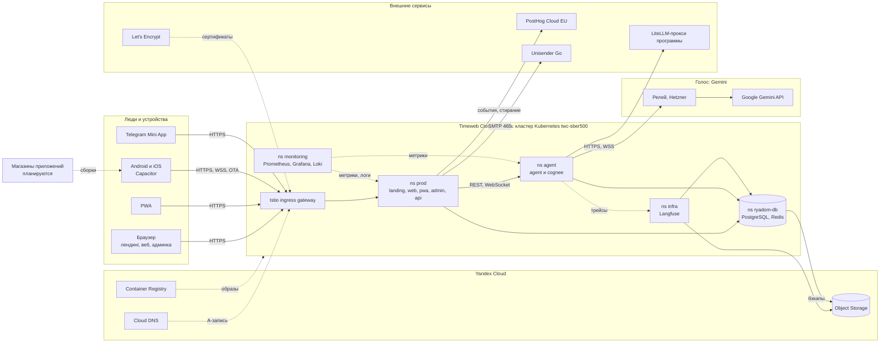
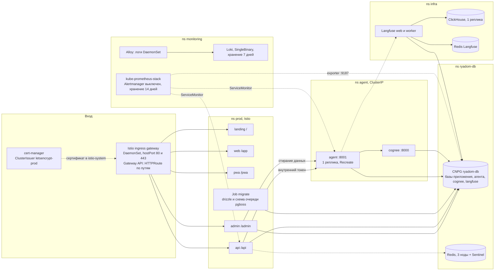
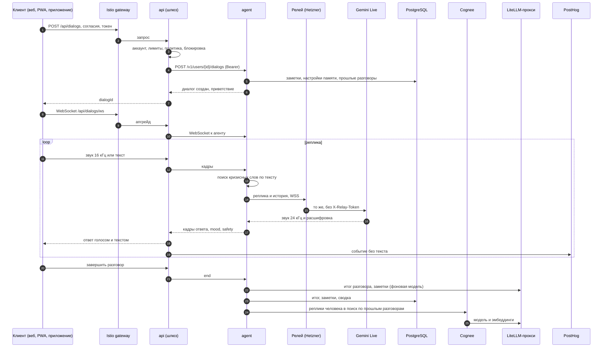
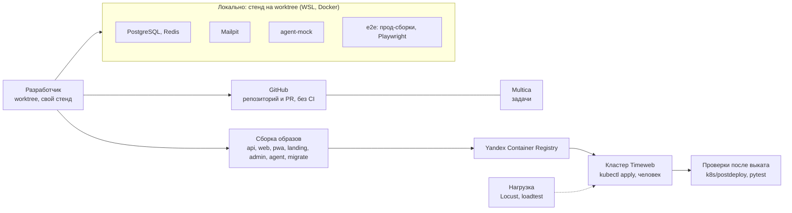

# Архитектура «Слышу Рядом»: карта систем

Полная карта: что где работает, в каком облаке, с кем интегрировано и что куда уходит. Диаграммы — Mermaid (GitHub
рисует их сам). Факты сняты с манифестов `k8s/`, конфигов `agent/` и `app/` и спек `openspec/specs/`; адреса, ключи и
идентификаторы сюда не выносятся. Подробности по разделам — `k8s/README.md`, `k8s/CLOUD-RESOURCES.md`, `agent/README.md`,
`agent/relay/README.md`, `docs/analytics.md`.

Окружение одно — прод; «локально» значит стенд разработчика (§6). Диаграммы проверены на рендер Mermaid.

## 1. Общая карта: кто в каком облаке

Куда уходят данные человека:

| Куда | Что уходит | Где это |
|---|---|---|
| Gemini через релей | голос и тексты разговора (Gemini Live — единственный голосовой путь) | за пределы РФ |
| LiteLLM-прокси программы | тексты разговора для итога и заметок, с маскированием персональных данных | внешний сервис |
| PostHog Cloud EU | события без текстов, ответов тестов и баллов | ЕС |
| Unisender Go | адрес почты и коды входа | внешний сервис |
| Langfuse (свой) | трейсы вызовов агента, только маскированный текст | наш кластер |

Агенту передаётся только `userId`: почта и имя остаются в приложении.

## 2. Кластер подробно

Сетевые правила (Calico, NetworkPolicy): агент принимает только `api` и `admin` из `prod`, на :8001; `agent` и `cognee`
ходят к прокси программы на :4000; из `prod` открыт исходящий SMTP на :465; `monitoring` по умолчанию закрыт на вход.

| Что | Как устроено |
|---|---|
| Маршрутизация | корень домена `слышу-рядом.рф`, поддоменов нет: `/` лендинг, `/app` веб, `/pwa` PWA, `/admin` админка, `/api` шлюз |
| Хранилище подов | диски NVMe Timeweb (CSI), удаление PVC удаляет диск: единственная копия PostgreSQL — бэкапы в Yandex S3 |
| Реплики | каждый сервис по одной (`api`, агент и Cognee — одна, сокеты привязаны к поду); фоновая работа `api` на очереди pg-boss может идти на нескольких |
| Образы | только из Yandex Container Registry (зеркало всех образов кластера, внешних реестров нет) |
| Секреты | Secrets кластера, значения хранит администратор, в git только шаблоны |

## 3. Путь разговора

Кризис проверяется кодом по тексту до показа ответа, без модели; при срабатывании идёт фиксированный ответ и кадр
`safety`, клиент открывает лист с линиями помощи.

## 4. Данные: что где лежит

| Хранилище | Что в нём | Срок |
|---|---|---|
| PostgreSQL: база приложения | аккаунты, согласия и их журналы, сессии, дневник настроения, итоги недели, результаты самопроверок, ссылки на разговоры, очередь pgboss | пока жив аккаунт; гость без визитов 90 дней стирается |
| PostgreSQL: база агента | разговоры и сообщения, итоги, заметки памяти, настройки, очередь для Cognee, расход моделей | разговоры 90 дней после последнего сообщения |
| PostgreSQL: база Cognee | граф и векторы поиска по прошлым разговорам | по сроку разговора |
| Redis (ryadom-db) | счётчики лимитов запросов (необязателен) | короткие окна |
| Langfuse: ClickHouse, Redis | трейсы агента, только маскированный текст | политика Langfuse |
| Yandex Object Storage | бэкапы PostgreSQL (WAL и base, 30 дней), файлы Langfuse | 30 дней для бэкапов |
| Prometheus, Loki | метрики 14 дней, логи 7 дней, без текстов реплик | 14 и 7 дней |
| PostHog Cloud EU | события без текстов; профиль стирается при удалении аккаунта | политика PostHog |
| Память процесса агента | открытый «не сохраняемый» разговор | до завершения или перезапуска |

## 5. Фоновая работа

| Где | Что | Как |
|---|---|---|
| `api` | чистка просроченных сессий, чистка гостевых аккаунтов, минутный проход итогов недели, сторож очередей | расписания pg-boss, один запуск на все реплики |
| `api` | стирание профиля в PostHog при удалении аккаунта, сброс итога недели после удаления разговора | задачи pg-boss, ставятся в транзакции удаления |
| `admin` | стирание профиля в PostHog при удалении администратором | производящий экземпляр pg-boss, воркеры в `api` |
| `agent` | срок хранения разговоров, физическая очистка помеченного (раз в 10 минут, выдержка час), выгрузка неактивных, очередь Cognee | циклы в процессе агента |

## 6. Сборка, доставка и разработка

- **Окружения.** Прод один; dev и stage не заведены. Локальный стенд на worktree (порты от слота) повторяет приложение
  с заглушкой агента и Mailpit вместо почты; e2e собирает прод-сборки приложений.
- **Выкат.** Образы собирает человек, кладёт в Yandex Container Registry, применяет манифесты и следит за выкатом; миграции
  идут отдельным Job (`migrate`) до `api`. Порядок и откат — скилл `deploy` и `k8s/README.md`.
- **Мобильные сборки.** Android и iOS на Capacitor собираются отдельно; JS-часть обновляется по воздуху (OTA), её раздаёт
  `api`; жёсткое и мягкое обновление управляется политикой релизов. В магазинах приложение пока не опубликовано.

## 7. Внешние сервисы: сводка

| Сервис | Роль | Протокол и точка | Если недоступен |
|---|---|---|---|
| Google Gemini (через релей Hetzner) | голос речь в речь, цвет шарика | HTTPS и WSS, `X-Relay-Token` | голоса нет, запасного пути нет: `VOICE_UNAVAILABLE`, текст идёт той же моделью |
| LiteLLM-прокси программы | фоновая модель (итоги, заметки), модели Cognee | HTTPS, порт 4000, ключ | разговор идёт, итоги и заметки откладываются |
| PostHog Cloud EU | аналитика | через прокси `/api/ingest`, серверный API для стирания | события теряются, стирание повторяется очередью |
| Unisender Go | письма: коды входа, подтверждение почты | SMTP, порт 465 | вход по коду из письма не работает |
| Let's Encrypt | сертификаты | HTTP-01 через cert-manager | при истечении сертификата сайт недоступен |
| Yandex Cloud | реестр образов, бэкапы, DNS | HTTPS | новые образы не подтянуть, DNS, бэкапы: см. `CLOUD-RESOURCES.md` |
| Telegram | клиент, в котором открывается Mini App; запуск подписан токеном бота | подпись `initData` проверяет `api` у себя, к Telegram не ходит | Mini App не открывается |
| Магазины приложений | дистрибуция Android и iOS | не подключены | веб и PWA работают |
