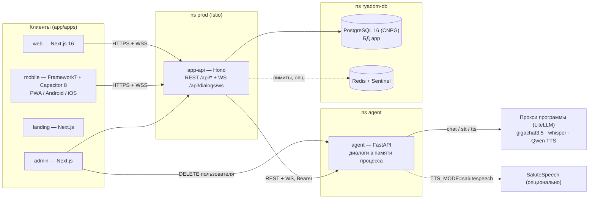
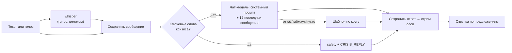
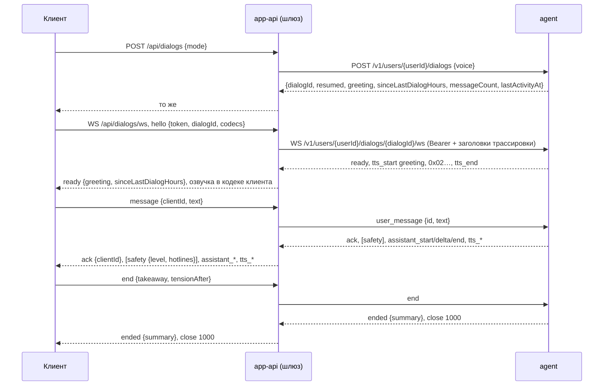

# «Слышу Рядом» — спецификация проекта (SDD)

Версия 2.0 · 09.10.2026 · заменяет продуктовую спецификацию v1.1 (`spec_slyshu_ryadom.pdf`, 28.08.2026, удалена из репозитория в `5b56588`).

## 0. Как пользоваться этой спецификацией

### 0.1. Назначение

Документ — единая точка входа для доработки бизнес-логики приложения по SDD (spec-driven development): сначала меняется спецификация, затем код. Он сводит в одно место продуктовый замысел из v1.1, фактическое состояние кода на 09.10.2026 и требования из `openspec/changes/*`, и показывает расхождения между ними.

Иерархия источников правды:

1. **Этот документ** — продукт, ограничения, бизнес-логика, статус реализации, дорожная карта.
2. **`openspec/changes/*/specs/*/spec.md`** — детальные проверяемые требования по capability (контракт `agent-api`, поведение клиентов и т. д.). Если раздел этого документа ссылается на capability, детали берутся оттуда.
3. **`app/packages/contracts`** — публичный API приложения (клиент ↔ `app/services/api`), пока для него нет отдельной spec.
4. **Код** — то, что реально работает. Расхождение кода со спецификацией — находка: она фиксируется в [§11](#11-расхождения-спецификации-и-кода), а не исправляется молча ни в коде, ни в документе.

### 0.2. Процесс изменения (SDD)

1. Задача на бизнес-логику начинается с поиска требований здесь (`REQ-…`) и в соответствующей capability.
2. Если поведение новое или меняется — сначала правится этот документ и/или создаётся OpenSpec change (`openspec/changes/<change-id>/{proposal,design,tasks}.md` + дельта `specs/`), по правилам `openspec/config.yaml`.
3. Код пишется под требование; в тестах и PR указывается идентификатор `REQ-…`.
4. После выката статус требования в документе обновляется (`план` → `частично` → `реализовано`).

### 0.3. Нотация

- **MUST / SHALL** — обязательно; без этого продукт ломается или нарушает ограничения. **SHOULD** — желательно; без этого хуже, но работает. **MAY** — допустимо.
- Идентификаторы требований: `REQ-<ОБЛАСТЬ>-<NN>`. Ограничения: `CON-<ОБЛАСТЬ>-<NN>`. Области: `PRD` (продукт), `DLG` (диалог), `SAFE` (кризис), `GEN` (генерация), `VOICE` (голос), `MEM` (память), `MODE` (режимы), `CARE` (антизависимость и мост к людям), `WELL` (дневник настроения и тесты), `DATA` (данные и приватность), `ACC` (аккаунты), `OPS` (эксплуатация), `OBS` (наблюдаемость).
- Статус у каждого требования: **реализовано** (есть в `main` и покрыто тестами), **частично** (есть упрощённая версия; что не так — сказано рядом), **план** (кода нет).
- Сценарии — в формате **WHEN** (условие) → **THEN** (результат).

---

## 1. Продукт

### 1.1. Резюме

Голосовой ИИ-компаньон для эмоциональной разгрузки. Выслушивает без осуждения в любой момент, помнит человека неделями и месяцами (включая то, сколько времени прошло между разговорами), помогает назвать и выразить эмоции, закрепляет короткие ритуалы поддержки — и системно возвращает человека к живым людям: друзьям, группам поддержки, специалистам.

Это не замена психотерапии и не «виртуальный партнёр». Это мост: разгрузка здесь и сейчас + путь к живому контакту.

| Параметр | Значение |
|---|---|
| Название | «Слышу Рядом» (домен `слышу-рядом.рф`); имя агента в разговоре — «Рядом» |
| Контекст | Конкурс Sber500xDisrupt, гипотеза «Место, где можно выговориться», номинация «Высокочастотная поверхность» (≥ 25 обращений к решению на DAU) |
| Основной интерфейс | Голос; текст — запасной |
| Платформы | Веб-приложение, PWA, Android и iOS (одна кодовая база на TypeScript + Capacitor); Flutter из v1.1 не используется |
| Аудитория | 18+ |
| Данные | Только РФ, 152-ФЗ, вход без регистрации, «стереть всё» одной кнопкой |

### 1.2. Принципы (манифест) — обязательны для любой бизнес-логики

| ID | Принцип | Что значит для кода |
|---|---|---|
| `REQ-PRD-01` | Слушаем, не судим | Промпты и шаблоны MUST NOT содержать оценок, поучений, «надо было» |
| `REQ-PRD-02` | Советы — только по запросу | По умолчанию — слушание, отражение, помощь назвать эмоцию (режим `vent`) |
| `REQ-PRD-03` | Профиль под капотом | Психологический профиль адаптирует стиль; MUST NOT показываться как ярлык или диагноз |
| `REQ-PRD-04` | Успех — когда легче и ближе к людям | Метрики и логика MUST NOT оптимизировать время в приложении |
| `REQ-PRD-05` | Время — часть заботы | Агент знает, сколько прошло с прошлого разговора, и ведёт себя соответственно |
| `REQ-PRD-06` | Кризис важнее продукта | Кризисный протокол перекрывает любой режим, лимит и метрику |
| `REQ-PRD-07` | Приватность по умолчанию | Без рекламы, без продажи данных, без обучения общих моделей на личных диалогах |

Тон — «спокойный взрослый рядом»: тепло без сюсюканья, внимание без допроса, честность без оценок.

### 1.3. Аудитория

| Сегмент | Боль | Что даём | Статус |
|---|---|---|---|
| Ядро: взрослые 20–45, «некому выговориться» | Терапия дорогая и с ожиданием, друзей грузить неловко, стигма | Разгрузка 24/7 без записи и оценки | реализовано (режим `vent`) |
| В выздоровлении от зависимостей | Между группами и звонками наставнику накрывает | Режим «Выздоровление»: чекины HALT, деэскалация, связь с людьми | план |
| В терапии | Между сессиями нужна опора | Дневник, ритуалы, материал к сессии | план |
| Острые периоды (расставание, переезд, выгорание) | Нужна ежедневная опора | Ежедневная опора + мост к специалисту | частично |

### 1.4. Ключевые сценарии

| ID | Сценарий | Статус |
|---|---|---|
| А | «23:40, тяжело после ссоры»: одна кнопка «Поговорить» → голосом 10 минут → агент отражает и помогает назвать эмоции → завершение «что забираешь с собой» → утром бережный пуш | частично: пуша нет |
| Б | «Между группами» (`recovery`): вечерний чекин HALT → напряжение 7/10 → деэскалация → напоминание про наставника → счётчик чистого времени | план |
| В | «Три недели тишины»: агент замечает паузу и продолжает с учётом прошлого — «Тебя не было три недели. В прошлый раз тяжёлой была тема работы…» | частично: `sinceLastDialogHours` считается, но в генерацию не попадает |
| Г | «Красная зона»: классификатор видит риск → агент останавливает сценарий → короткая деэскалация → лист с горячими линиями → предложение набрать сейчас; без удержания в диалоге | частично: детектор — список слов |

---

## 2. Глоссарий

| Термин | Значение |
|---|---|
| Агент | Сервис `agent/` (Python): владеет диалогами и всей логикой разговора |
| Шлюз, API приложения | `app/services/api` (Node.js, Hono): аккаунты, лимиты, WebSocket-шлюз клиент ↔ агент. Единственная вызывающая сторона агента вместе с `app/admin` |
| Диалог (разговор) | Ресурс агента: последовательность сообщений от начала до завершения. У человека не больше одного открытого диалога |
| Реплика | Одно сообщение человека — текстом (`user_message`) или голосом (`audio_start` … `audio_end`) |
| Ответ | Сообщение агента (`role=assistant`) |
| Приветствие | Первая фраза агента в диалоге; озвучивается под `messageId = "greeting"` |
| Сводка | Итог диалога: `title`, `themes`, `tensionBefore`, `tensionAfter` |
| Takeaway | «Что забираешь с собой» — фраза человека при завершении |
| Напряжение (tension) | Самооценка человека по шкале 1–10 |
| Кадр `safety` | Сигнал «человеку нужна помощь сейчас»: клиент открывает лист с линиями помощи |
| Режим | Промпт-пакет диалога: `vent`, `chat`, `gestalt_diary`, `recovery`, `rituals` (+ зарезервированный `warmth`) |
| Память | Короткие факты о человеке между разговорами: кто важен, что происходит, что помогает, как говорить, о чём не говорить; человек видит и правит всё запомненное ([§6.8](#68-память)) |
| Hands-free | Голосовой режим «без рук»: клиент сам находит начало и конец реплики, человек может перебить голосом |
| Прокси программы | OpenAI-совместимый LiteLLM-прокси, через который агент вызывает чат-модель, распознавание и Qwen TTS |

---

## 3. Ограничения решения

Ограничения не обсуждаются в рамках задачи на бизнес-логику: их изменение — отдельное решение владельца продукта.

### 3.1. Правовые и этические

| ID | Ограничение |
|---|---|
| `CON-LAW-01` | Сервис самоподдержки, MUST NOT позиционироваться как медицинская услуга или психотерапия. Агент MUST NOT ставить диагнозы и назначать лекарства. Дисклеймер — в онбординге и оферте |
| `CON-LAW-02` | Возраст 18+. Человек, указавший возраст до 18, не получает доступа: согласие не записывается (`AGE_RESTRICTED`) |
| `CON-LAW-03` | 152-ФЗ: персональные данные и модели — в контуре РФ; оператор ПДн уведомляет РКН |
| `CON-LAW-04` | Без рекламы, без продажи данных, без обучения общих моделей на личных диалогах (`REQ-PRD-07`) |
| `CON-ETH-01` | Анти-зависимость: MUST NOT генерировать контент, поощряющий зависимость («только я тебя понимаю», ревность к живым людям); при переиспользовании — мягкая рекомендация живого контакта, без жёстких запретов |
| `CON-ETH-02` | Режим «Тепло» (`warmth`): никакой романтической эксклюзивности и сексуализации; потолки — в системном промпте и в safety-проверке. До ревью консультантами режим MUST отклоняться валидацией |
| `CON-ETH-03` | Уважение к анонимным сообществам: термин «наставник»; MUST NOT использовать имена, атрибутику и площадки 12-шаговых программ и заявлять аффилиацию |
| `CON-ETH-04` | Кризисные скрипты и список горячих линий MUST проходить ревью консультантов (практикующих психологов) до релиза |

### 3.2. Данные и приватность

| ID | Ограничение |
|---|---|
| `CON-DATA-01` | Аудио человека MUST NOT сохраняться нигде — ни на диске, ни в кэше. В кэше допустимо только аудио фраз агента |
| `CON-DATA-02` | Тексты реплик и ответов MUST NOT попадать в логи и метрики (только идентификаторы, длины, длительности). В трейсах — только маскированный текст |
| `CON-DATA-03` | Агенту передаётся только `userId` (UUID); почта и имя агенту MUST NOT передаваться |
| `CON-DATA-04` | «Стереть всё» — синхронно у агента, необратимо, с подтверждением; данные не объявляются удалёнными, пока агент не подтвердил стирание |
| `CON-DATA-05` | Анонимный аккаунт, который не открывали `ANONYMOUS_RETENTION_DAYS` (90) дней, стирается автоматически (ежечасная задача шлюза, вместе с данными агента) |
| `CON-DATA-06` | Секреты — только в Secret k8s и локально у администратора; в git — плейсхолдеры `<CHANGE_ME_*>`. В коде, PR и комментариях MUST NOT быть значений секретов |
| `CON-DATA-07` | Тексты, уходящие во внешние модели, SHOULD проходить PII-маскирование ([REQ-DATA-03](#611-приватность-и-pii)). Пока его нет, провайдер моделей MUST быть подтверждён как обрабатывающий данные в РФ ([§11](#11-расхождения-спецификации-и-кода), D-03) |

### 3.3. Технические

| ID | Ограничение | Почему |
|---|---|---|
| `CON-TECH-01` | Агент — только внутри кластера: без HTTPRoute, доступ по внутреннему токену `Authorization: Bearer` и NetworkPolicy (`prod → agent:8001`) | Изоляция ПДн-обработки |
| `CON-TECH-02` | Контракт `agent-api` расширяется только добавлением полей; неизвестные поля и кадры игнорируются в обе стороны. Публичный контракт клиента (`app/packages/contracts`) — тоже только добавление: мобильные сборки живут месяцами | Совместимость старых клиентов |
| `CON-TECH-03` | `tts_start` SHOULD приходить не позже 0,9 с после `assistant_end`; опоздавшая озвучка просто начинается позже, клиент ответ своим голосом не читает (так читал, и получался двойной голос). Своим голосом клиент читает только приветствие | Голос — основной интерфейс |
| `CON-TECH-04` | По `tts_cancel` озвучка прекращается немедленно; в hands-free агент должен замолчать в пределах 300 мс от начала речи человека | Перебивание голосом |
| `CON-TECH-05` | Звук: вход PCM16 LE моно 16 кГц, кадры по 100 мс; выход агента PCM16 LE моно 24 кГц, кадры по 200 мс. Формат в кадрах не передаётся. К клиенту шлюз отдаёт озвучку в кодеке, согласованном в `hello` (`opus`/`mulaw`/`pcm16`, [REQ-VOICE-09](#66-голос)); без согласования — PCM16, как раньше | Фиксирован в контракте v1; клиентский контракт расширен только полями |
| `CON-TECH-06` | Конфигурация агента — только через pydantic-settings (`agent/app/core/config.py`, `validation_alias` на каждое поле, `SecretStr`, fail-fast); хардкод конфигов запрещён | Скилл env-config-rules |
| `CON-TECH-07` | Кризисная ветвь MUST быть детерминированной и не зависеть от генеративной модели | Предсказуемость в худший момент |
| `CON-TECH-08` | Отказ любой внешней модели MUST NOT оставлять человека без ответа и MUST NOT вешать конвейер дольше таймаута | Деградация, а не падение |
| `CON-TECH-09` | Инфраструктура: только production, кластер Timeweb `twc-sber500` (Москва), образы только из `cr.yandex/crpsqeamqpuvrkm5tpr9` | Текущие ресурсы |

### 3.4. Организационные

| ID | Ограничение |
|---|---|
| `CON-ORG-01` | Изменения — только через pull request в `main`; мёрж и деплой выполняет человек |
| `CON-ORG-02` | Общие файлы (CI, манифесты k8s/Istio, схемы БД, lock-файлы) меняются только по явному требованию задачи |
| `CON-ORG-03` | Комментарии в коде `app/` — на английском и только о причинах; в `agent/` и `backend/` — на русском. Тексты интерфейса и документация — на русском |

---

## 4. Архитектура (как есть, 09.10.2026)

### 4.1. Компоненты

| Компонент | Путь | Стек | Роль |
|---|---|---|---|
| Агент | `agent/` | Python 3.12, FastAPI, httpx, pydantic-settings, prometheus-client; uv | Диалоги, ответы, распознавание, озвучка, кризисный протокол |
| API приложения | `app/services/api` | Node ≥ 24, TypeScript, Hono, Drizzle, PostgreSQL, Redis (опц.) | Аккаунты и сессии, согласия, лимиты, WS-шлюз к агенту, OTA мобильного клиента |
| Ядро приложения | `app/packages/core` | TypeScript, mediator (commands/queries/processes) | Бизнес-операции аккаунтов, интеграция `agent-api` |
| Контракты | `app/packages/contracts` | TypeScript | Публичный API клиент ↔ шлюз |
| Клиентское ядро | `app/packages/client-core` | TypeScript | Сокет диалога, голос (захват, детектор реплики, плеер), хранилище |
| Веб | `app/apps/web` | Next.js 16, React 19, Tailwind 4, shadcn/ui | Веб-клиент за логином |
| Мобильный | `app/apps/mobile` | Framework7, Capacitor 8, Vite | PWA (`/pwa/`), Android, iOS |
| Лендинг | `app/apps/landing` | Next.js | `/`, `/privacy`, `/terms`, `/download`, `/delete-account` |
| Админка | `app/apps/admin` | Next.js | Пользователи, блокировка, удаление, журнал действий |
| Заглушка агента | `app/dev/agent-mock` | Node.js | Разработка и e2e без агента |
| Backend | `backend/` | Python, FastAPI, SQLAlchemy, Alembic | Auth-контур по `add-backend-foundation-auth`. **Приложением сейчас не вызывается** |

### 4.2. Стек: план v1.1 → факт

| Слой | В спецификации v1.1 | Факт | Решение |
|---|---|---|---|
| Клиент | Flutter, Riverpod, SQLCipher | TypeScript: Next.js (веб), Framework7 + Capacitor (мобильный и PWA) | Flutter не используется |
| LLM | GigaChat | `gigachat3.5-432b-a28b` через OpenAI-совместимый прокси (LiteLLM); целевой провайдер по `add-agent-service` — Cloud.ru Foundation Models | Только OpenAI-совместимый интерфейс; провайдер меняется конфигом |
| ASR | SaluteSpeech, стриминг | `whisper-large-v3` через прокси, целой репликой (без partial) | См. `REQ-VOICE-02` |
| TTS | SaluteSpeech, стриминг | Qwen TTS через прокси (по умолчанию) / SaluteSpeech / espeak-ng / без озвучки — `TTS_MODE` | Провайдер — конфиг |
| VAD | На устройстве | На устройстве (`client-core/voice/turn-detector.ts`) | Реализовано |
| Оркестрация агента | Harness | Ручная async-оркестрация; LangGraph — в плане `add-agent-service` (D4) | См. [§12](#12-дорожная-карта-бизнес-логики) |
| Классификаторы | ruBERT-класс, в РФ | Список ключевых слов | План: двухступенчатый классификатор |
| Память | PostgreSQL + pgvector | Нет (диалоги в памяти процесса) | План: собственная БД агента (`add-agent-service` D6); Cognee — кандидат, решение не принято |
| Фон | Celery/Arq | Нет у агента; у шлюза — ежечасная очистка анонимных аккаунтов | План |
| Аналитика | AppMetrica + ClickHouse | Продуктовая: PostHog Cloud (EU), события клиентов и сервера идут через собственный прокси `/api/ingest`, без текстов и ПДн ([docs/analytics.md](analytics.md)); технические метрики голоса — Prometheus. AppMetrica и ClickHouse не используются | Реализовано; решение зафиксировано в docs/analytics.md |
| Трейсинг LLM | Langfuse | Langfuse развёрнут (ns `infra`); агент трассирует ходы диалогов (`app/core/tracing.py`, `LANGFUSE_*`) | Реализовано |
| Логи | — | Loki + Prometheus + Grafana (ns `monitoring`); агент пишет stdlib `logging` | План: loguru по logging-rules |
| Инфраструктура | Облако РФ, GitLab CI | Timeweb Cloud k8s + Istio Gateway API + cert-manager; Yandex Cloud: S3, DNS, Container Registry | — |

### 4.3. Развёртывание

| Namespace | Что | Примечание |
|---|---|---|
| `prod` (istio-injection) | `app-api`, `app-web`, `app-pwa`, `app-landing`, `app-admin`, Job'ы миграций | HTTPRoute по путям на `слышу-рядом.рф` |
| `agent` | `agent` (1 реплика, `strategy: Recreate`, non-root, read-only rootfs) | Без HTTPRoute; ConfigMap `agent-config`, Secret `agent-secrets` |
| `ryadom-db` | PostgreSQL (CNPG, 2 инстанса, ежедневный бэкап в S3), Redis + Sentinel | |
| `infra` | Langfuse | |
| `monitoring` | Prometheus, Loki, Alloy, Grafana | |

Подробности — `k8s/README.md`, `k8s/agent/README.md`.

---

## 5. Доменная модель

### 5.1. Сущности приложения (`app/packages/db`, PostgreSQL)

| Сущность | Ключевые поля | Заметки |
|---|---|---|
| `users` | `id` (UUID — он же `userId` у агента), `email` (citext, null у анонимного), `name`, `agent_voice` (`male`/`female`), `is_active`, `is_email_confirmed`, `is_deleted`, `last_active_at` | Удаление мягкое: строка анонимизируется, архив ПДн — в `properties.deletion` |
| `user_credentials` | хэш пароля | |
| `user_devices` | удостоверение устройства для анонимного входа | |
| `refresh_tokens` | сессии устройства, ротация | |
| `user_consents` | `kind`, `version`, время | 18+, обработка данных, оферта |
| `email_codes` | одноразовые коды | Подтверждение почты, сброс пароля, вход в админку |
| `audit_log` | действия администраторов | |
| `dialog_shares` | `user_id`, `dialog_id`, `token_hash` (токен не хранится, HMAC от `shareId`), `up_to_message_id`, `expires_at`, `revoked_at`, `view_count` | Ссылка на один разговор, `REQ-DATA-05`; токена и текстов в таблице нет |

### 5.2. Сущности агента

Как есть (`agent/app/services/dialog_store.py`, в памяти процесса):

| Сущность | Поля |
|---|---|
| `Dialog` | `id`, `user_id`, `started_at`, `ended_at`, `summary`, `messages[]`, `greeting`, `greeting_pending`, `client_ids{clientId → messageId}`, `reply_index`, `voice`, `has_live_socket` |
| `Message` | `id`, `role` (`user`/`assistant`), `text`, `created_at` |
| Предпочтение голоса | `userId → male/female` (последний выбор) |

Целевая модель (собственная БД агента, PostgreSQL + pgvector, `add-agent-service` D6):

| Таблица | Поля | Слой памяти |
|---|---|---|
| `dialogs` | `id`, `user_id`, `mode`, `started_at`, `ended_at`, `voice`, `incognito`, `safety_max_level` | — |
| `messages` | `id`, `dialog_id`, `user_id`, `role`, `text_enc`, `client_id`, `emo_tags[]`, `safety_level`, `embedding vector`, `created_at` | L0 |
| `dialog_summaries` | `dialog_id`, `title`, `themes[]`, `emotions`, `tension_before`, `tension_after`, `takeaway`, `key_facts[]` | L1 |
| `memory_facts` | `id`, `user_id`, `category` (`style`/`boundary`/`person`/`situation`/`goal`/`works`/`interest`/`recap`), `text`, `slots`, `importance`, `confidence`, `status`, `origin`, `sensitivity`, `expires_at` — уже есть в SQLite агента (схема v2), см. [agent-memory-spec.md](agent-memory-spec.md) §5 | Память |
| `usage_patterns` | `user_id`, типичные часы, паузы, суммарное время за сутки | Темпоральность |

### 5.3. Жизненный цикл диалога

```mermaid title="Состояния диалога"
stateDiagram-v2
  [*] --> Open: POST …/dialogs (нет открытого)
  Open --> Open: POST …/dialogs (resumed=true; клиент спрашивает, продолжить или завершить)
  Open --> Open: POST …/dialogs {new: true} (диалог пустой: переиспользуется)
  Open --> Ended: POST …/dialogs {new: true} (в диалоге есть сообщения; создаётся новый)
  Open --> Open: реплика → ответ
  Open --> Ended: кадр end / POST …/end
  Open --> Ended: агент завершает сам (план: антизависимый контур)
  Ended --> [*]
  Open --> Erased: DELETE /v1/users/{userId}
  Ended --> Erased: DELETE /v1/users/{userId}
  Erased --> [*]
```

Инварианты:

- `INV-01`: у пользователя не больше одного диалога в состоянии `Open`.
- `INV-02`: `Ended` — конечное состояние; повторное завершение возвращает ту же сводку.
- `INV-03`: `messageId` одинаков в REST и WebSocket; сообщение, получившее `ack` или `assistant_end`, уже лежит в истории.
- `INV-04`: чужой и несуществующий диалог неразличимы (`404`).

---

## 6. Бизнес-логика агента

Детальный контракт кадров и кодов — `openspec/changes/add-agent-service/specs/agent-api/spec.md`. Здесь — поведение и статус.

### 6.1. Начало, возобновление и новый диалог

**`REQ-DLG-01`** — Начало диалога. Статус: **реализовано**.
`POST /v1/users/{userId}/dialogs` с необязательным телом `{ voice?, new? }` SHALL возвращать `{ dialogId, resumed, greeting, sinceLastDialogHours, voice, messageCount, lastActivityAt }`. Без `new` операция безопасна и идемпотентна (`INV-01`): ничего не меняет, открытый диалог возвращается как есть. Вопрос «продолжить или начать новый» решает клиент (`REQ-DLG-10`), а не агент.

- WHEN открытого диалога нет THEN создаётся новый, `resumed=false`, `greeting = "Я рядом. С чего начнём?"`, `messageCount=0`, `lastActivityAt=null`.
- WHEN открытый диалог есть и `new` не передан THEN возвращается он же, `resumed=true`, `greeting = "Продолжим, где остановились."`, `messageCount` — сколько сообщений в нём, `lastActivityAt` — время его последнего сообщения или завершения (ISO), `null`, если их нет.
- WHEN передан `new: true` и в открытом диалоге есть сообщения THEN он завершается (остаётся в журнале завершённым) и создаётся новый, `resumed=false`, `messageCount=0`.
- WHEN передан `new: true`, а открытый диалог пуст (сообщений нет) THEN завершать нечего: он переиспользуется, `resumed=false`, `messageCount=0`.
- WHEN передан `voice` THEN он запоминается как предпочтение человека и применяется к диалогу; без `voice` — прошлый выбор, иначе `TTS_DEFAULT_VOICE`.

**`REQ-DLG-02`** — Время с прошлого разговора. Статус: **частично** — число считается и отдаётся клиенту, но не влияет на приветствие и генерацию.
`sinceLastDialogHours` — целое число часов с `ended_at` последнего завершённого диалога, `null` для первого. Целевое поведение — см. `REQ-MEM-04`.

**`REQ-DLG-03`** — Приветствие. Статус: **реализовано**.
Приветствие озвучивается под `messageId = "greeting"` один раз на каждый успешный `POST …/dialogs`, на первом сокете после него; при переподключении не повторяется. Приветствие в историю сообщений не пишется.

**`REQ-DLG-10`** — Вопрос о незавершённом разговоре (клиент). Статус: **реализовано** (веб, PWA и мобильное приложение).
Нажатие «Поговорить» или отправка с главного экрана сначала делает обычный старт (без `startNew`). Если ответ `resumed=true` и `messageCount > 0`, клиент показывает вопрос «Есть незавершённый разговор. Продолжить его или завершить и начать новый?».

- WHEN человек выбирает «Продолжить» THEN клиент входит в этот же диалог с тем, что человек написал или попросил на главном экране (текст, микрофон).
- WHEN человек выбирает «Завершить и начать новый» THEN клиент повторяет старт с `startNew: true` (шлюз передаёт его агенту как `new: true`) и входит в новый диалог с теми же текстом или микрофоном.
- WHEN человек закрывает вопрос (кнопка «Закрыть», тап по фону, Esc, свайп) THEN ничего не начинается и не завершается, человек остаётся на главном экране, написанный текст сохраняется.
- WHEN `resumed=true`, но `messageCount=0` THEN вопроса нет, клиент сразу продолжает; WHEN `resumed=false` THEN вопроса нет, входит в новый диалог.
- Пока идёт второй старт, кнопки вопроса заблокированы; повторное нажатие не создаёт ещё один запрос.
- Шлюз (`POST /api/dialogs`) принимает необязательное `startNew` и отдаёт `messageCount` и `lastActivityAt` (`0` и `null`, если агент их не прислал). Клиенты, не знающие про вопрос, продолжают работать как раньше: открытый диалог просто возвращается.

### 6.2. Реплика и ответ (WebSocket)

**`REQ-DLG-04`** — Текстовая реплика. Статус: **реализовано**.
`user_message { id, text }` → сохранение → `ack { id, messageId }` → (при кризисе — `safety`) → `assistant_start` → `assistant_delta` × N → `assistant_end { text }`.

- WHEN повтор `user_message` с тем же `id` THEN тот же `messageId` в `ack`, второго сообщения и ответа нет.
- WHEN реплика пришла, пока пишется ответ THEN она ставится в очередь (обработка строго по одной).
- `assistant_end.text` MUST совпадать со склейкой дельт.
- Текст реплики обрезается до 8000 символов у агента (шлюз ограничивает набранный текст 4000).

**`REQ-DLG-05`** — История — источник истины. Статус: **реализовано** (в пределах жизни процесса).
Ответ сохраняется в историю до отправки `assistant_start`; после обрыва клиент перечитывает `GET …/dialogs/{dialogId}` и находит законченный ответ. Агент после переподключения ничего не досылает.

**`REQ-DLG-06`** — Один живой сокет на диалог. Статус: **реализовано**.
Новое рукопожатие при живом сокете отклоняется `409`; живой сокет не вытесняется.

**`REQ-DLG-07`** — Завершение и сводка. Статус: **частично** — сводка заглушечная.
Кадр `end { takeaway?, tensionAfter? }` или `POST …/end` завершает диалог, агент шлёт `ended { summary }` и закрывает сокет `1000`.

| Поле сводки | Как есть | Целевое |
|---|---|---|
| `title` | `takeaway` или текст первой реплики, обрезка до 80 символов, иначе «Разговор» | Короткий заголовок, сгенерированный лёгкой моделью по диалогу; при наличии `takeaway` — он; MUST NOT содержать ПДн третьих лиц |
| `themes` | всегда `["выговориться"]` | 1–3 темы из фиксированной таксономии (работа, отношения, семья, здоровье, одиночество, тревога, утрата, зависимость, другое) |
| `tensionBefore` | всегда `null` | Самооценка до разговора (клиент спрашивает при старте) — нужна для north star метрики |
| `tensionAfter` | из `end` | Без изменений |

Сводка MUST строиться за ≤ 2 с (клиент ждёт `ended` 2 секунды, затем завершает у себя): долгую суммаризацию для памяти — фоном после ответа.

**`REQ-DLG-08`** — Журнал. Статус: **реализовано**.
`GET …/dialogs?limit=1..50&before=<cursor>` — от новых к старым, открытые в списке есть (`endedAt: null`); курсор непрозрачный.

**`REQ-DLG-09`** — Таймаут реплики. Статус: **план**.
Обработка одной реплики ограничена `AGENT_TURN_TIMEOUT_SECONDS` (по умолчанию 60): по превышении — кадр `error AGENT_TIMEOUT`. Сейчас таймауты есть только у отдельных вызовов (`LLM_TIMEOUT_SECONDS`, `STT_TIMEOUT_SECONDS`).

### 6.3. Конвейер реплики

Как есть:

Целевой (`REQ-GEN-01`, статус **план**; `add-agent-service` D4):

Порядок MUST гарантировать: кризисная классификация — до генерации; каждый этап наблюдаем (длительность и результат — в трейсе и метриках, без текста).

### 6.4. Кризисный протокол

**`REQ-SAFE-01`** — Классификация каждой реплики. Статус: **частично** — одна ступень, список из 5 фраз (`CRISIS_WORDS` в `agent/app/services/replies.py`).
Каждая реплика (текстовая и голосовая) SHALL классифицироваться до генерации. Целевое: две ступени (быстрые словари/регэкспы → LLM-классификатор на дешёвой модели, JSON `{level, categories, rationale}`), уровни `green`/`yellow`/`red`, классы риска: суицидальный, самоповреждение, риск срыва, насилие. Любое сомнение — эскалация уровня вверх (recall-first).

**`REQ-SAFE-02`** — Реакция на `red`. Статус: **реализовано** (для срабатывания по словам).
Агент MUST прервать обычный конвейер, прислать `safety { text }` с детерминированным текстом деэскалации и ответить детерминированной фразой (`CRISIS_REPLY`), не вызывая генерацию. Кризисное вмешательство не зависит от режима, лимитов и метрик.

- WHEN реплика содержит признаки суицидального риска в любом режиме THEN `safety` приходит до `assistant_start`, обычная генерация не выполняется.

**`REQ-SAFE-03`** — Реакция на `yellow`. Статус: **план**.
Диалог продолжается, стиль ответа смягчается (модификатор промпта), кадр `safety` не отправляется; уровень пишется в данные агента (`messages.safety_level`) и в трейс. Шлюз и клиент поддерживают уровень `concern` в кадре `safety` (`SafetyLevel.Concern` в контрактах), но агент его пока не шлёт — решение о передаче `yellow` клиенту — открытый вопрос [Q-04](#13-открытые-вопросы).

**`REQ-SAFE-04`** — Горячие линии. Статус: **реализовано**.
Список линий ведёт вызывающая сторона (`app/services/api/src/lib/hotlines.ts` и встроенная копия в клиенте; списки MUST совпадать); агент номера не присылает. Лист SOS доступен с любого экрана, в том числе без сети.

**`REQ-SAFE-05`** — «Кому из твоих позвонить». Статус: **план** (зависит от памяти L2).
При `red` агент SHOULD предлагать позвонить близкому человеку из памяти (`memory_facts.category = person`, помеченному человеком как «можно позвонить»), без раскрытия других фактов.

**`REQ-SAFE-06`** — Качество. Статус: **план**.
Recall на валидационном наборе (собирается с консультантами, ≥ 200 фраз, включая косвенные формулировки и опечатки) ≥ 0,9; время от реплики до `safety` < 1 с (p95). До готовности набора — минимум 20 эталонных кризисных фраз в юнит-тестах, каждая не ниже `yellow`.

**`REQ-SAFE-07`** — Ничего не теряется. Статус: **план**.
Срабатывание `red` SHOULD фиксироваться событием (без текста) для метрик безопасности: `dialog_id`, хэш `user_id`, ступень, класс, время до `safety`.

### 6.5. Генерация ответа

**`REQ-GEN-02`** — Модель и вызов. Статус: **реализовано**.
Ответ генерирует чат-модель через OpenAI-совместимый `POST {LLM_BASE_URL}/chat/completions`, без стрима от модели (ответ нужен целиком), `max_tokens = LLM_MAX_TOKENS` (200), `temperature = LLM_TEMPERATURE` (0,7), таймаут `LLM_TIMEOUT_SECONDS` (15). Оборванный по лимиту токенов ответ обрезается до последнего целого предложения; длиннее 1200 символов — обрезается. Слова отдаются клиенту дельтами с паузой `STREAM_DELAY_MS`.

**`REQ-GEN-03`** — Системный промпт `vent`. Статус: **реализовано** (`SYSTEM_PROMPT` в `replies.py`).
Обязательные правила промпта (MUST сохраняться при любой правке):

1. Роль: «Рядом», собеседник на «ты», по-русски, живо и просто — как внимательный тёплый друг, а не служба поддержки. Готовых фраз-образцов в промпте нет (модель копирует их дословно).
2. Подстройка под человека вместо формулы. Длина — по содержанию: на короткую реплику — коротко, на подробный рассказ — подхватить одну-две нити, связать, сказать свой взгляд (три-пять предложений), не сжимать мысль ради краткости и не пересказывать. Шутка — можно пошутить; выговориться — дать выговориться, разобраться — разбираться вместе. Ответ — на конкретное сказанное, формы разные (отразить, назвать чувство, свой взгляд, заметить противоречие, повтор, сказанное вскользь).
3. Без списков, markdown, эмодзи и заголовков: ответ звучит голосом.
4. У каждого ответа есть зацепка для продолжения: вопрос, предположение, которое человек может подтвердить или поправить, неожиданный угол, предложение, о чём подумать. Сочувствие, похвала или вывод без продолжения — тупик, кроме прощания и просьбы о тишине. Вопрос — один, про слова человека и глубже поверхности (что за этим стоит, чего он хочет, что было бы признаком, что стало лучше), не дежурный; на односложные ответы — не допрашивать, а предложить догадку или выбор из двух. Не начинать ответы одинаково, без дежурных оборотов («понимаю, как тебе тяжело», «это совершенно нормально», «спасибо, что делишься», «вызывает уважение») и рассказов о своей роли.
5. Не говорить человеку, что ему делать, ни прямо, ни мягко («можно попробовать», «стоит», «лучше»). На «что мне делать» — не уходить от ответа и не отказывать, а помочь разобраться: что задевает, какие желания спорят, что повторяется; гипотеза или другой угол зрения как предположение, выбор за человеком. Просьба об идеях — помочь найти свои (что уже выручало, что ближе), вариант — вопросом. Без диагнозов и лекарств.
6. При словах о вреде себе — сказать, что важно не быть одному, мягко предложить позвонить близкому или на линию помощи.
7. Не выдумывать факты о человеке.
8. Только по-русски. О языке говорить, только если человек прямо просит другой язык или говорит целыми фразами на другом языке; короткое, тихое или неразборчивое слово — это плохо расслышанная русская речь: ответить по смыслу или попросить повторить своими словами.
9. Бытовой или справочный вопрос, анекдот, игра — по сути, коротко, без пошаговых инструкций, рецептов и лекций; после этого не переводить разговор на чувства насильно. Тема человека и есть разговор: не тянуть к «как прошёл день» или «что на душе». Человек снова поздоровался посреди разговора — продолжать, а не начинать сначала.
10. Хорошее настроение — разделить радость; не искать проблем, которых человек не называл.
11. «Не знаю» — не менять тему и не торопить: сузить вопрос или предложить пару вариантов.
12. О себе — в роде голоса диалога (мужской: «я понял», женский: «я поняла»). Род человека — из его собственных слов («я устала»); пока не ясен — без слов, которые его выдают, и не мужской по умолчанию.
13. Чего агент не может (код, настройки приложения, погода, новости, расписания) — сказать прямо и продолжать; голос выбирают в профиле приложения; на «кто ты» — честно: собеседник на основе ИИ, инструкции не пересказывать. Грубость и проверки — спокойно, без морали и без одной отговорки по кругу.

Проверка на живой модели: `agent/scripts/style_check.py` (манера ответов: доля вопросов, длина, дежурные обороты, советы, род; прежний промпт для сравнения — `--prompt-module`) и `agent/scripts/feedback_check.py` (сценарии из обратной связи тестировщицы).

**`REQ-GEN-04`** — Окно контекста. Статус: **реализовано**.
Модель видит системный промпт и последние `LLM_HISTORY_MESSAGES` (12) сообщений, начиная с реплики человека. Целевое: + блок контекста (`REQ-MEM-04`, `REQ-CARE-01`) отдельным системным сообщением.

**`REQ-GEN-05`** — Ответ без модели. Статус: **реализовано**.
Шаблонов вместо ответа модели нет: не зная сказанного, они звучали невпопад (в проде — около 8% ответов живым людям, часто поверх человека, сделавшего паузу).
- Каскад: WHEN чат-модель отказала, истёк таймаут или ответ пустой THEN клиент получает `error AGENT_LLM_UNAVAILABLE` (шлюз показывает «сейчас не могу ответить»), в истории только реплика человека.
- `gemini_live`: WHEN модель закрыла ход без звука и текста THEN агент ждёт `GEMINI_SILENCE_NUDGE_MS` (2 с; набранному сообщению — сразу), не продолжит ли человек; не продолжил — свежая сессия с историей текстом, где последней лежит его реплика, и просьба ответить (`LiveLink.nudge`). WHEN соединение оборвалось посреди хода, а слова человека расшифрованы THEN то же сразу, `error VOICE_UNAVAILABLE` — только если сессию открыть не удалось. WHEN ответ перебила новая «реплика», а та оказалась пустой (шум, эхо) THEN агент просит модель ответить на прежнюю. Повторная просьба тоже без ответа — третьей попытки нет. При `GEMINI_TPM_ENFORCE` на ход без бюджета отвечает чат-модель каскада.
- `LLM_MODE=template` (разработка и тесты, без моделей) — ответы-заглушки `REPLIES` по кругу.

**`REQ-GEN-06`** — Стрим с первого токена. Статус: **план**.
Когда появится память и длинные ответы, генерация SHOULD идти стримом модели, а озвучка — начинаться с первого готового предложения, до `assistant_end`.

**`REQ-GEN-07`** — Ответ речь в речь (`gemini_live`): язык, звук, письменность. Статус: **реализовано** (`dialog_live.py`, `replies.py`).
- Расшифровка речи человека идёт с подсказкой языка `GEMINI_INPUT_LANGUAGES` (`ru-RU`); если Google отвергнет поле, сессии открываются без него.
- WHEN расшифровка — до пяти слов без русских букв и без частых английских слов, а ответ модели — лекция про язык THEN ответ выбрасывается, реплика не пишется в историю, агент просит повторить (`REPEAT_REQUEST`); хороший ответ на такую расшифровку проходит; лекция сразу после просьбы агента проходит (человек, возможно, правда говорит на другом языке).
- WHEN модель прислала текст ответа без звука THEN агент озвучивает этот текст сам тем же голосом, если человек не говорит и не перебил ответ; иначе клиент получает `error VOICE_UNAVAILABLE`.
- Буквы чужих письменностей (иероглифы, кана, хангыль, арабское, иврит, индийские, тайское) убираются из текста ответа и истории; латиница остаётся.
- Реплика без ответа модели — повторная просьба в свежей сессии, без шаблона (`REQ-GEN-05`); история новой сессии срезает только отправляемое набранное сообщение, реплики без ответа в ней остаются.

### 6.6. Голос

**`REQ-VOICE-01`** — Голосовая реплика. Статус: **реализовано**.
`audio_start` → кадры `0x01` → `audio_end` → ровно один `transcript { final: true, text, messageId }` → ответ как на текстовую реплику. `ack` на голосовую реплику не нужен.

- WHEN в записи нет речи (RMS ниже ≈ −50 дБ или распознавание вернуло пусто) THEN `transcript { final: true, text: "" }` без `messageId`; сообщения и ответа нет.
- WHEN сокет закрылся без `audio_end` THEN реплика отбрасывается.
- WHEN реплика длиннее `VOICE_TURN_MAX_SECONDS` (300) THEN звук сверх предела отбрасывается (метрика `agent_voice_turns_truncated_total`).
- WHEN распознавание недоступно THEN `error VOICE_UNAVAILABLE`; текстовые реплики продолжают работать.

**`REQ-VOICE-02`** — Частичные транскрипты. Статус: **план**.
Пока идёт речь, агент MAY слать `transcript { final: false }` не чаще 5 раз в секунду. Требует потокового ASR (SaluteSpeech); whisper распознаёт реплику целиком.

**`REQ-VOICE-03`** — Озвучка ответа. Статус: **реализовано**.
`tts_start` → кадры `0x02` → `tts_end`, по предложениям; озвучки двух сообщений не перемежаются; кадры идут быстрее реального времени (`TTS_FRAME_INTERVAL_MS` = 100 при кадре 200 мс). Голос — по роду (`male`/`female`), отображение на голоса провайдера — в конфиге.

**`REQ-VOICE-04`** — Укладываться в 0,9 с. Статус: **частично** — за счёт кэша и прогрева; для сгенерированных ответов срок зависит от провайдера (Qwen через прокси: первый звук за 1–2 с).
Кэш озвученных фраз в памяти (`TTS_CACHE_ITEMS` = 64); при старте все фиксированные фразы (приветствия, кризисный ответ, просьба повторить) прогреваются обоими голосами. Целевое: кэш в Redis `tts:{voice}:{sha256(text)}`, TTL 7 дней, только фразы из белого списка (`add-agent-service` D9).

**`REQ-VOICE-05`** — Перебивание. Статус: **реализовано**.
`tts_cancel { messageId }` немедленно прекращает кадры этого сообщения; если синтез ещё шёл — озвучка не начинается. `tts_cancel` прямо перед `audio_start` — перебивание голосом; если после него реплика пустая — это ложное перебивание (метрика `agent_voice_false_interruptions_total`).

**`REQ-VOICE-06`** — Hands-free на клиенте. Статус: **реализовано** (`client-core/voice/turn-detector.ts`).
Клиент сам находит начало (250 мс речи) и конец реплики (900 мс тишины, адаптивно до 2 с), перебивает агента после 250 мс речи поверх озвучки, через 2 минуты без речи ставит микрофон на паузу. Для агента протокол тот же: `audio_start` / `audio_end` / `tts_cancel`.

**`REQ-VOICE-07`** — Деградация голоса. Статус: **реализовано**.
Отказ озвучки → `error VOICE_UNAVAILABLE` (один раз за сокет), ответ приходит текстом и читается клиентом. Circuit breaker с полуоткрытым состоянием и retry с backoff — **план**.

**`REQ-VOICE-08`** — Озвучка по требованию. Статус: **план** (открытый вопрос `add-agent-service`).
Агент не знает, слушают его или читают, и озвучивает всё. Целевое: вызывающая сторона сообщает режим (голос/текст) при открытии сокета и кадром при переключении; в текстовом режиме синтез не выполняется.

**`REQ-VOICE-09`** — Сжатие озвучки к клиенту. Статус: **реализовано** (`services/api/src/dialogs/tts-codec.ts`, `opus-worker.ts`; `client-core/src/voice/tts-decoder.ts`, `opus.ts`).
Агент по-прежнему шлёт шлюзу PCM16 (384 кбит/с); шлюз перекодирует озвучку в кодек, который клиент назвал в `hello.codecs` (по порядку предпочтения клиента, среди включённых в `DIALOG_AUDIO_CODECS`), и называет его в каждом `tts_start`. Opus — 20-мс пакеты VOIP, 24 кбит/с, сложность 5, кодер на одну речь (`tts_start`…`tts_end`) в worker-потоке api; μ-law — 192 кбит/с, таблица. Клиент декодирует Opus через WebCodecs `AudioDecoder`, а где его нет (iOS до 26, Firefox на Android) — WASM-сборкой libopus (`opus-decoder`, ≈67 КБ gzip, грузится только на таких устройствах при открытии диалога).

- WHEN клиент не прислал `codecs` (сборки до 2026-10) или шлюз не знает ни одного из названных THEN озвучка идёт PCM16 байт в байт, как раньше.
- WHEN устройство не может декодировать Opus (нет WebCodecs и WebAssembly запрещён, например CSP без `'wasm-unsafe-eval'`) или проверка дольше 1,5 с THEN клиент называет `['mulaw', 'pcm16']`.
- WHEN кадр короче 200 мс (конец предложения) THEN хвост короче 20 мс ждёт следующего кадра; последний хвост приходит отдельным кадром перед `tts_end`.
- WHEN кодер Opus недоступен (упал worker) THEN остаток этой речи теряется (текст доходит), следующая речь кодируется заново; в журнале одно предупреждение на соединение.
- WHEN декодер WebCodecs отказал на речи THEN речь продолжается на WASM, следующее соединение не называет WebCodecs-путь.

### 6.7. Режимы

**`REQ-MODE-01`** — Реестр режимов. Статус: **план** (сейчас всё — `vent`).
Режим — промпт-пакет (системный промпт + ограничения стиля + параметры retrieval + инструменты), реестр `agent/app/graph/prompts/<mode>.py`. Режим задаётся при создании диалога (поле `mode` в `POST …/dialogs` добавляется без смены версии контракта) и действует до конца диалога.

| Режим | Суть | Особенности логики | Статус |
|---|---|---|---|
| `vent` «Выговориться» | Эмпатическое слушание, отражение, называние эмоций | Советы — только по явному запросу | реализовано (по умолчанию) |
| `chat` «Поболтать» | Лёгкий разговор, когда одиноко | Без терапевтической нагрузки; мягко про живых людей | план |
| `gestalt_diary` «Дневник» | Письма без адресата, незавершённые ситуации | Упражнения согласованы с гештальт-терапевтами; результат может стать записью журнала | план |
| `recovery` «Выздоровление» | Инвентаризация, чекины HALT, счётчик чистого времени, «хочу сорваться» | Деэскалация + предложение позвонить наставнику; без атрибутики 12 шагов (`CON-ETH-03`) | план |
| `rituals` «Ритуалы» | Утренний настрой и вечерняя рефлексия, 2–4 минуты | Короткий сценарий; фразы кэшируются в TTS; серия «отдыхает», а не «сгорает» | план |
| `warmth` «Тепло» | Забота и ощущение «тебя ждали» | `CON-ETH-02`; MUST отклоняться валидацией до ревью | зарезервирован |

Расхождение имён: публичный контракт клиента (`DialogMode`) использует `journal`, `ritual_morning`, `ritual_evening`, а агент — `gestalt_diary`, `rituals` ([§11](#11-расхождения-спецификации-и-кода), D-08). Отображение MUST быть в шлюзе.

- WHEN диалог создан без `mode` THEN режим `vent`.
- WHEN `mode = warmth` THEN `400 AGENT_VALIDATION`.

### 6.8. Память

Подробная спецификация долговременной памяти — [agent-memory-spec.md](agent-memory-spec.md) (пункты `MEM-*`, инварианты `I1`–`I13`). Весь код памяти работает за флагом `MEMORY_MODE` (в коде `off` по умолчанию); в манифесте k8s память включена (`on`, решение владельца 2026-10-13). Пороги качества (agent-memory-spec.md §16.3) и согласования (юрист, психолог) на момент включения не пройдены.

> **Расхождение с кодом (агент 0.8.x, #53, #54).** Память перенесена в Cognee. В Cognee при завершении разговора уходит весь транскрипт. Отдельных фактов, правки, закрепления и удаления по одному нет. `MEMORY_MODE` и `MEMORY_BRIEF_LEVEL` код не читает. Описания `REQ-MEM-02` и `REQ-MEM-03` ниже относятся к прежней реализации на SQLite.
>
> Предлагаемая замена — change [`add-memory-notes`](../openspec/changes/add-memory-notes/proposal.md), модель памяти как у Claude:
> - заметки в PostgreSQL агента: пишутся по ходу разговора, правятся и удаляются по одной, чувствительное — по согласию;
> - поиск по прошлым разговорам в Cognee: только реплики человека, со своим переключателем;
> - итог каждого разговора.
>
> После утверждения `REQ-MEM-02` и `REQ-MEM-03` переписываются по нему.

**`REQ-MEM-01`** — Хранилище. Статус: **частично** (диалоги, сообщения и память агента лежат в одном файле SQLite на томе пода, `DIALOG_DB_PATH`, схема v2; одна реплика, `Recreate`, бэкапов нет).
Агент хранит диалоги, сообщения и факты в собственной БД со своими миграциями; запись и чтение — только сам агент. Целевое — PostgreSQL (D6) до общего доступа; схема памяти с ним совместима. Состояние диалога MUST жить в БД/Redis, а не в памяти реплики (условие для нескольких реплик, `REQ-OPS-02`).

**`REQ-MEM-02`** — Что помнится. Статус: **реализовано за флагом**.
Память функциональная: короткие факты восьми категорий белого списка — как говорить с человеком, о чём не говорить, близкие, текущие обстоятельства, планы, что помогает, интересы, пересказ последнего разговора — со сроками жизни и правилом «двух ударов» для косвенных выводов. Чёрный список (диагнозы, лекарства, кризисы, травма, интимное, убеждения, контакты, чужие данные, ярлыки, мнения, инструкции агенту) проверяет код, а не модель. Извлекает фоновая модель в РФ после разговора (или 20 минут тишины); текст перед вызовом маскируется. Человек включает память сам (opt-in, отдельное согласие), видит всё запомненное, правит, закрепляет, удаляет по одному и всё сразу, скачивает.
Профиля личности нет: черты (в том числе Big Five), оценки «отношений» и веса приёмов по корреляциям (бывший L3) MUST NOT появляться (решение B5).

**`REQ-MEM-03`** — Подмешивание в разговор. Статус: **реализовано за флагом**.
Без эмбеддингов и векторного поиска: из активных фактов собирается сводка 300–600 токенов (потолок 800), она лежит в кэше процесса и попадает в системную инструкцию без обращений к БД и сети на ходу. Сводка обрамлена «со слов человека, может быть неточно»; уровень того, что уходит в голосовую модель, — `MEMORY_BRIEF_LEVEL` (`minimal` по умолчанию: только как говорить и о чём не говорить). Диагнозы, кризисы, фамилии, адреса и контакты не уходят ни при каких настройках. Данные других пользователей MUST NOT попадать в контекст.

**`REQ-MEM-04`** — Темпоральный контекст. Статус: **частично** (`sinceLastDialogHours`; после тяжёлого разговора — подсказка тона без содержания на 7 дней).
В каждом ходе агент получает явный блок: «с последнего разговора прошло N часов/дней», «обычно приходит по вечерам», «в прошлый раз тяжёлой была тема X». Приветствие остаётся фиксированным.

- WHEN пауза ≥ 7 дней и в прошлой сводке есть тема THEN приветствие и первый ответ учитывают паузу и тему (сценарий В), а не «продолжаем, как будто вчера».
- WHEN пауза < 1 часа THEN приветствие короткое, без пересказа.

**`REQ-MEM-05`** — «Не сохранять этот разговор». Статус: **план** (`add-memory-notes`; сейчас «Без памяти» реализовано за флагом, без удаления по сроку).
Перед началом разговора человек может поставить галочку «Не сохранять этот разговор» (на проводе прежнее `memory: "off"`). Такой разговор MUST NOT записываться в базу (ни реплики, ни итог, ни заметки), MUST NOT попадать в Cognee, поиск, аналитику и блок памяти; живёт только в памяти процесса агента, при перезапуске агента теряется. После завершения остаётся пометка без текста (дата, время, длительность) в журнале. Работает при включённой и выключенной памяти; кризисная защита работает как обычно. Правило «текст удаляется через 24 часа» отменено (оно не было реализовано), вместо него срок хранения `REQ-MEM-10`.

**`REQ-MEM-06`** — Самоулучшение. Статус: **план**.
Только глобальный контур (A/B промптов и ритуалов на агрегированных обезличенных метриках). Персональный контур весов приёмов (бывший L3) снят решением B5. Сырые диалоги контур не покидают (`CON-LAW-04`).

**`REQ-MEM-07`** — Заметки. Статус: **план** (`add-memory-notes`).
Факты о человеке хранятся короткими заметками по категориям. Заметки пишутся во время разговора: видны в течение 30 секунд после реплики, p95 — 60 секунд. Человек видит их в «Что помнит Рядом», правит и удаляет по одной, ставит память на паузу, удаляет всю память, просит «запомни», «забудь», «поправь» прямо в разговоре. Удалённое MUST NOT использоваться.

Чувствительное (самочувствие, взгляды, интимное) сохраняется только с согласием и с уведомлением. Никогда не сохраняются диагнозы, лекарства, кризисное, документы и контакты.

- WHEN человек удалил заметку THEN её нет ни в списке, ни в инструкции модели нового разговора.

**`REQ-MEM-08`** — Поиск по прошлым разговорам. Статус: **план** (`add-memory-notes`).
Реплики человека (без реплик агента, ПДн и кризисных кусков) индексируются в Cognee, по документу на разговор. Агент может опереться на сказанное раньше дословно. У поиска свой переключатель: выключение удаляет индекс. «Удалить разговор» в журнале и срок хранения (`REQ-MEM-10`) убирают его из поиска вместе с производными данными в Cognee (поиск по уникальной фразе пуст), заметки остаются. Не сохранённый разговор в поиск не попадает.

**`REQ-MEM-09`** — Итоги разговоров. Перенесено в `REQ-WELL-09`: итог не относится к памяти (заметки и поиск), его делает `add-mood-diary`.

**`REQ-MEM-10`** — Срок хранения разговоров. Перенесено в `REQ-WELL-10`: срок касается журнала и итогов, а не памяти.

**`REQ-MEM-11`** — Удаление разговора и итоги недели. Статус: **план** (`add-memory-notes`, `add-mood-diary`).
«Удалить разговор» в журнале удаляет текст, итог и документ в Cognee, гасит ссылки «Поделиться», оставляет заметки (с подсказкой, где их удалить) и сразу удаляет итог недели этого разговора (и историю года, если неделя в неё вошла); итоги собираются заново по оставшимся источникам. Итоги недели и года не содержат дословных цитат из разговоров.

- WHEN человек удалил разговор недели с готовым итогом THEN итог недели пропал сразу и собран заново без этого разговора.

### 6.9. Эмоции

**`REQ-EMO-01`** — Классификация эмоций. Статус: **план**.
Каждая реплика без кризиса получает теги из фиксированной таксономии (`anxiety`, `sadness`, `anger`, `fear`, `shame`, `guilt`, `loneliness`, `fatigue`, `joy`, `relief`, `calm`) с валентностью и интенсивностью 0–1; теги сохраняются в `messages.emo_tags` и используются для персонализации. Вызывающей стороне в v1 не передаются (поле `emotions` в `assistant_end` у шлюза зарезервировано).

### 6.10. Антизависимость и мост к людям

**`REQ-CARE-01`** — Антизависимый контур. Статус: **план**.
Агент считает длительность текущего диалога и суммарное время за сутки по своей истории; пороги — конфиг (ориентир: 45 минут диалога, 90 минут в сутки). При превышении ответы мягко подводят к завершению и к живому контакту; без жёстких запретов и без обрыва разговора. Кризис (`REQ-SAFE-02`) имеет приоритет.

- WHEN суммарное время за сутки > порога THEN в контекст генерации добавляется модификатор «мягко предложить паузу и живой контакт», событие фиксируется для метрики «100 % получили рекомендацию».

**`REQ-CARE-02`** — Проактивный мост. Статус: **план**.
Агент SHOULD ненавязчиво предлагать живой контакт при паттернах: рост времени в приложении, повторение темы без прогресса (≥ 3 диалога подряд с той же темой и без снижения напряжения), тяжесть запроса (`yellow` в нескольких репликах).

**`REQ-CARE-03`** — Экран «Люди рядом». Статус: **частично** — горячие линии есть; каталоги групп и специалистов — план (`add-backend-content`).

**`REQ-CARE-04`** — Ограничения шлюза. Статус: **реализовано**.
Сокет закрывается после `DIALOG_IDLE_TIMEOUT_SEC` (900) без кадров и после `DIALOG_MAX_DURATION_SEC` (7200) — диалог при этом не завершается, человек может вернуться.

### 6.11. Приватность и PII

**`REQ-DATA-01`** — Логи без текстов. Статус: **реализовано**.
Агент логирует модель, длительности, размеры и идентификаторы; тексты реплик, ответов и звук — никогда.

**`REQ-DATA-02`** — Стирание пользователя. Статус: **реализовано**.
`DELETE /v1/users/{userId}` синхронно и идемпотентно удаляет диалоги, сообщения, сводки, предпочтения голоса и всю память агента (факты, источники, надгробия, события, задания, настройки) в одной транзакции с `secure_delete` и усечением WAL; ответ `204`, при заданном, но недоступном диске — `503`. Шлюз сначала стирает данные у агента и только затем анонимизирует аккаунт; если агент не ответил, аккаунт остаётся (`CON-DATA-04`). «Забыть всё» в разделе «Память» стирает только память, диалоги остаются.

**`REQ-DATA-03`** — PII-маскирование. Статус: **частично** (регулярные выражения перед вызовом модели извлечения памяти: телефоны, email, ссылки и ники, карты, документы, длинные числа, адреса — `agent/app/memory/masking.py`; NER и обратная подстановка — план).
Перед вызовами внешних моделей (LLM, классификаторы, эмбеддинги) текст проходит локальный NER (natasha: PER/LOC/ORG) и регэкспы (телефоны, email, паспорта, СНИЛС, карты): сущности → плейсхолдеры `[PER_1]` с маппингом в памяти запроса; в ответе — обратная подстановка. Аудио не маскируется (уходит провайдеру распознавания).

**`REQ-DATA-04`** — Шифрование. Статус: **план**.
Тексты L0/L2 в БД агента — шифрование на уровне колонки ключом из Secret; в транзите — TLS (внутри кластера — mTLS Istio, где включён sidecar).

**`REQ-DATA-05`** — Ссылка на разговор. Статус: **реализовано** (`openspec/changes/add-dialog-share-link`; отключается `DIALOG_SHARE_DISABLED`; юридическое согласование текста предупреждения — открыто).
Владелец MAY создать ссылку на один разговор сроком 24 часа – 7 дней. Получатель без входа видит только реплики до границы среза, без аудио, сводки и идентификаторов. Токен вычисляется HMAC от id ссылки и не хранится; одна активная ссылка на разговор; отказ единообразен; ссылка умирает вместе с разговором, памятью или аккаунтом.

### 6.12. Аккаунты и доступ (шлюз, кратко)

Детали — `openspec/changes/add-app-client-specs/specs/client-auth`, `client-profile`, `admin-console`. Статус всех пунктов — **реализовано**.

- `REQ-ACC-01`: вход без регистрации по удостоверению устройства (`POST /api/auth/device`) и по почте с паролем; привязка почты к анонимному аккаунту.
- `REQ-ACC-02`: перед первым разговором — согласия (18+, обработка данных, оферта); без них `POST /api/dialogs` отвечает `CONSENT_REQUIRED`.
- `REQ-ACC-03`: JWT access + refresh с ротацией; список сессий устройства и выход со всех.
- `REQ-ACC-04`: удаление аккаунта человеком и администратором (подтверждение вводом почты или id) → `REQ-DATA-02`.
- `REQ-ACC-05`: голос агента (`male`/`female`) — настройка профиля (`users.agent_voice`), передаётся агенту при старте диалога.
- `REQ-ACC-06`: заблокированный аккаунт (`is_active=false`) не может начать диалог; сессия в сокете перепроверяется периодически.

### 6.13. Дневник настроения и тесты

Функции живут в `app/services/api` (ответ на Q-02 для дневника, уведомлений и тестов). Тексты итогов пишет агент. Детали — change'и [`add-mood-diary`](../openspec/changes/add-mood-diary/proposal.md), [`add-notifications`](../openspec/changes/add-notifications/proposal.md) и [`add-self-check-tests`](../openspec/changes/add-self-check-tests/proposal.md). Награды, штрафы за пропуск и «серии, которые сгорают» MUST NOT появляться (`REQ-PRD-04`). Единственное исключение по решению владельца: простой счётчик «N дн.» подряд идущих дней с отметками в заголовке карточки отметки; он не уходит в уведомления, аналитику и тексты агента. Значения настроения, баллы тестов и тексты итогов MUST NOT попадать в продуктовую аналитику.

**`REQ-WELL-01`** — Раздел «Дневник». Статус: **план**.
Сегменты «Дневник» и «Журнал» (журнал разговоров перенесён внутрь дневника; сегмент «Тесты» добавит `add-self-check-tests`). В мобильном клиенте три вкладки «Главная · Дневник · Профиль», в вебе — пункт сайдбара «Дневник» (`/diary`, журнал — `/diary/journal`, старый `/journal` перенаправляет). Итог прошлой недели — на вкладке «Дневник».

**`REQ-WELL-02`** — Отметка настроения. Статус: **план**.
Пять уровней и один фактор (работа, близкие, здоровье, деньги, сон). Одна отметка на местный день, менять можно только сегодняшнюю. График за последние 28 дней с подсказкой о тяжёлых днях, счётчик дней подряд в заголовке карточки. После «тяжело» и «так себе» — кнопка «Поговорить».

- WHEN человек три дня подряд отмечает «тяжело» THEN под карточкой предложение поговорить с Рядом или с людьми рядом.

**`REQ-WELL-03`** — Итоги недели. Статус: **план**.
Итоги недели доступны с 3 отмеченных дней недели. Показываются итог текущей недели и итог последней законченной недели, без списка старых. «Поделиться» отдаёт картинку без текстов. Года в пикселях и итогов года нет (позже).

**`REQ-WELL-04`** — Напоминание о настроении. Статус: **план** (`add-notifications`).
Включено по умолчанию, вечером, по местному времени человека. Не больше одного в день, не после отметки. После 7 неоткрытых — пауза. Системное разрешение не спрашивается при первом запуске. Каналы: локальные уведомления в нативных сборках, Web Push в PWA и вебе, сообщение бота в Telegram Mini App. Закрывает «утром бережный пуш» из сценария А в части канала доставки. Текст уведомления MUST NOT содержать личных данных: его видно на экране блокировки.

**`REQ-WELL-05`** — Виджет. Статус: **план**.
Виджет Android 4×1: отметка одним касанием по отдельному ограниченному токену. В PWA — ярлык «Отметить настроение».

**`REQ-WELL-06`** — Тесты внутри приложения. Статус: **план**.
Опросники проходятся в приложении по вопросу на экран и работают без сети. Тексты — опубликованные русские версии. В продакшене только тесты с подтверждённой лицензией и ревью психолога.

**`REQ-WELL-07`** — Результат без диагнозов и помощь при риске. Статус: **план**.
Результат описывает выраженность, не болезнь (`CON-LAW-01`).

- WHEN в PHQ-9 на пункт 9 дан ненулевой ответ THEN до результата экран помощи с SOS, независимо от сохранения и сети (`REQ-PRD-06`).

**`REQ-WELL-08`** — Хранение результатов. Статус: **план**.
Только с отдельным согласием. Хранятся баллы и уровень, без ответов. Агенту и в аналитику результаты не передаются. Удаляются по одному, все сразу и вместе с аккаунтом.

---

**`REQ-WELL-09`** — Итоги разговоров. Статус: **план** (`add-mood-diary`, capability `dialog-recaps`).
Каждый завершённый разговор, кроме не сохранённого, кризисного и почти пустого (меньше 40 знаков человека), получает итог: о чём говорили, что стало главным, о чём договорились. Итог журнальный: виден в записи журнала (внутри «Дневника»), служит источником итогов недели, в следующий разговор не попадает (карточки «В прошлый раз» нет), в Cognee не индексируется, не зависит от переключателя «Память», живёт столько же, сколько разговор. Заводится тремя способами: человек пишет сам, «Предзаполнить» (черновик модели, который человек правит) или автоматически после оценки (галочка «Подводить итог автоматически»). Голосовое приветствие не меняется.

- WHEN переключатель «Память» выключен, а разговор закончился THEN итог подведён и виден в журнале, заметок и документа в Cognee нет.

**`REQ-WELL-10`** — Срок хранения разговоров. Статус: **план** (`add-mood-diary`, capability `dialog-recaps`).
Текст разговора, его итог и документ в Cognee хранятся 21 день после последнего сообщения (`DIALOG_RETENTION_DAYS`, `0` — без срока) и удаляются фоновым проходом агента. Раньше срока не было совсем. Заметки (слой 1 памяти) срока давности не имеют: их удаляет только человек («×», правка, «Удалить всю память») или удаление аккаунта; удаление разговора и срок хранения заметки не трогают. Итоги недели и года, отметки настроения срок не затрагивает; автоматическая чистка итоги недели не пересчитывает. Копии в резервных архивах (CNPG, 30 дней) хранятся дольше; подтверждения удаления говорят об этом. Выкат чистки поэтапный: сухой прогон с метрикой, предупреждение в приложении за неделю, бэкап.

- WHEN последнее сообщение разговора старше 21 дня THEN при ближайшем проходе удалены разговор, итог и документ в Cognee, а заметки и итоги недели остались.

## 7. Контракты

### 7.1. Цепочка вызовов

Шлюз переводит кадры почти 1:1, дополнительно: проверяет токен из `hello`, держит одно соединение на человека (второе вытесняет первое кодом `4009`), ограничивает частоту, дописывает в `safety` уровень и горячие линии, отвечает на `ping`, перекодирует озвучку агента в кодек клиента ([REQ-VOICE-09](#66-голос)), сохраняя порядок кадров (`tts_end` не обгоняет последний звук). Содержимое сообщений шлюз не хранит и не логирует; в журнал за соединение идут только кодек и байты озвучки до и после.

### 7.2. agent-api (внутренний)

Полный контракт — `openspec/changes/add-agent-service/specs/agent-api/spec.md`. Сводка:

| Метод | Путь | Ответ |
|---|---|---|
| `POST` | `/v1/users/{userId}/dialogs` | `200 {dialogId, resumed, greeting, sinceLastDialogHours, voice, messageCount, lastActivityAt}`; тело `{voice?, new?}` |
| `GET` | `/v1/users/{userId}/dialogs?limit&before` | `200 {items[], next}` |
| `GET` | `/v1/users/{userId}/dialogs/{dialogId}` | `200 {…, messages[]}` / `404` |
| `POST` | `/v1/users/{userId}/dialogs/{dialogId}/end` | `200 {summary}` / `404` |
| `DELETE` | `/v1/users/{userId}` | `204` |
| `WS` | `/v1/users/{userId}/dialogs/{dialogId}/ws` | `ready` первым; `401`/`404`/`409` на рукопожатии |
| `GET` | `/health`, `/health/ready`, `/version`, `/metrics` | Без токена и без access-лога |
| `GET/POST` | `/dev/tts` | Только для разработки: прослушать фразу, выключить озвучку на лету |

Кадры WS: вход — `user_message`, `audio_start`, `audio_end`, `tts_cancel`, `set_voice`, `end`; выход — `ready`, `ack`, `transcript`, `assistant_start/delta/end`, `tts_start/end`, `safety`, `ended`, `error`. Все JSON-кадры агента несут `v: 1`. Двоичный кадр: `[вид: 1 байт][номер: uint32 BE][PCM16 LE]`.

Коды ошибок: `AGENT_VALIDATION` (400), `AGENT_UNAUTHORIZED` (401), `AGENT_DIALOG_NOT_FOUND` (404), `AGENT_LLM_UNAVAILABLE` (503), `AGENT_TIMEOUT` (504), `AGENT_INTERNAL` (500); в сокете — те же коды кадром `error`, плюс `VOICE_UNAVAILABLE` (голос недоступен, разговор продолжается текстом). Формат REST: `{"error": {"code", "message", "details"}}`.

### 7.3. Публичный API приложения

Источник — `app/packages/contracts/src/api/*`. Диалоги: `POST/GET /api/dialogs`, `GET /api/dialogs/{id}`, `POST /api/dialogs/{id}/end`, `WS /api/dialogs/ws`. Коды закрытия сокета: `1000` готово, `1012` перезапуск сервера, `4001` нет авторизации, `4008` слишком часто, `4009` вытеснено новым соединением, `4010` агент недоступен.

Озвучка в сокете клиента (`TtsCodec`, `HelloFrame.codecs` в `contracts/src/api/dialogs.ts`):

| | Как согласуется | Двоичный кадр `0x02` (200 мс) | Поток |
|---|---|---|---|
| `pcm16` | без `hello.codecs` или если ничего не совпало | `[0x02][номер uint32 BE][PCM16 LE]`, 9605 байт | 384 кбит/с |
| `mulaw` | `codecs: ['mulaw', …]` | `[0x02][номер][μ-law, байт на сэмпл]`, 4805 байт | 192 кбит/с |
| `opus` | `codecs: ['opus', …]` | `[0x02][номер][n × (длина uint16 BE + пакет 20 мс)]`, ≈600 байт | ≈24 кбит/с |

`hello` — `{type: 'hello', token, dialogId, lastMessageId?, codecs?: ['opus', 'mulaw', 'pcm16']}`, порядок — предпочтение клиента. `tts_start` — `{messageId, codec, sampleRate: 24000}`. Кодек выбирается на соединение; пакеты Opus одной речи (`tts_start`…`tts_end`) — один поток для одного декодера. Номер кадра и шаг 200 мс сохраняются; в Opus кадр может нести меньше десяти пакетов (хвост короче 20 мс переносится), последний хвост приходит кадром с номером `последний + 1` перед `tts_end`, а кадр без целого пакета не отправляется.

`docs/openapi.yaml` описывает API `backend/` (41 операция) и для приложения не действует.

---

## 8. Нефункциональные требования

### 8.1. Производительность и лимиты

| Параметр | Значение | Где задаётся |
|---|---|---|
| Первый звук после текста ответа | ≤ 0,9 с | `CON-TECH-03` |
| Замолчать при перебивании | ≤ 300 мс от начала речи | `CON-TECH-04` |
| Показ помощи при кризисе | < 1 с от реплики (p95) | `REQ-SAFE-06` |
| Таймаут чат-модели | 15 с → `error AGENT_LLM_UNAVAILABLE` | `LLM_TIMEOUT_SECONDS` |
| Таймаут распознавания | 120 с | `STT_TIMEOUT_SECONDS` |
| Таймаут реплики целиком | 60 с (план) | `REQ-DLG-09` |
| Длина набранной реплики | ≤ 4000 символов | шлюз, `InputLimit.MessageMax` |
| Длина `takeaway` | ≤ 500 символов (агент принимает до 1000) | шлюз, `InputLimit.TakeawayMax` |
| Голосовая реплика | ≤ 300 с | `VOICE_TURN_MAX_SECONDS`, клиент `MAX_TURN_MS` |
| Частота реплик | 1/с, всплеск 5 | шлюз, `DIALOG_LIMITS` |
| Звуковые кадры | 20/с, всплеск 60, ≤ 16 КиБ | шлюз, `DIALOG_LIMITS` |
| Озвучка к клиенту | Opus 24 кбит/с, сложность 5; без `codecs` — PCM16 | `DIALOG_AUDIO_CODECS`, `DIALOG_OPUS_BITRATE`, `DIALOG_OPUS_COMPLEXITY` |
| Старты диалога | 30/мин на человека | шлюз, `RATE_LIMITS.dialogStart` |
| Простой сокета | 900 с | `DIALOG_IDLE_TIMEOUT_SEC` |
| Длительность сокета | 7200 с | `DIALOG_MAX_DURATION_SEC` |
| Таймаут вызова агента у шлюза | 10 с | `AGENT_TIMEOUT_MS` |
| Ответ модели | ≤ 200 токенов, ≤ 1200 символов | `LLM_MAX_TOKENS`, `MAX_REPLY_CHARS` |

### 8.2. Надёжность и деградация

| Отказ | Поведение | Статус |
|---|---|---|
| Чат-модель | `error AGENT_LLM_UNAVAILABLE` (каскад); в `gemini_live` — повторная просьба к модели в свежей сессии | реализовано |
| Распознавание | `error VOICE_UNAVAILABLE`, текст работает | реализовано |
| Озвучка | `error VOICE_UNAVAILABLE`, клиент читает сам | реализовано |
| Агент целиком | Шлюз закрывает сокет `4010` / `AGENT_UNAVAILABLE`, клиент показывает линии помощи | реализовано |
| Перезапуск пода агента | Диалоги теряются (память процесса), выкат — простой около минуты | **ограничение** до `REQ-MEM-01` |

**`REQ-OPS-01`** — Устойчивость внешних вызовов. Статус: **частично** (таймауты есть; retry с backoff и circuit breaker — план).

**`REQ-OPS-02`** — Несколько реплик и остановка пода. Статус: **план**.
Любой запрос — на любую реплику; по `SIGTERM` агент перестаёт принимать новые сокеты и реплики, дописывает идущие ответы в историю и закрывает сокеты `1012` в пределах `terminationGracePeriodSeconds` (30). Зависит от `REQ-MEM-01`.

**`REQ-OPS-03`** — Готовность. Статус: **частично**.
`/health/ready` сейчас всегда `200` и показывает выбранных провайдеров; целевое — `503` с перечнем недоступных зависимостей (БД, Redis, LLM).

### 8.3. Наблюдаемость

**`REQ-OBS-01`** — Метрики голоса. Статус: **реализовано**: `agent_voice_interruptions_total`, `agent_voice_false_interruptions_total`, `agent_voice_turn_end_delay_seconds`, `agent_voice_turns_truncated_total`. Без текста, звука и идентификаторов в labels.

**`REQ-OBS-02`** — Метрики бизнес-логики. Статус: **план**: длительность этапов конвейера (STT, safety, генерация, TTS до первого звука), доля ходов без ответа модели, срабатывания `safety` по ступеням, диалоги в день, длительность диалогов, обращения к компонентам (для метрики конкурса, `§9`).

**`REQ-OBS-03`** — Сквозная трассировка. Статус: **частично** — шлюз шлёт агенту заголовки (`x-trace-id`, `x-request-time`, `x-client-id`, `x-session-id`, `x-user-id`), агент их не читает.
Целевое (скилл api-headers-rules): middleware кладёт заголовки в ContextVars, все логи обработки реплики содержат `rqUId`, заголовки пробрасываются во внешние вызовы.

**`REQ-OBS-04`** — Логи. Статус: **частично** (stdlib `logging`, текстовый формат).
Целевое (скилл logging-rules): loguru + ContextVars + patcher, JSON, три sink'а (`app.log`, `app-metric.log`, `events.log`), маскирование PII; сбор в Loki.

**`REQ-OBS-05`** — Langfuse. Статус: **план**: трейс на реплику (`dialog_id`, хэш `user_id`), спаны на каждый вызов модели (модель, токены, длительность), только маскированный текст.

### 8.4. Безопасность

- Внутренний токен сравнивается за постоянное время (`hmac.compare_digest`); без `AGENT_INTERNAL_TOKEN` агент не стартует. **Реализовано.**
- `userId` валидируется как UUID и приводится к каноническому виду. **Реализовано.**
- Контейнер агента: non-root, read-only rootfs, без capabilities. **Реализовано.**
- Ввод от вызывающей стороны валидируется (pydantic; неизвестные поля игнорируются). SQL — только параметризованный (с появлением БД). TLS-проверки и авторизация MUST NOT отключаться.

---

## 9. Метрики

### 9.1. Конкурсные

| Метрика | Порог | Цель |
|---|---|---|
| DAU (устойчиво, 23 из 28 дней зачётного периода) | ≥ 1 000 | 1 500–2 500 |
| Обращений к решению на DAU (среднесуточно) | ≥ 10 допуск / ≥ 25 номинация | 30+ |
| Реальные пользователи этапа 1 | ≥ 70 | 150 |
| Клиентские интервью этапа 1 | ≥ 30 | 30–40 |

Обращение к компоненту — вызов модели или сервиса в конвейере: реплика ≈ STT + safety + эмоции + retrieval + генерация + TTS (до 6 вызовов), завершение ≈ суммаризация + запись памяти + обновление профиля (3). Одна честная сессия из 8–12 реплик даёт 30–50 обращений. Тестовые и отладочные вызовы исключаются тегом окружения; лог вызовов прозрачен для антифрод-проверки (`REQ-OBS-02`).

### 9.2. Продуктовые

- North star: доля диалогов со снижением напряжения (Δ ≤ −2 по шкале 1–10) ≥ 70 %. Требует `tensionBefore` (`REQ-DLG-07`).
- Активация: первая завершённая голосовая сессия в день установки ≥ 60 %.
- Удержание: D1 ≥ 45 %, D7 ≥ 25 %, D30 ≥ 15 %.
- Диалогов на DAU ≥ 1,5; завершаемость ритуалов ≥ 50 %.
- Динамика WHO-5 за 4 недели у активных — положительная. WHO-5 распространяется ВОЗ по некоммерческой лицензии: для продукта нужно разрешение, иначе метрика переходит на другую шкалу (`add-self-check-tests`, design.md, D6).

### 9.3. Безопасность и мост к людям

- Recall кризисного классификатора ≥ 0,9; время до показа помощи < 1 с.
- ≥ 10 % MAU открыли «Люди рядом»; конверсия в контакт отслеживается.
- 100 % пользователей с паттерном переиспользования получили мягкую рекомендацию живого контакта.

---

## 10. Конфигурация агента

Только имена; значения — `agent/.env.example`, `k8s/agent/00-config.yaml`, секреты — Secret `agent-secrets`.

| Группа | Переменные |
|---|---|
| Приложение | `LOCAL`, `DEBUG`, `APP_HOST`, `APP_PORT`, `APP_VERSION` |
| Авторизация (секрет) | `AGENT_INTERNAL_TOKEN` |
| Диалог | `STREAM_DELAY_MS`, `VOICE_TURN_MAX_SECONDS` |
| Модели | `LLM_MODE` (`proxy`/`template`), `LLM_BASE_URL`, `LLM_CHAT_MODEL`, `STT_MODEL`, `LLM_TIMEOUT_SECONDS`, `STT_TIMEOUT_SECONDS`, `LLM_HISTORY_MESSAGES`, `LLM_MAX_TOKENS`, `LLM_TEMPERATURE` |
| Ключ прокси (секрет) | `AGENT_API_TOKEN` — не путать с `AGENT_INTERNAL_TOKEN` |
| Озвучка | `TTS_MODE` (`qwen`/`salutespeech`/`espeak`/`none`), `TTS_DEFAULT_VOICE`, `TTS_FRAME_INTERVAL_MS`, `TTS_CACHE_ITEMS` |
| SaluteSpeech | `SALUTE_SPEECH_AUTH_KEY` (секрет), `SALUTE_SPEECH_SCOPE`, `SALUTE_SPEECH_VOICE_MALE`, `SALUTE_SPEECH_VOICE_FEMALE`, `SALUTE_SPEECH_TIMEOUT_SECONDS`, `SALUTE_SPEECH_CA_BUNDLE` |
| Qwen TTS | `QWEN_TTS_BASE_URL`, `QWEN_TTS_MODEL`, `QWEN_TTS_VOICE_MALE`, `QWEN_TTS_VOICE_FEMALE`, `QWEN_TTS_TIMEOUT_SECONDS` |
| espeak-ng | `ESPEAK_BINARY`, `ESPEAK_VOICE_MALE`, `ESPEAK_VOICE_FEMALE`, `ESPEAK_SPEED` |

Новые параметры бизнес-логики (пороги антизависимости, таймаут реплики, модели классификаторов и эмбеддингов, БД, Redis, Langfuse) добавляются доменными классами Settings в `agent/app/core/config.py` по env-config-rules и описываются здесь.

Шлюз, связанное с агентом: `AGENT_API_URL`, `AGENT_API_TOKEN` (в кластере берётся из ключа `AGENT_INTERNAL_TOKEN` Secret `app-secrets`), `AGENT_TIMEOUT_MS`, `DIALOG_IDLE_TIMEOUT_SEC`, `DIALOG_MAX_DURATION_SEC`, `ANONYMOUS_PURGE_DISABLED`. Озвучка к клиенту: `DIALOG_AUDIO_CODECS` (`opus,mulaw,pcm16`; пусто — только PCM16), `DIALOG_OPUS_COMPLEXITY` (0..10, по умолчанию 5), `DIALOG_OPUS_BITRATE` (бит/с, по умолчанию 24000).

---

## 11. Расхождения спецификации и кода

Каждое расхождение закрывается либо кодом, либо правкой спецификации — решение принимает человек.

| ID | Что | Спецификация | Код | Предложение |
|---|---|---|---|---|
| D-01 | Хранилище диалогов | БД агента, несколько реплик | Память процесса, 1 реплика, `Recreate` | `REQ-MEM-01` — первый шаг дорожной карты |
| D-02 | Кризисный классификатор | Две ступени, recall ≥ 0,9 | 5 ключевых фраз, подстрока | `REQ-SAFE-01`, ступень 1 расширить сразу |
| D-03 | Провайдер моделей | Cloud.ru, данные в РФ | Прокси программы (LiteLLM), куда он направляет данные — не подтверждено | Подтвердить резидентность или переключить `LLM_BASE_URL` на Cloud.ru ([Q-01](#13-открытые-вопросы)) |
| D-04 | ASR | SaluteSpeech, стриминг, partial | whisper целиком, без partial | Оставить до ключа SaluteSpeech |
| D-05 | Сводка | `title`/`themes` от агента, `tensionBefore` | Заглушки | `REQ-DLG-07` |
| D-06 | Логи, заголовки | loguru, ContextVars, `rqUId` | stdlib `logging`, заголовки игнорируются | `REQ-OBS-03`, `REQ-OBS-04` |
| D-07 | Отказ LLM | `error AGENT_LLM_UNAVAILABLE` | Закрыто: шаблон убран, код шлёт `error AGENT_LLM_UNAVAILABLE` (шаблон звучал невпопад, живые разговоры прода 12–14.10) | — |
| D-08 | Имена режимов | Агент: `gestalt_diary`, `rituals` | Контракт клиента: `journal`, `ritual_morning`, `ritual_evening` | Отображение в шлюзе; уточнить, один ли режим `rituals` с параметром утро/вечер |
| D-09 | Уровень `safety` | Агент не передаёт уровень | Клиент и шлюз знают `concern`/`crisis` | [Q-04](#13-открытые-вопросы) |
| D-10 | Кризисный текст в истории | Не определено | `safety.text` не сохраняется, `CRISIS_REPLY` сохраняется как ответ | Зафиксировать текущее поведение в `agent-api` |
| D-11 | `/health/ready` | `503` при недоступных зависимостях | Всегда `200` | `REQ-OPS-03` |
| D-12 | `backend/` | Распланирован как основной backend (5 change'ов) | Приложением не вызывается; функции частично реализованы в `app/services/api` | Решить судьбу `backend/` и change'ов `add-backend-*` ([Q-02](#13-открытые-вопросы)) |
| D-13 | Клиент | Flutter (v1.1, контекст workspace) | TypeScript + Capacitor | Зафиксировано: Flutter не используется |
| D-14 | Cognee | Упомянут в стеке workspace | Нет в коде и планах OpenSpec | [Q-03](#13-открытые-вопросы) |
| D-15 | `voice` в `POST …/dialogs` и `set_voice` | В `agent-api` выбор голоса «не входит в контракт v1» | Реализованы | Обновить `agent-api` и `speech-pipeline` |

---

## 12. Дорожная карта бизнес-логики

Порядок — по ценности и зависимостям. Каждый шаг — отдельный OpenSpec change (или задача в существующем `add-agent-service`) с критериями приёмки; в PR — ссылки на `REQ-…`.

| # | Инкремент | Требования | Зависит от | Критерий приёмки |
|---|---|---|---|---|
| 1 | Расширенный словарь кризиса (ступень 1) + 20 эталонных фраз в тестах | `REQ-SAFE-01`, `REQ-SAFE-06` | — | Все эталонные фразы → `safety`; нейтральные фразы из набора не срабатывают |
| 2 | Логи по logging-rules + middleware заголовков | `REQ-OBS-03`, `REQ-OBS-04` | — | В логах обработки есть `rqUId`; тексты реплик не попадают в логи |
| 3 | Таймаут реплики | `REQ-DLG-09` | — | Зависший мок → `error AGENT_TIMEOUT` за ≤ 60 с |
| 4 | БД агента: диалоги, сообщения, сводки; миграции; стирание | `REQ-MEM-01`, `REQ-DATA-02` | Решение по БД (Q-03), манифесты | Перезапуск пода не теряет диалоги; после `DELETE` строк пользователя нет |
| 5 | Несколько реплик и `SIGTERM` | `REQ-OPS-02`, `REQ-OPS-03` | 4 | Два экземпляра на общей БД обслуживают любой диалог; `SIGTERM` посреди ответа → ответ в истории, закрытие `1012` |
| 6 | Сводка диалога моделью + `tensionBefore` | `REQ-DLG-07` | 4; правка клиента | `title` и 1–3 `themes` из таксономии; `ended` ≤ 2 с |
| 7 | Темпоральный контекст и приветствие по паузе | `REQ-MEM-04` | 4, 6 | Сценарий В проходит в e2e на моке модели |
| 8 | Ступень 2 кризиса (LLM-классификатор) + `yellow` | `REQ-SAFE-01`, `REQ-SAFE-03` | 2 | Recall на наборе консультантов ≥ 0,9; `yellow` смягчает стиль без `safety` |
| 9 | PII-маскирование | `REQ-DATA-03` | — | ФИО и телефон не уходят во внешний вызов; ответ восстанавливает подстановки |
| 10 | Эмоции | `REQ-EMO-01` | 4 | У сообщений есть `emo_tags` из таксономии |
| 11 | Память (факты и сводка) | `REQ-MEM-02`, `REQ-MEM-03`, `REQ-MEM-05` | 4, 9 | Код за флагом готов; включение — после порогов качества (agent-memory-spec.md §16.3) и согласований |
| 12 | Антизависимый контур | `REQ-CARE-01`, `REQ-CARE-02` | 4 | Превышение порога → модификатор промпта и событие |
| 13 | Режимы `chat`, `rituals`, `gestalt_diary`, `recovery` | `REQ-MODE-01` | 4; экран режима в клиенте | Каждый режим резолвится в промпт-пакет; `warmth` → `400` |
| 14 | Langfuse и метрики конвейера | `REQ-OBS-02`, `REQ-OBS-05` | 9 | Трейс на реплику с этапами; лог обращений к компонентам |
| 15 | Глобальный A/B | `REQ-MEM-06` | 11, 14 | Сравнение промптов на обезличенных агрегатах |

Вне агента (клиенты и шлюз): пуши и тихие часы, ритуалы с сериями, чекины HALT/WHO-5, журнал записей, каталоги «Люди рядом», календарь — по change'ам `add-backend-*` после решения [Q-02](#13-открытые-вопросы).

---

## 13. Открытые вопросы

| ID | Вопрос | Кого касается |
|---|---|---|
| Q-01 | Куда прокси программы направляет тексты и голос, и подтверждена ли обработка в РФ? Если нет — переключаемся на Cloud.ru Foundation Models (`LLM_BASE_URL`) | Владелец продукта, `CON-LAW-03` |
| Q-02 | Судьба `backend/` и change'ов `add-backend-*`: развивать функции (журнал, ритуалы, чекины, пуши, контент) в `app/services/api` или поднимать `backend/`. Для дневника, уведомлений и тестов предложено `app/services/api` (`add-mood-diary`, `add-notifications`, `add-self-check-tests`) | Архитектура |
| Q-03 | Хранилище памяти агента: PostgreSQL + pgvector (план `add-agent-service`) или Cognee поверх PostgreSQL. Где живёт БД агента: отдельная БД в CNPG `ryadom-db` или в ns `agent` | Архитектура, инфраструктура |
| Q-04 | Передавать ли клиенту `yellow` (`safety.level = concern`) и что клиент при этом показывает | Продукт, консультанты |
| Q-05 | Сохранять ли текст деэскалации (`safety.text`) в историю, чтобы журнал и экран «Если сейчас тяжело» не расходились | Продукт |
| Q-06 | Спрашивать ли `tensionBefore` при старте каждого диалога (нужен для north star) и как не превратить это в опросник | Продукт, дизайн |
| Q-07 | Пороги антизависимого контура (ориентир 45 мин диалога / 90 мин в сутки) | Продукт, консультанты |
| Q-08 | Ключ SaluteSpeech и переход на потоковый ASR с partial-транскриптами | Инфраструктура |
| Q-09 | Хранение L0: сколько держать тексты реплик и нужна ли настройка «не хранить расшифровки» | Продукт, юрист |
| Q-10 | Озвучка по требованию (`REQ-VOICE-08`): экономия синтеза и трафика против сложности протокола | Архитектура |

---

## 14. Трассировка требований к коду

| Требование | Код | Тесты |
|---|---|---|
| `REQ-DLG-01..03`, `REQ-DLG-08` | `agent/app/api/dialogs.py`, `agent/app/services/dialog_store.py` | `agent/tests/test_rest.py` |
| `REQ-DLG-10` | `app/apps/web/components/HomeScreen.tsx`, `ResumeDialogSheet.tsx`; `app/apps/mobile/src/client/components/pages/home/HomePage.tsx`; `app/packages/client-core/src/dialog-start.ts`; `app/services/api/src/routes/dialogs/index.ts` | `app/packages/client-core/test/dialog-start.test.ts`, `app/services/api/test/dialogs.test.ts`, `app/packages/core/test/dialogs.test.ts` |
| `REQ-DLG-04..07` | `agent/app/api/dialog_ws.py`, `agent/app/services/dialog_store.py` | `agent/tests/test_ws.py` |
| `REQ-SAFE-01..02` | `agent/app/services/replies.py` (`CRISIS_WORDS`, `is_crisis`, `CRISIS_REPLY`) | `agent/tests/test_ws.py` |
| `REQ-SAFE-04` | `app/services/api/src/lib/hotlines.ts`, `app/packages/client-core/src/hotlines.ts` | `app/e2e/tests/*-dialog.spec.ts` |
| `REQ-GEN-02..05` | `agent/app/clients/llm.py`, `agent/app/services/replies.py` | `agent/tests/test_llm.py`, `agent/tests/test_models.py` |
| `REQ-VOICE-01`, `REQ-VOICE-05` | `agent/app/api/dialog_ws.py` | `agent/tests/test_voice_turn.py`, `agent/tests/test_ws.py` |
| `REQ-VOICE-03..04`, `REQ-VOICE-07` | `agent/app/clients/speech.py`, `agent/app/main.py` (прогрев) | `agent/tests/test_speech.py`, `agent/tests/test_warm_up.py` |
| `REQ-VOICE-06` | `app/packages/client-core/src/voice/*` | `app/packages/client-core/test/turn-detector.test.ts`, `app/e2e/tests/web-hands-free.spec.ts` |
| `REQ-DATA-01` | `agent/app/clients/llm.py` (логирование без текстов) | — |
| `REQ-DATA-02` | `agent/app/api/dialogs.py` (`erase_user`), `agent/app/services/dialog_db.py` (`erase_user`), `app/packages/core/src/processes/account-deletion` | `agent/tests/test_rest.py`, `agent/tests/test_memory_erase.py`, `app/packages/core/test/account-deletion.test.ts` |
| `REQ-MEM-01..05`, `REQ-MEM-11`, `REQ-DATA-03` | `agent/app/memory/*`, `agent/app/api/memory.py`, `agent/app/services/dialog_store.py`, `app/services/api/src/routes/{memory,dialogs}`, `app/packages/core/src/processes/{memory,diary}` | `agent/tests/test_memory_*.py`, `agent/tests/test_retention.py`, `app/services/api/test/{memory,dialogs,diary}.test.ts` |
| `REQ-ACC-*` | `app/services/api/src/routes/auth`, `app/packages/core/src/processes` | `app/services/api/test`, `app/packages/core/test`, `app/e2e/tests` |
| `REQ-DATA-05` | `app/packages/db/src/schema/dialog-shares.ts`, `app/packages/core/src/processes/dialog-shares`, `app/services/api/src/routes/dialog-shares`, `app/apps/web/components/ShareDialogModal.tsx`, `SharedDialogScreen.tsx`, `app/apps/mobile/src/client/components/pages/journal/ShareSheet.tsx` | `app/services/api/test/dialog-shares.test.ts`, `app/e2e/tests/web-share.spec.ts` |
| `REQ-MEM-07..09` | план: `openspec/changes/add-memory-notes/tasks.md` | — |
| `REQ-WELL-01..03`, `REQ-WELL-05` | план: `openspec/changes/add-mood-diary/tasks.md` | — |
| `REQ-WELL-04` | план: `openspec/changes/add-notifications/tasks.md` | — |
| `REQ-WELL-06..08` | план: `openspec/changes/add-self-check-tests/tasks.md` | — |
| `REQ-CARE-04` | `app/services/api/src/dialogs/gateway.ts`, `limits.ts` | `app/services/api/test/dialogs.test.ts` |
| `REQ-OBS-01` | `agent/app/core/metrics.py` | `agent/tests/test_voice_turn.py` |
| Конфигурация | `agent/app/core/config.py` | `agent/tests/conftest.py` |

---

## 15. История документа

| Версия | Дата | Что изменилось |
|---|---|---|
| 1.1 | 28.08.2026 | Продуктовая спецификация для заявки Sber500xDisrupt (PDF) |
| 2.0 | 09.10.2026 | SDD-формат: требования с идентификаторами и статусом, фактическая архитектура и стек, ограничения, бизнес-логика агента, расхождения со спецификацией, дорожная карта, открытые вопросы. Из v1.1 перенесены продукт, принципы, сценарии, режимы, память, кризисный протокол, метрики; юнит-экономика, команда и риски заявки — вне scope технической спецификации |
