# Доказательства: update-terms

- Ветка: `app/update-terms`
- Коммит: `73a936f0`
- Стенд: `terms`, слот 3 (веб-приложение http://127.0.0.1:20353, PWA http://127.0.0.1:20354)
- Снято: 2026-11-08 23:01 UTC
- Даты и время на снимках закрашены серым: снимок одного шага должен совпадать от прогона к прогону.

## desktop (1280×900)

Сценарий: landing.spec.ts › соглашение: редакция, выделенные границы и все 14 разделов

### 01. Новая редакция и выделенные границы сервиса

### 02. Правила использования читаются в общей типографике документа

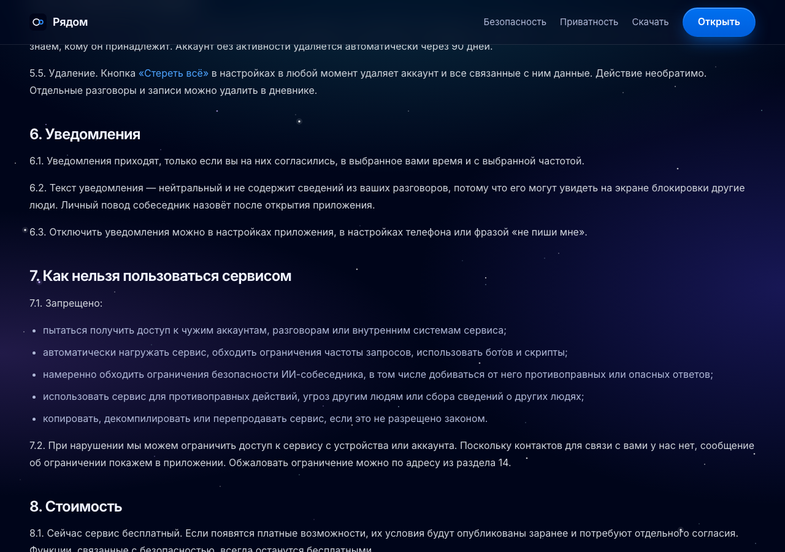

### 03. В документе присутствуют все 14 разделов

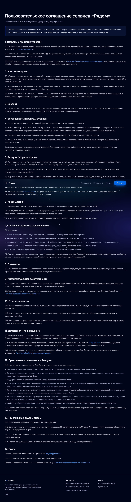

Сценарий: landing.spec.ts › соглашение: оферта, отдельное согласие и аккаунт без регистрации

### 04. Оферта и отдельное согласие на обработку данных

### 05. Аккаунт создаётся на устройстве без обязательной регистрации

### 06. Перенос, 90 дней без активности и необратимое удаление

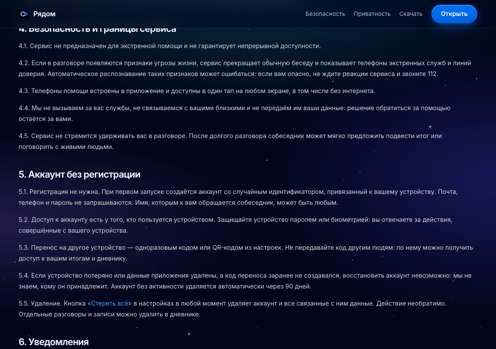

Сценарий: landing.spec.ts › соглашение: технологии, возраст и кризисные границы

### 07. Технологии и ограничения ответов искусственного интеллекта

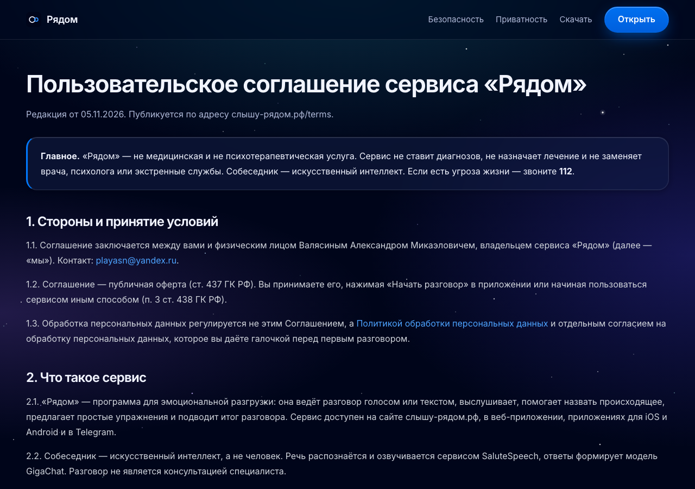

### 08. Сервис предназначен для людей старше 18 лет

### 09. Кризисные границы: звонок 112 остаётся за человеком

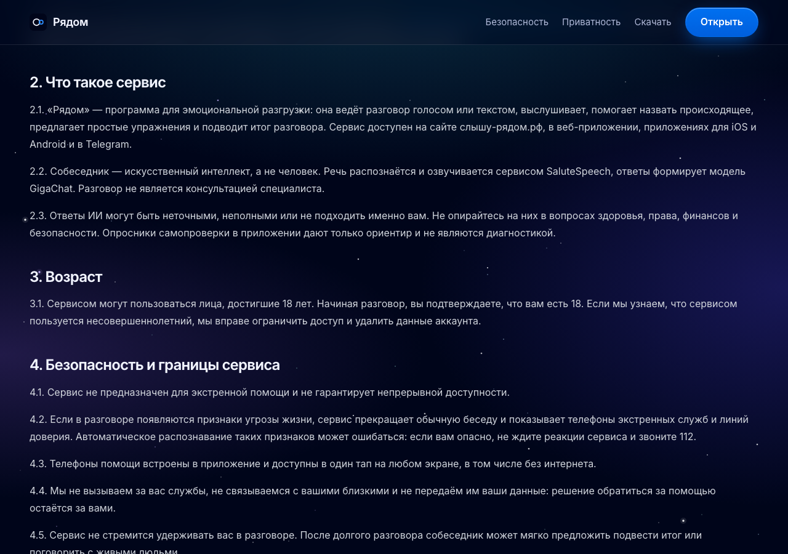

Сценарий: landing.spec.ts › соглашение: площадки, споры и связь с правообладателем

### 10. Дополнительные условия App Store и других площадок

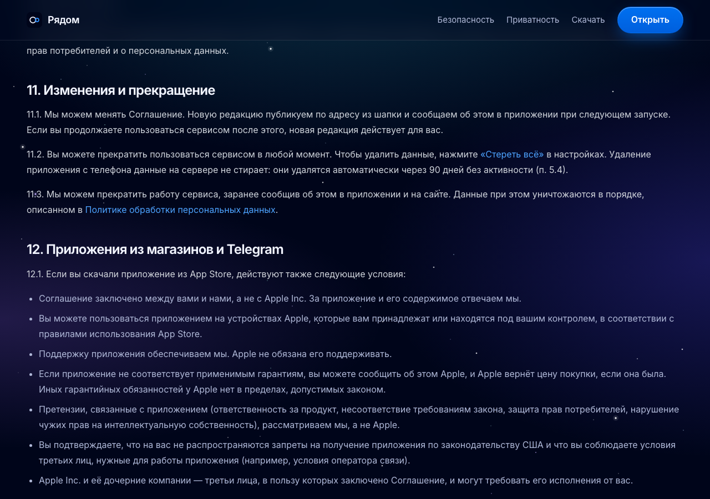

### 11. Применимое право и порядок рассмотрения споров

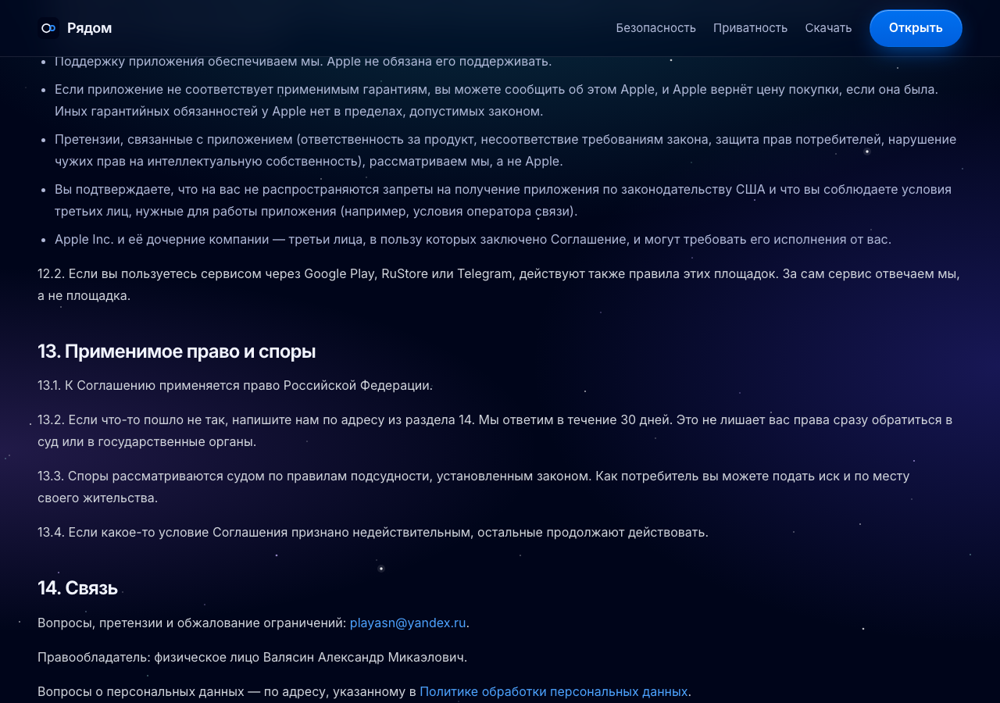

### 12. Почта и имя правообладателя в разделе связи

## mobile (412×839)

Сценарий: landing.spec.ts › соглашение: редакция, выделенные границы и все 14 разделов

### 01. Новая редакция и выделенные границы сервиса

### 02. Правила использования читаются в общей типографике документа

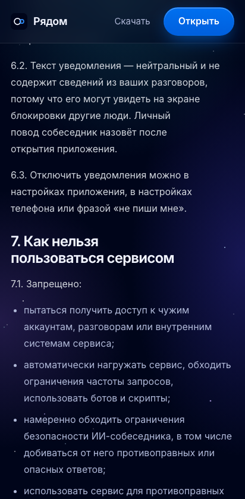

### 03. В документе присутствуют все 14 разделов

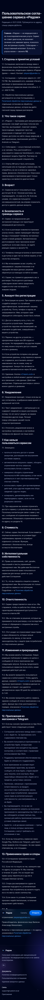

Сценарий: landing.spec.ts › соглашение: оферта, отдельное согласие и аккаунт без регистрации

### 04. Оферта и отдельное согласие на обработку данных

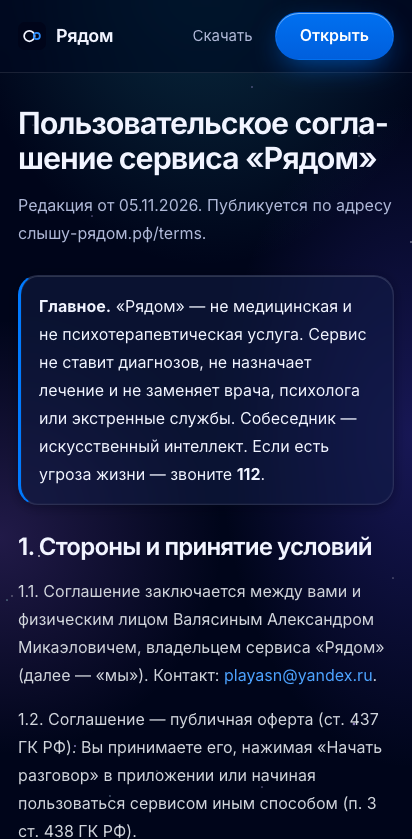

### 05. Аккаунт создаётся на устройстве без обязательной регистрации

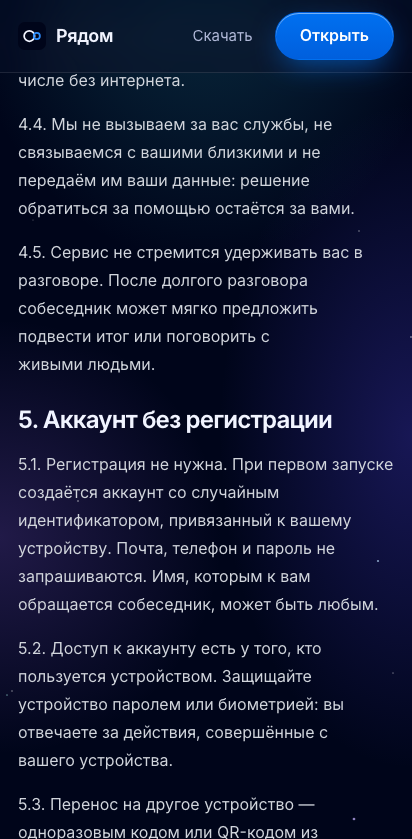

### 06. Перенос, 90 дней без активности и необратимое удаление

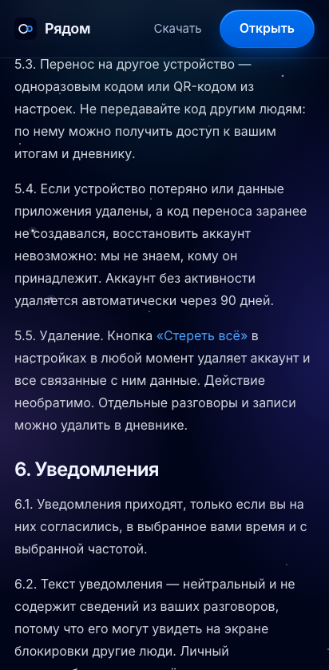

Сценарий: landing.spec.ts › соглашение: технологии, возраст и кризисные границы

### 07. Технологии и ограничения ответов искусственного интеллекта

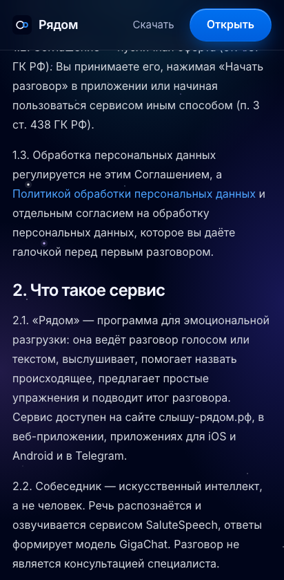

### 08. Сервис предназначен для людей старше 18 лет

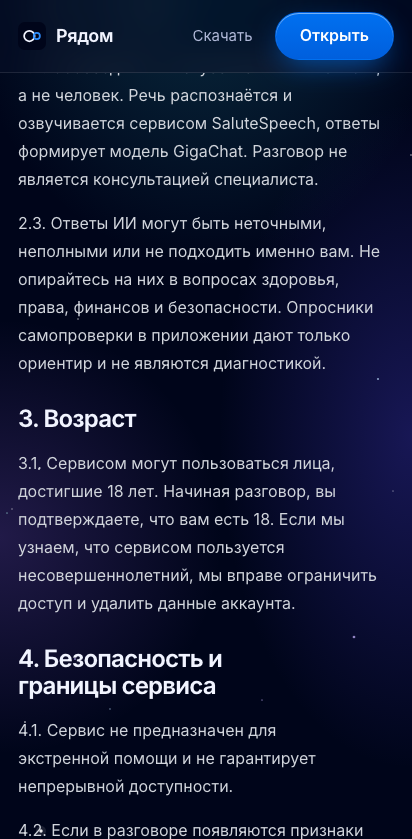

### 09. Кризисные границы: звонок 112 остаётся за человеком

Сценарий: landing.spec.ts › соглашение: площадки, споры и связь с правообладателем

### 10. Дополнительные условия App Store и других площадок

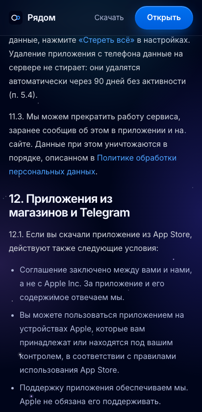

### 11. Применимое право и порядок рассмотрения споров

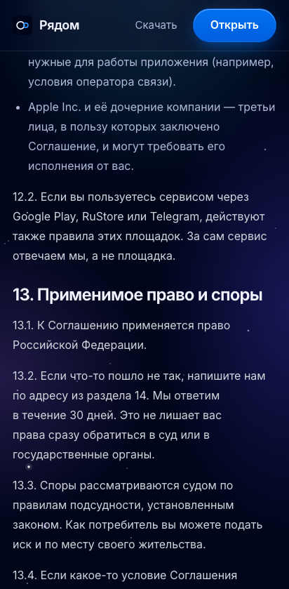

### 12. Почта и имя правообладателя в разделе связи

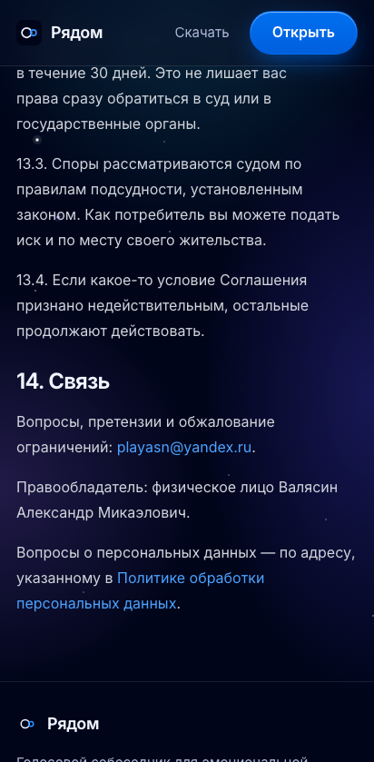
